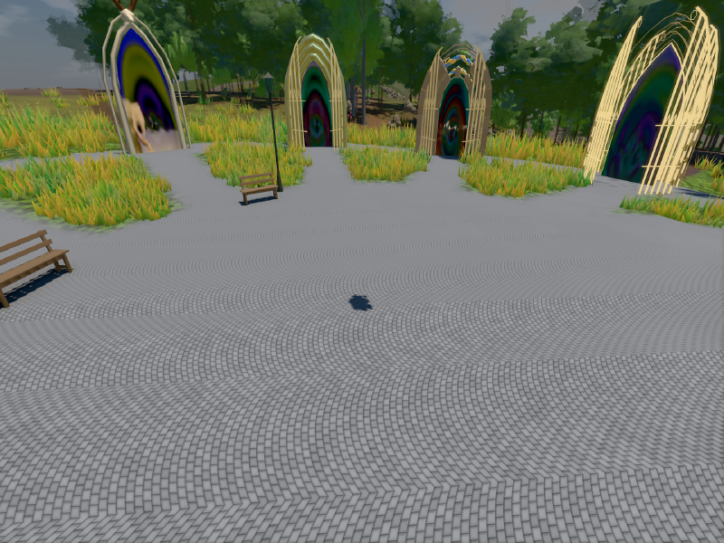
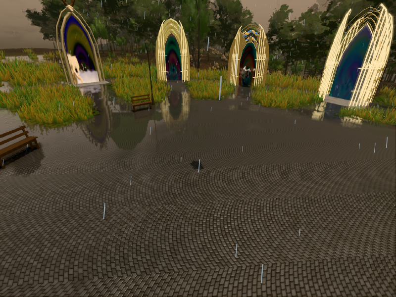
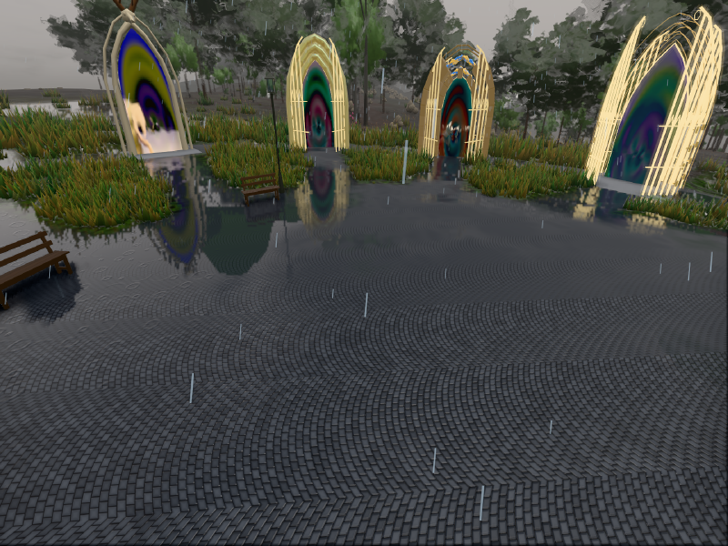
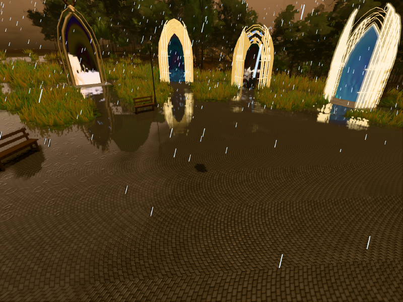
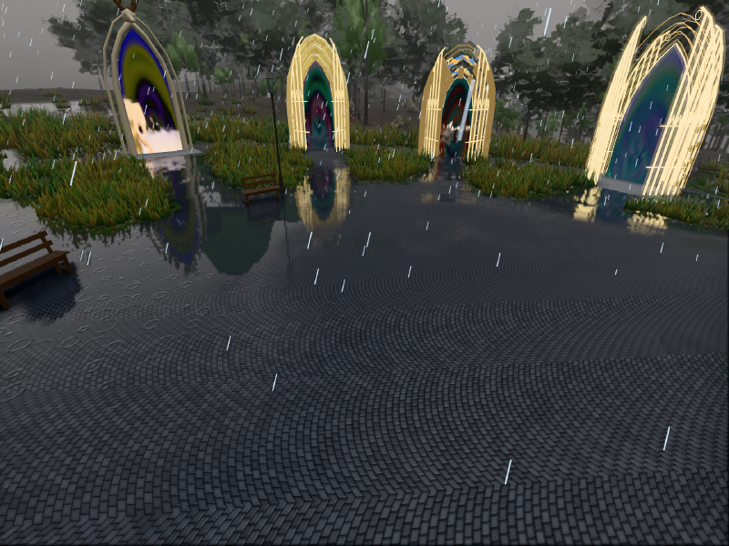
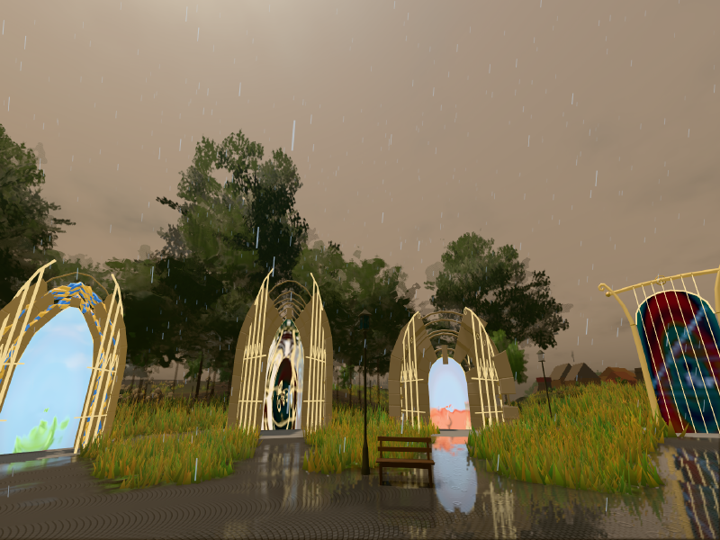
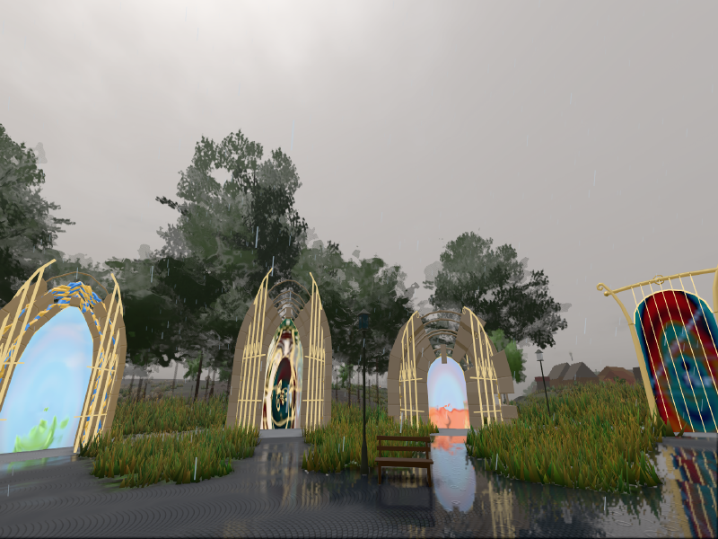
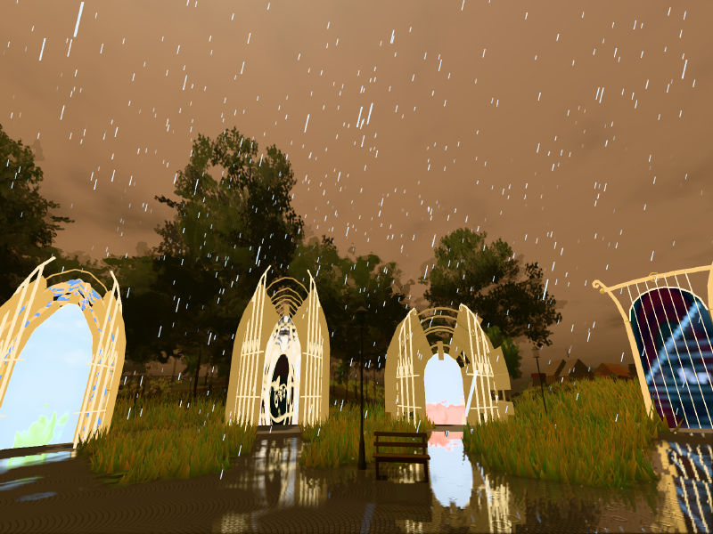
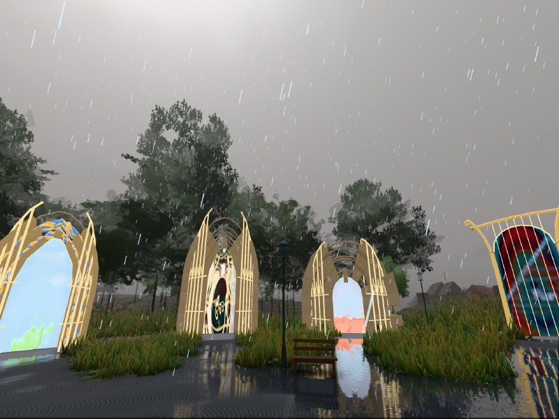

# Licht im Regen — das Wetter-Feld färbt Himmel UND Sonne (w28-licht-regen)

OMEN GTX 1060, 16.11. · Dorfplatz (Genesis-Mitte) 12:30 · main 77a9095f ↔ Zweig 4d211280 · Rohzahlen `vorher.json` / `nachher.json`.

## Geschnitten (EINE Wurzel, ein Leser)

- **Der Tropfen ist kein Dunst** (`foundry-core.js` `ATMO_RECHNUNG.medium`): die Wetter-Trübung über der klaren Luft ging als
  Ångström-Dunst ins Medium und rötete Sonne und Wolke (Sturm = orange-braun). Jetzt streut sie grau; bei klar byte-gleich.
- **Das Gesetz** (`phyto-core.js` `WX_LICHT`): `direktHoch 3`, `himmelHub 0,35`, `himmelGrau 0,82`. `WEATHER_TINTS` leitet je Wort ab:
  `direkt = (1 − grey)^3`, `himmel = 1 + hub·grey`, `grau = 0,82·grey`.
- **EIN Leser** (`_dayNightComputeTint`): Richtlicht und Mond × `direkt` (der harte Schatten weicht), der Himmel trägt `himmel`
  statt `skyMul` (das diffuse Licht steigt), und `U.grau` entsättigt Himmel, Umgebung, Sonde, PMREM und Tor-Spiegel an EINER
  Stelle (`welt-licht.js` `umgebungLicht` / `himmelGrau`).

## Gemessen

| Zahl | main | Zweig |
|---|---|---|
| Himmel-Sättigung klar | 0,314 | 0,314 |
| Himmel-Sättigung Sturm ÷ klar (Soll ≤ 0,5) | 1,454 | **0,059** |
| Himmel-Sättigung Regen ÷ klar | 0,694 | **0,096** |
| Richtlicht Sturm ÷ klar (Soll ≤ 0,5) | 0,036 | 0,0001 |
| Richtlicht Regen ÷ klar | 0,192 | 0,017 |
| Schatten-Kontrast unter dem Spieler, klar | 9,71 | 9,77 |
| Schatten-Kontrast Regen | 1,32 | **1,02** |
| Schatten-Kontrast Sturm | 3,34 | **1,00** |
| Belichtung klar / Regen / Sturm | 0,52 / 1,27 / 5,20 | 0,52 / 1,08 / 1,97 |

Schatten-Kontrast = Luma des Flecks im Spielerschatten OHNE Schattenwurf des Richtlichts ÷ MIT (die nasse Spiegelung kürzt sich).
Himmel-Sättigung = HSV-Mittel des obersten Sechstels im Himmels-Blick (Ego, 20° über dem Horizont).

**Preis** ABAB (p50 je 240 Bilder, klar, A = main 62e3bdff, B = Zweig): 16,42 / 17,64 / 17,06 / 16,39 ms — im Rauschen
(Regen 16,59 / 17,18 / 16,99 / 16,60; Sturm 16,45 / 17,53 / 17,02 / 16,70). Die Zahl liegt nahe 16,7 ms und kann am Takt hängen.

## Bildpaar

| | main | Zweig |
|---|---|---|
| klar |  |  |
| Regen |  |  |
| Sturm |  |  |
| Himmel Regen |  |  |
| Himmel Sturm |  |  |

## Offen

- Der Sturm-Himmel ist im Bild heller als der klare Zenit (Luma 0,55 gegen 0,15, die Belichtung zieht nach) — ein dunkler
  Gewitter-Himmel ist das noch nicht.
- Das Labor (`worlds/terrain/phytogenesis.js`) trägt seine Grau-Zahlen als Literale, nicht aus `WX_LICHT`.
- `cloudCover` liest die Intensität des Worts, nicht `grey`.
- Keine eigene Linse für den Schatten-Kontrast im Regen; Richter der Sättigung ist die Station `karte2.planet.kopplung.wetter-welt#1`.

Status: ZWISCHENSTAND
