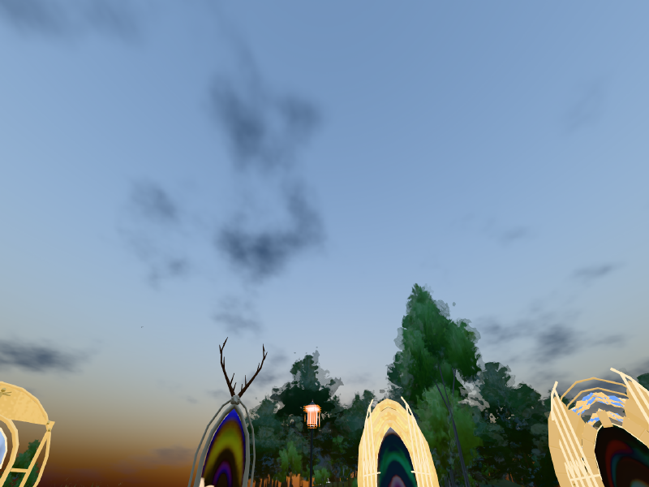
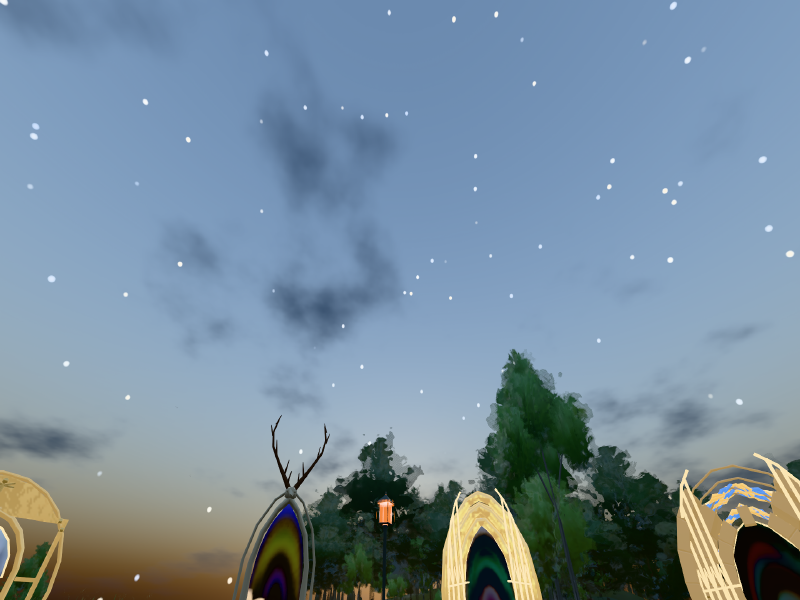
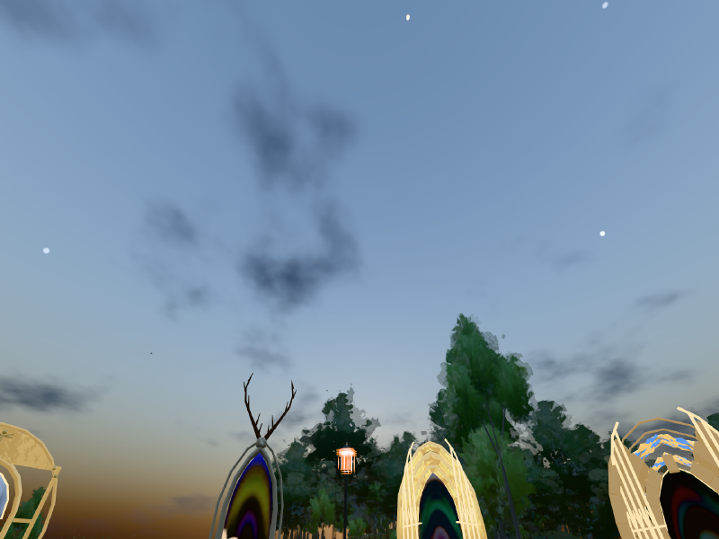
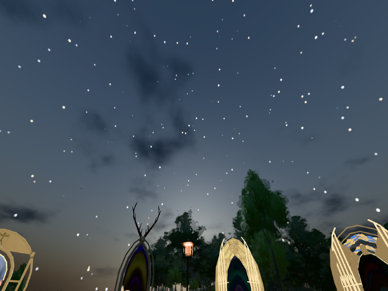
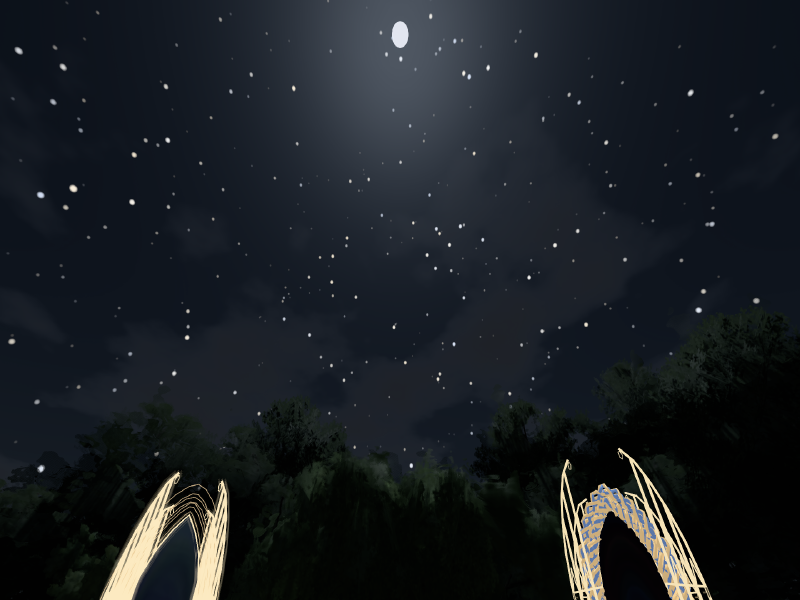
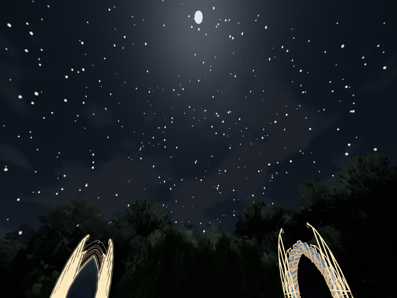

# Sternhimmel — die Helligkeit der Sterne folgt der Sternzählung (w28-sternhimmel)

OMEN GTX 1060, 17.11. · Genesis-Ort, Ego, 40° über dem Horizont, klar · main 77a9095f ↔ Zweig 3bed1f78 (mit main b5681770).

## Geschnitten (EINE Wurzel: `_buildStarField`, `stamm/bild-himmel.js`)

- **Die Größenklasse** jedes Fixsterns kommt aus der Sternzählung (`AnazhRealm._sternMag`, `HIMMEL.sternZaehlung 0,47`): von 2800
  Sternen sind 4 heller als 0 mag, 13 heller als 1, 109 heller als 3 — vorher 141 heller als 0.
- **Die Punkt-Helligkeit** ist der Fluss über der Schwelle des Auges (`HIMMEL.sternKontrast 0,6`), keine harte Stufe; die Farbe
  trägt nur noch den Ton. Kein Deckel je Szene, die Grenzgröße der Tag-Achse bleibt der eine Leser.

## Gemessen

Station `karte2.planet.kosmos.sternhimmel#1` am Kopf e2a28364 (punkte-maschine `messung/e2a28364-gtx.json`):

| Sicht | Tag ≥ 10° | ≥ −3° (Soll ≤ 3) | Nacht min (Soll ≥ 5) | γ (Soll ≥ 0,8) |
|---|---|---|---|---|
| genesis ego | 0 | 0 | 62 | 0,99 |
| wiese ego | 0 | 0 | 21 | 0,92 |
| genesis third | 0 | 0 | 35 | 0,97 |
| wiese third | 0 | 0 | 13 | 0,90 |

Radeon an fe885d9d: genesis ego ROT (≥ −3° max 4), wiese third ROT (γ 0,74). Halbe Nacht jetzt bei Sonne −14,0° … −15,8°.

`npm run check` EXIT=0 (645 s), `gate:welt-boot` EXIT=0 am Kopf 3bed1f78 (Kette k95).

## Bildpaar

| Sonne | main | Zweig |
|---|---|---|
| −3,5° |  |  |
| −7,0° |  |  |
| −13,9° |  |  |
| Mitternacht |  |  |

## Offen

- Die Station bleibt ROT am Teil „WEG Uhr 0 / 0,25 weicht ab“ (Y 0,0249 gegen Soll ≤ 0,01): die ruhige Aufnahme der Probe gegen
  die volle, untere Bildhälfte — eine eigene Wurzel, vom Sternfeld nicht berührt.
- Die Quad-Größe des Sterns bleibt an 720p gebunden.
- Der Punkt-Zähler des Bild-Werkzeugs (`p3/n1611/stern`) zählt auch Wolkenränder (Grund ~150), seine Zahlen sind kein Urteil.

Status: ZWISCHENSTAND
