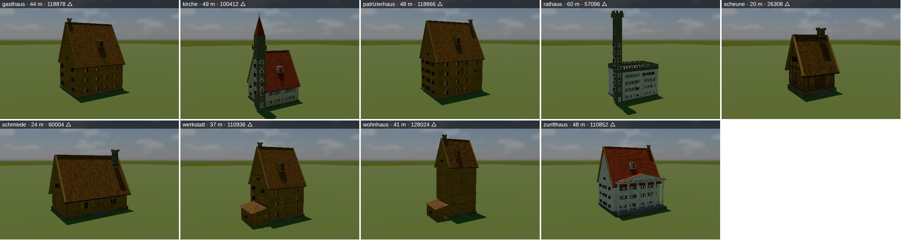
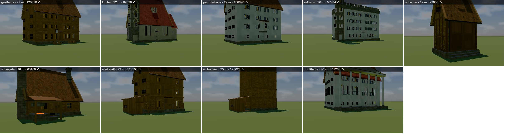

# Stand-Blatt bau-funktion — Sprosse `karte2.mensch.bau.bedarf#1` (ZWISCHENSTAND)

## Täter-Zahl (27.11., am main eef726c7, headless an `buildInstance` L0)

- Je Rolle aus vier Dorf-Plänen (`exportSettlement`) das Haus mit seinem Vektor gegen denselben Vektor mit `rolle: 'wohnhaus'`:
  **0 von 15 Rollen** ändern das Haus-Mesh (sha1 der Lagen byte-gleich) — die Rolle zeichnet am Körper nichts; die Gestalt folgt nur
  den Maßen, die `bauProgramm` (`fachwerk-core.js:2973`) aus dem Raumprogramm rechnet (W, D, Geschosse, Grundriss).
- Das Raumprogramm kennt den Bedarf (`BAU_NUTZUNG`, `fachwerk-core.js:2860–2890`: schmiede `esse_werkraum` + `beschlagstand` an der
  Straße, gasthaus `gaststube` an der Straße, zunfthaus `trinkstube` im OG zur Straße, patrizierhaus `sala` + `kontor` zur Straße,
  rathaus `halle` + `uhrturm`, kirche `chor`, scheune `tenne`, werkstatt `werkraum` zur Straße) — kein Leser im Haus-Bau `HAUS`.
- Die Rolle zeichnet heute nur in der Parzelle (`hofFuer`, `fachwerk-core.js:4555` drei Kisten · `:4559` ein Trog), die kein Leser
  der Welt baut.

## Vorher (Sonde: je Rolle ein Haus des Plans, voller Vektor samt Rolle, Bühne der Welt, Mittag, vorn-schräg 30°)

Gasthaus · Patrizierhaus · Werkstatt · Wohnhaus · Schmiede: dasselbe braune Blockhaus.

## Nachher (dieselbe Sonde, dieselbe Pose; der Kern `BEDARF_GESTALT` zeichnet aus `BAU_NUTZUNG.raeume` die Front)

Aus 12–36 m (Augenhöhe 2,2 m, das Maß des Auftrags „aus 20–30 m“):

Je Rolle das EINE Merkmal (der Raum des Programms → die Gestalt):

| Rolle | Raum | das Merkmal | Maß |
|---|---|---|---|
| Schmiede | `beschlagstand` + `esse_werkraum` | offener Beschlagstand unter dem Pultdach mit glühender Esse, Stein-Schlot am Giebel | Vordach 2,5 m tief, Esse 2,1 × 0,75 × ≤ 1,75 m, Schlot 1,2 × 1,0 m, 1,0 m über First |
| Kirche | `schiff` + `chor` | eingezogener Chor (ein Körper des Baus, auch fern) mit Kreuz, Hallenfenster, das Schiff EIN Raum ohne Treppe | Chor 0,62 der Tiefe, Kreuz 1,8 × 0,9 m |
| Patrizierhaus | `kontor` + `sala` | Steinbau (Putz) mit Erker über der Tür | Erker 2,4 × 0,9 m |
| Rathaus | `uhrturm` | die Uhr am Turm | Zifferblatt 1,2–1,7 m |
| Scheune | `tenne` | das Tenntor, dahinter EIN Raum ohne Herd | 3,2–4,8 × 3,4–4,4 m |
| Werkstatt | `werkraum` | gerahmtes Tor, Klappläden (Ladenbrett + Klappe) an jedem Erdgeschoss-Fenster der Straße | Tor 2,2 × 2,3 m, Brett 0,6 m, Klappe 0,7 m / 20° |
| Zunfthaus | `trinkstube` | hohes Saal-Geschoss mit hohen Fenstern | Saal 4,0 m, Fenster 1,9–2,4 m |
| Gasthaus | `gaststube` | Ausleger mit Schild, Tische und Bänke vor der Tür, das Licht der Gaststube | Ausleger 0,97 m, Schild 0,9 × 0,7 m |
| Wohnhaus | `wohnen` | ohne Zeichen (byte-gleich mit seinem Zwilling) | — |

Ehrlich schwach im eigenen Auge: Gasthaus und Werkstatt (Schild und Klappläden < 1 m, aus 25 m wenige Pixel); das Urteil fällt der
Blind-Prüfer (`karte2.mensch.bau.bedarf#1`, Station nicht gefahren: GPU).

Linse: `gate:settlement` Teil B (B1 8 von 8 Rollen bauen nah und fern ein anderes Haus als ihr Wohnhaus-Zwilling, B2 das Wohnhaus
byte-gleich mit demselben Vektor ohne Rolle, dem Bau, den cv:6 einfriert; Selbsttest „die Rolle zeichnet die Gestalt nicht“ → ROT in
B1, „jede Rolle zeichnet die Gaststube“ → ROT in B1, „das Wohnhaus zeichnet die Gaststube“ → ROT in B2).

Die Anbauten tragen die Masse (`masse`, der Mass-Bau des Dorf-Layouts): die Lose rücken für echte Körper, die Goldens
`siedlung.json` / `siedlung-lose.json` sind neu gemintet (Vertrags-Akt). Der Snap-Selbsttest des Würfels beißt an der Stadt 7/30
nicht mehr; Fixture dazu das Dorf 35/24 (Gesetz 0, Snap 1: Los 5 kaufhaus −5 cm → 894045 1,13 m; Suche 1..40 × nH 24).

## Tris / Draws je Haus (L0 · L1 · L2, vorher → nachher; die neun Häuser der Sonde aus den Dorf-Plänen)

| Rolle | L0 | L1 | L2 |
|---|---|---|---|
| Gasthaus | 118 878/17 → 120 330/18 | 39 322/12 → 41 142/12 | 4 618/7 → 4 988/7 |
| Kirche | 100 412/18 → 87 088/18 | 18 652/10 → 12 412/10 | 1 668/6 → 1 170/6 |
| Patrizierhaus | 118 866/17 → 106 890/17 | 30 510/11 → 20 778/9 | 6 076/7 → 1 792/7 |
| Rathaus | 57 096/16 → 57 384/16 | 23 976/8 → 24 264/8 | 3 604/4 → 3 844/5 |
| Scheune | 26 308/16 → 28 708/15 | 5 104/11 → 4 864/11 | 572/7 → 610/7 |
| Schmiede | 60 004/18 → 60 160/18 | 9 808/12 → 9 964/12 | 1 046/7 → 1 178/7 |
| Werkstatt | 110 936/19 → 111 008/19 | 28 008/12 → 30 076/12 | 3 410/7 → 3 824/7 |
| Wohnhaus | 128 024/18 → 128 024/18 | 32 484/12 → 32 484/12 | 3 516/7 → 3 516/7 (byte-gleich) |
| Zunfthaus | 110 852/18 → 111 260/18 | 22 988/10 → 22 988/10 | 2 850/7 → 2 838/7 |

## C-K5 (27.11.): die Ort-Wahl länger als der Deckel des Stillstands

- Befund: kein Hänger. Die Ort-Wahl im Faden an der Zelle −6,−6 (Saat 1862753406, nH 13, neben der Stadt: 145 Kandidaten, 71 im
  stehenden Bau) rechnete 17,9–20,9 s. Der Deckel der Linse (`welt-boot.cjs` `deckel`, 3 600 Takte unveränderte Welt) fiel vorher.
  main bed6256c hält die Marge knapp (4 von 5 Läufen grün), mein Diff (Anbauten als Masse: mehr Kandidaten fallen erst im Bau) kippte sie.
- Schnitt an der Wurzel (`voxel-worker.js` `ortWahl`): das Wasser am Punkt ist eine Funktion des Gesetzes (`ortNass`). Je Kandidat
  fragen `ortImWasser`, der Boden vor dem Bau (`hochAm` → `ortPlan` nurBoden) und der Plan dieselben Punkte. Das Gedächtnis `nass`
  (je Kandidat geleert) trägt die Wiederholung, exakt. Gemessen an −6,−6: **230 586 → 119 951 Urteile, die Wahl 20,9 → 13,5 s**, C-K5 ✅.
- Linse: `gate:settlement` C-K5 „DAS WASSER EINMAL JE PUNKT“. Jede Wahl im Faden nennt `wasser {fragen, urteile}`, Urteile < Fragen.
  Am main ROT (das Feld fehlt). Selbsttest: „jede Frage ein Urteil“ und „eine Wahl ohne Zahl“ → ROT.
- Ein Versuch am Kern (`erdbauY` auf feinem Raster) war bit-gleich, aber am echten Erdbau langsamer. Er ist zurückgenommen.

## W10 (27.11.): das Tor öffnet EINEN Raum

- `gate:haus-welt` W10 Spielgang ROT durch meinen Diff (main bed6256c in der CI grün): drei Scheunen des Drehbuch-Dorfs
  (italienisch@141°, italienisch@−39°, provenzalisch@−39°), `tür 2,02 m neben`. Sonde: die Flurwand bei ±fw (x 1,0–1,12) stand
  0,1 m hinter dem 3,2-m-Tenntor, der Gang an der Zarge (x 1,26) prallte. Dahinter stand der Herd (1,05 × 1,0 × 1,5 m) im Weg.
- Schnitt im Gesetz: `TENNE` (BEDARF_GESTALT.tor) — das Erdgeschoss mit Tor ist EIN Raum, ohne Kammer und ohne Flurwand
  (`rooms`, `innenwaende`); die Tenne trägt `ohneFeuer` (Feuerordnungen: kein Herd in der Scheune), `herd`/`herdKaesten` lesen es.
  Headless an 5 Kulturen × 5 Saaten: im Gang nur die Zarge, die der Gang streift (wie am Wohnhaus). Nur Scheune und Werkstatt
  ändern sich, sieben Rollen byte-gleich.

## B3 (27.11.): die Halle erschließt keinen Dachraum

- `gate:studio-begehen` B3 Steigen ROT durch meinen Diff: 22 von 23 Treppen (OG→OG 12/13). Sonde: `#0 635014 provenzalisch/kirche`,
  ein Lauf 26 × 0,188 m = 4,9 m frei durch das Schiff zum Estrich, der Körper fiel (steig −2,06 m).
- Schnitt an der EINEN Aussage „nutzbarer Dachraum“ `hasAttic` (Gaube, Treppen-Spur, Loch und `dachRaum` lesen sie): über der Halle
  (BEDARF_GESTALT.halle) liegt kein erschlossener Dachraum — kein Lauf, kein Loch, keine Gaube (Dachstuhl der Kirche: erschlossen über
  Turm oder Mauertreppe, nie aus dem Schiff). Die Zeile `dachRaum`, die der Selbsttest „dachlos“ mutiert, bleibt byte-gleich. Nur die
  Kirche ändert sich (L0 89 620 → 87 088).

## Geerbt (nicht geheilt)

- `gate:pruefbuehne-licht` S0 Himmel (Dämmerung, Umgebung 1,16e-7 gegen Himmel 1,07e-7) und S0 BILD Nacht: geerbt, mein Diff berührt
  das Licht nicht.
- `zug.sh probe-tag`: nicht im Baum (artifacts/profiband/werkzeug, 404 an main und koordination). Von Hand nach `spec/ci/ci-zeiten.json`:
  pruefbuehne-licht 43 s · weltbild-frost:echt 135 s · studio-begehen 185 s, jedes ≤ 480 s.
- `gate:weltbild-frost:echt` lokal ohne Urteil (Station nicht gefahren: GPU): swiftshader unter xvfb auf 4 Kernen baut je Programm
  4–7 min (Stall-Akte: 41 Pipelines, nach 1 800 s `URTEIL AWAIT` an `createRenderPipelineAsync #41`, der Haupt-Thread lebt). Das Urteil
  fällt die GPU-Probe des Kopfs.
- `gate:settlement` C-K5b „NACH DEM ZUG STEHT DIE WELT“: in EINEM von vier Läufen ROT (nachZug 2 — dieselben 6 Exporte wie grün,
  2 davon nach dem Ruhe-Fenster 20 × 20 ms der Linse); allein wiederholt und am Merge-Kopf mit main b3740dd5 GRÜN (nachZug 0).

## Am Merge-Kopf (main b3740dd5)

format:check · lint · check:statik (voll, 637 s) · gate:fachwerk-contract · gate:asset-contract · gate:welt-boot · gate:settlement
GRÜN; davor am Kopf mit dem Schnitt der Halle: gate:studio-begehen · gate:haus-fern · gate:haus-welt · gate:nervensystem-fachwerk GRÜN.

## Post 22:38 (Koordinator) — Antwort

- **Station bedarf#1:** braucht KEINE Änderung der Station. Die Rolle zeichnet im Kern (`HAUS` liest `BEDARF_GESTALT` über die
  bestehende Naht P.rolle → slot.ov → buildInstance); jedes Dorf-Haus am Kopf trägt sie, die Station legt nur die Bilder, der Prüfer
  (`vision/pruefer/pruefer.cjs`, Art klasse, 9 Optionen) liest sie unverändert.
- **Die unterste rote Sprosse von mensch.bau ohne Blindurteil:** `karte2.mensch.bau.bauen#1` · 1 Spieler-Haus aus der Werkstatt ·
  gleiche Tiefe wie im Labor · Richter: Bildpaar Labor ↔ Welt gleiche Kamera: kein Unterschied. (bedarf#1, huelle#1 und innen#3
  tragen den R11-Prüfer, `vision/richter-tafel.json`.)
  - **Täter-Zahl:** 98,0 % Differenz gegen Soll ≤ 2,1 % (`vision/richter/mensch.bau.bauen.1.31ea3847-gtx.json`, GTX 1060, 21.11.,
    am Kopf 31ea3847 vom 20.11.; ebenso f68dbf09 am 19.11.: 98,0 %). Die Silhouetten decken sich zu 99,4 %, der Rest ist Luma
    (`cloud-post/haus-gestalt.md` OFFEN K4).
  - **Die Zahl ist älter als der Schnitt:** `fachwerk-buehne` (483b3c2e, 24.11.) zeichnet das Labor seither auf der EINEN Bühne der
    Welt (`AnazhHuelle.studio` → `buehne`, ihr Licht an ihrer Uhr, das Werk aus dem Ofen der Welt). Seitdem lief die Station nicht. Vor
    jedem Bau misst sie die Station an diesem Kopf (lokal swiftshader: je Programm 4–7 min, kein Urteil). Die Bahn `haus-gestalt` trug
    dieselbe Sprosse (Vorprüfung 5e497a9f); ich baue sie erst auf die Zahl des Kopfs hin.

Karte 2 gebucht 156 von 1 718 (`vision/karte-2-stand.json`) · Status ZWISCHENSTAND
