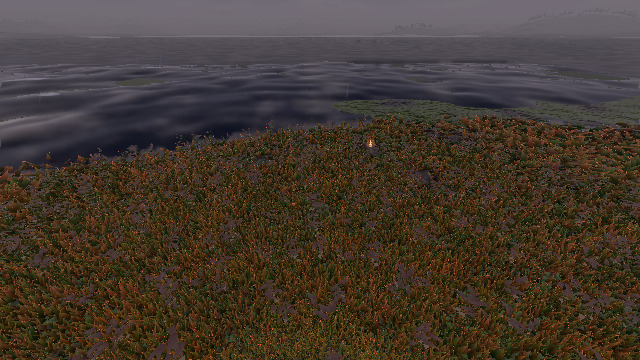
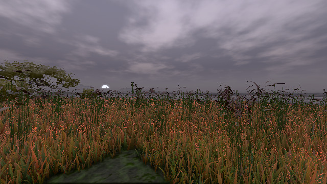
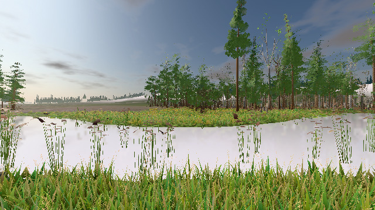

# Vorprüfung messort-zeit — eine Szene ist ein Messort mit Ort, Zeit und Wetter, mit EINEM Leser

ZWISCHENSTAND · Karte 2 gebucht 105 von 1 718 (diese Abgabe bucht keine Sprosse; sie baut den Messort, an dem Sprossen messen).

**Geschnitten.** Ein Messort trägt `zeit { uhr, tag, wetter, wort }`, und `werkbank umstellen --ort` ist ihr einziger Leser: er
spricht sie mit den Worten des Spielers, prüft, was die Welt nahm, und wartet nach dem Sprung der Uhr auf das Licht des Orts. Dazu
zwei neue Orte als Funktion des Gelände-Kerns mit Beleg (Höhe, Spiegel, Abstand): `kueste` und `ufer`.
**Gemessen.** `umstellen --ort kueste` (Exit 0, 614 s) und `umstellen --ort ufer` (Exit 0, 896 s) stellen Ort, Uhr, Wetter und
Saison; die Welt misst die Belege wie das Gesetz (Küste −2,39 m, Meer −3 in 40 m, 0,879°; Ufer 22,23 m, Fluss 21,96 in 4,75 m,
8,65 m breit; je 0 Kronen im Blick), je ein Bild aus dem Ausgabe-Pfad mit Abnahme GRÜN — an der Küste von 7,7 m, weil am Auge
das Schilf steht (82 m Gürtel längs des Blicks). `umstellen --ort wiese` gibt auf dem Kopf der Abgabe in 13 von 15 Schlüsseln
dieselben Bytes wie main 78ed3167 (sha d6e3923cd73e; die zwei übrigen zählen die Wanduhr); gate:profiband 58/58 im Selbsttest.
**Ehrlich offen.** Am Auge der Küste steht das Schilf vor dem Meer (das Ufer-Band des Kerns gilt am Meer wie am See); der Inhalt
im Bild (`imBild`) und die Serie je Gerät × Sicht (8 Ratschen) messen erst auf echter GPU; die Jahreszeit stellt ein Welt-Akt,
kein Chat-Satz; das Watt kennt keine Gezeit; `quelle` ist nur Kandidat (Liste unten).

## Schnitt 1 — die Zeit des Orts, EIN Leser

- `spec/profiband/haushalt.json`: das Feld `zeit` (additiv) an `kueste` und `ufer`; die neun bestehenden Orte tragen keins und
  laufen wie zuvor.
- `scripts/lib/band-urteil.cjs` `ortZeitWorte(zeit)`: aus der Zeit die Worte des Spielers — `setze uhrzeit <uhr>`, `setze wetter
  <wetter>`, das freie `wort` — und für den Tag der Welt-Akt `set_season`. Einen Chat-Satz für die Jahreszeit kennt der Parser
  nicht; der Akt ist das Programm, das die Welt-KI zum Wort „fruehling“ schreibt (offen unten).
- `scripts/werkbank.cjs` `umstellen --ort`: jeder Satz geht durch `parseChatToDsl` (kein Satz → laut ROT), dann durch
  `processChatCommand` (Quelle „human“), der Akt durch `dslRun`. Der Halt der Messung weicht nur für diese Worte, der Übergang des
  Wetters fällt. Dann prüft der Leser die Welt, nie die Worte: Uhr, Wetter und Saison gegen den Ort, sonst bricht er mit Log. Die
  Bühne hält, was die Welt nahm (`window.__ortZeit`, `scripts/lib/ausgabe-aufnahme.cjs` `buehne`), in jedem Takt und Bild; nach dem
  Sprung der Uhr ist der Himmel der neuen Stunde frisch (`_himmelFrisch`), und das Einschwingen wartet auf das Licht des Orts.
- `/bild` urteilt den Inhalt an der Uhr, die die Bühne hält (`AA.inhaltUrteil(…, uhr)`): ein Abend-Bild wird nicht am Mittag
  gerichtet.
- Die Ausgabe von `umstellen` trägt die Zeit des Orts unter `ortZeit` (wie `__ortZeit`). Unter `zeit` brach der erste Lauf an
  `ufer` nach 869 s am Ende mit TypeError ab: das Ende jedes Befehls liest `zeit.rot` als Urteil der Böe (`bild --zeit`), und die
  Ausgabe ging verloren. `befehlUrteil` nennt eine Ausgabe mit `zeit` ohne `rot` ROT beim Namen und druckt sie; die Täter-Zeile
  steht im Selbsttest von `werkbank bild` (in check:statik), das Ende von main stürzt an ihr mit Exit 2.
- Die Linse (Familie gate:profiband, kein neues Gate): H17 liest die Worte jedes Orts mit dem Parser des Stamms. Täter-Zeile S23z
  im Selbsttest: ein Messort mit `zeit.uhr`, den `umstellen --ort` nicht stellt (ohne Uhr-Satz) → ROT.

## Schnitt 2 — Küste und Flussufer aus dem Gelände-Kern

Der Beleg ist EINE Funktion mit zwei Wirten (`scripts/lib/welt-orte.cjs` `belegMessen`, `belegUrteil`): längs des Blicks das
erste nasse Stück (`_nassAt`, Schritt 0,25 m), dort der Spiegel des Körpers (`_koerperWasser`), die Art des Wassers (Fluss, wenn
der Spiegel des Flusses ihn trägt, Meer auf dem Meeresspiegel, sonst See), der Hang vom Spieler zum Wasser, die Breite des
Flusses (`_hydroDistAt`) und die Äsung am Ort (`_kreaturNahrung`). gate:profiband H1 misst die Zahlen am Gesetz, `umstellen --ort`
die Art in der Welt (die Welt trägt den Pegel, der die Flüsse hebt; die Zahl ist Gesetz, die Art ist Welt).

| Ort | Spieler | Blick | Höhe | Wasser | Spiegel | Abstand | Hang | Breite | Äsung | Zeit |
|---|---|---|---|---|---|---|---|---|---|---|
| kueste | −215,7 / 10 555,3 | −29,3 / 10 777,5 | −2,39 m | Meer | −3,00 m | 40 m | 0,88° | — | 0,068 | 0,7 · herbst · bewoelkt |
| ufer | −118 / −838 | −91,8 / −809 | 22,23 m | Fluss | 21,96 m | 4,75 m | 3,29° | 8,65 m | 0,799 | 0,35 · fruehling · sonne |

- **kueste.** 10,6 km vom Ursprung: von 120 Strahlen aus dem Ursprung trägt Strahl 87 das breiteste Watt; in seiner Umgebung
  (±1,5 km, Raster 25 m, mit den Kacheln der Hydrosphäre um jede Stelle) die Stelle 0,2–0,8 m über dem Meer, ohne Fluss am Ort,
  mit dem Meer als erstem Wasser in 30–120 m, ohne Krone in der Ego-Sicht (das Gesetz der Mess-Wiese, `belegSicht`) und mit dem
  breitesten Watt längs des Blicks: 306 m zwischen +1,5 m und −1,5 m um den Spiegel, 0,56°. 10 Stellen hielten ohne Krone im
  Blick, 13 fielen als verstellt (18 s). Am Ort: kein Baum im Ring von 25 m, der Korridor bis 30 m hinter dem Wasserrand (±20°) frei,
  der Horizont −0,27°, 200 m hinter dem Rand 5,04 m unter null. Der Hang des Belegs (0,88°) hält die Klasse „flach“ 0–2° der
  Kartierung des Harle-Seegatts (Mascioli et al. 2023, Journal of Maps 19, https://doi.org/10.1080/17445647.2022.2154175);
  `hangMax` 2 ist diese Klasse. Die Äsung 0,07 ist das kahle Watt.
- **ufer.** In der Heim-Region die offene Bank am Fluss (`flussRand` 4,3 m halbe Breite): Wiesen-Probe ohne Krone im Ring,
  Waldrand im Kranz, 0,27 m über dem Ruhe-Spiegel, das Wasser 4,75 m vor dem Spieler, der Blick quer zum Gegenufer.
  `aesungMin` 0,5 ist die Hälfte des vollen Lebens des Felds.
- **Der Täter, den der Wirt verbarg.** Die erste Küste (1 191,1 / 9 928,8) hielt am Gesetz, und die Welt stellte den Spieler in
  eine Mündung: „Küste 1191.1/9928.8: längs des Blicks steht kein Meer (fluss bei 0 m)“. Der Wirt rechnete nur die Hydrosphäre
  der Heimat; 10 km fern las er den Meeresspiegel, die Welt dort ihre Kachel mit dem Fluss. Wurzel: `wirtAmGesetz(root, true)`
  rechnet die Kacheln um den Ort wie der Faden (`wasserUm`: Teilung wie `_ensureHydroTilesAround`, `hydroComputing` wie
  `hydroRegion`). Linse S20c (gate:profiband): die Mündung → ROT „kein Meer (fluss bei 0 m)“, und der Wirt ohne Kachel liest dort
  „meer“ — der Täter beim Namen. Weiter in S20c: Höhe +1 m → ROT mit Zahl, ein Blick ohne Wasser → ROT, Art `ufer` am Meer → ROT,
  `quelle` fehlt → ROT.
- **Das Meer im Bild des Wassers.** Die neue Küste hielt am Gesetz, und die Welt nannte das Wasser in 35 m „see“ (nach 1 214 s):
  dort liest der Spiegel des Körpers den Automaten (`_wasserBildAt`), und das Meer steht bei −2,9999999999999996, der Wirt ohne
  Chunks liest den Atlas, genau −3. Die Art fragte nach Gleichheit. Wurzel: `belegMessen` urteilt Meer wie Fluss auf 1 cm. Linse
  S20c: der Wirt im Bild des Wassers (−3 + 4e‑16) hält, die Art auf Gleichheit (der Stand davor) nennt dort „see“ → ROT.
- **Der Wald am Watt.** Diese zweite Küste (859,3 / 10 430,3) hielt dann auch in der Welt — und ihr Bild zeigte Laub: der Ort stand
  im Erlen-Wald (Krone 0,897, 6 Kronen in der Ego-Sicht, eine Erle 0,9 m vor dem Auge), die Blick-Wahl der Kamera floh auf 7,55 m.
  Der Beleg maß Höhe, Wasser und Abstand, nie den Blick. Wurzel: `belegMessen` misst die Sicht mit dem Gesetz der Mess-Wiese
  (`belegSicht` → `wieseMessen` imBlick: Kronen in 15 m im Sektor ±55° oder über dem Auge), am Gesetz (`belegSichtAmGesetz`,
  die Kacheln um den Ort vorgerechnet, sonst bricht der Faden des Walds im Wirt) wie in der Welt (`window.__belegSicht`);
  `belegUrteil` nennt jede Krone im Blick ROT, eine ungemessene Sicht ebenso. Linse S20c: der Wald-Ort → ROT „der Blick zum
  Wasser ist nicht frei — 6 Krone(n)“, der Beleg ohne Sicht → ROT „der Blick ist nicht gemessen“.
- **Das Schilf vor dem Auge.** Die dritte Küste hält am Gesetz und in der Welt, ohne Krone im Blick — und das Auge sieht das
  Meer nur als Band über Halmen und Schilf (Bild unten: die Abnahme an der Pose des Auges ROT „verdeckt von Boden-Schicht in
  5.93 m“, die Blick-Wahl hob die Kamera auf 7,7 m). Gemessen am Gesetz: das Ufer-Band des Schilfs (foundry-core `schilf`,
  `ufer` [−0,6, −0,3, 0,3, 0,9] m über dem Spiegel, 40 je 100 m²) trägt längs des Blicks von 22 m hinter dem Spieler bis
  60 m vor ihm Gewicht (82 m, davon 28 m voll; am Spieler 0,467), die Wasserlinie bei 40 m liegt in seiner Mitte. Auf einem
  Watt von ≤ 2° entkommt dem keine Pose: näher am Wasser steht das Auge tiefer im Gürtel, höher am Hang bleibt über den
  Spitzen ein Band von unter 2°. Die Wurzel liegt im Gesetz der Welt — das Band gilt am Meer wie am See, Salz kennt es nicht —,
  in einem Kern außerhalb dieses Auftrags (Byte-Beweis, Lehre 11). `imBlick` zählt Kronen, nie die Boden-Schicht; Beleg,
  Kommentar und Titel sagen genau das.

## Die Bilder — `umstellen --ort`, dann `werkbank bild` an der Kamera des Spiels (Ausgabe-Pfad)

Werkbank auf dem Kopf nach dem Merge von main 804ca10c (V18.546.419), swiftshader, chrome-headless-shell 148, Leinwand der
Sitzung 640 × 360 (die Klasse in 1920 × 1080 steht hier nicht, siehe offen). Je Ort zuerst `umstellen --ort`, dann die Kamera
des Spiels (`_loopCamera`) als Pose, Blickziel 20 m voraus, die Blick-Wahl der Werkbank (Standard 42 Posen).

| Ort | umstellen | die Welt nahm | Beleg in der Welt | Bild |
|---|---|---|---|---|
| kueste | Exit 0, 614 s, 344 Takte | Uhr 0,7 · cloudy · autumn | −2,39 m · meer −3 in 40 m · 0,879° · Äsung 0,068 · 0 Kronen | `kueste.jpg`: Abnahme GRÜN, Pose 33 von 2 versuchten (7,7 m hoch), 130 s |
| ufer | Exit 0, 896 s, 462 Takte | Uhr 0,35 · sunny · spring | 22,23 m · fluss 21,96 in 4,75 m · 3,28° · 8,65 m breit · Äsung 0,799 · 0 Kronen | `ufer.jpg`: Abnahme GRÜN an der Pose des Auges (1 Pose), 30 s |
| kueste, Auge | (zweiter Lauf, 619 s) | dieselbe | dieselbe | `kueste-auge-rot.jpg`: `--wahl 0`, Abnahme ROT „Blickziel verdeckt von Boden-Schicht in 5.93 m“ |

Die Belege der Welt sind die Zahlen des Gesetzes (H1) bis auf die zweite Stelle (Hang am Ufer 3,28° ↔ 3,286°).







Mein Blick: die Küste zeigt im gehobenen Bild das Watt in Herbstfarben, das Meer mit dem Wolkenspiegel und die ferne Küste;
am Auge Schilf und Halme. Das Ufer zeigt die Bank, den Fluss, Rohrkolben im Flachwasser und das Gegenufer — der Fluss spiegelt
den Morgenhimmel fast weiß (das Bild Luma 146,9), ungeurteilt, weil die Klasse `wasserSatz` erst die echte GPU misst.

## Die neun bestehenden Orte — `umstellen --ort wiese` vorher ↔ nachher

Gleiche Werkbank (swiftshader, chrome-headless-shell 148), gleicher Befehl auf frischer Werkbank (`start --ort wiese`, dann
`umstellen --ort wiese`), vorher auf main 78ed3167, nachher zweimal: auf dem Kopf vor dem Merge und auf dem Kopf der Abgabe nach
dem Merge von main 804ca10c. Die Ausgabe trägt in allen Läufen dieselben 15 Schlüssel; 13 sind byte-gleich (sha256 von
`JSON.stringify(o, null, 1)` ohne die zwei Zeit-Felder: d6e3923cd73e ↔ d6e3923cd73e ↔ d6e3923cd73e) — Spieler −280,4 / −1045,6, Blick, die ganze Wiesen-Messung (y 27,48 · Hang 1,81° · Krone 0,043 · 4 Bäume · Kranz
0,428 · Horizont 2,6° · Gras 1), 25 Chunks, Gier −1,9717, keine Zeit, kein Beleg. Verschieden sind nur die zwei Felder, die die
Wanduhr zählen: `ms` 916 620 ↔ 1 290 364 ↔ 1 325 453 und `takte` 440 ↔ 499 ↔ 496 (Takte bis Ring und Welt stehen; im Nachher-Lauf lief zu Beginn
37 s lang gate:altlasten auf denselben vier Kernen). Die Lage und das Verhalten des Orts sind gleich; die Ausgabe als Ganzes ist es
nicht, weil sie die Zeit des Laufs mitschreibt.

## Schnitt 3 — Kandidat `quelle` an den Soll-Zeilen der Stationen (nur Vorschlag; die Stationen im Zweig `punkte-maschine` blieben unberührt)

**Befund.** Die 36 Stationen in `meisterkarte-quelle/punkte/stationen/` tragen im Text 1 221 Soll-Zeilen (`{ wort, richtung,
wert, wortlaut, feld }`), keine trägt eine Quelle; 99 messen laut Wortlaut „gegen“ ein Gegenüber, darunter Peterson-Barney,
Koschmieder, Walker's Law, DMSP/VIIRS und Seshat. Wer die Zahl prüfen will, findet sie heute nur im Kopf des Autors.

**Der Kandidat.** Ein Feld `quelle: "Autor Jahr URL"` an der Soll-Zeile, deren Zahl von außen kommt — ein String, drei Teile, die
URL zuletzt (DOI bevorzugt). Beispiel an `formant_abweichung_pct` (k2-erleben):

```js
{ wort: "formant_abweichung_pct", richtung: "≤", wert: 15,
  wortlaut: "F0 und Formanten am Abgriff gegen Peterson-Barney-Tafel ±15 % nach Leibmaßen", feld: "richter",
  quelle: "Peterson Barney 1952 https://doi.org/10.1121/1.1906875" }
```

und hier am Messort selbst getragen (`beleg.quelle` der Küste): „Mascioli et al. 2023 https://doi.org/10.1080/17445647.2022.2154175“.
Der Leser wäre der Richter der Station (er druckt die Quelle neben dem Preis); die Wand wäre eine Zeile in der bestehenden Familie
der Stationen: eine Soll-Zeile, deren Wortlaut „gegen <Name>“ sagt, ohne `quelle` → ROT. Ob und wo — das setzt der Koordinator.

## Ehrlich offen

- **Der Inhalt im Bild (`imBild`) ist ungeurteilt.** Die Klasse der Teilung misst in 1920 × 1080; unter swiftshader in diesem
  Container stand der Klassen-Schuss der Küste nach 43 min noch in der GPU (der Takt der Welt bei 481, ein Bild-Takt 12 ms, der
  GPU-Prozess bei 367 % CPU), und ich brach ihn ab. Die Bilder unten kommen aus demselben Ausgabe-Pfad in der Leinwand der Sitzung,
  ohne Teilung. `imBild` (kueste: bodenSatz, wasserSatz; ufer: nahWiese, wasserSatz) urteilt erst die echte GPU.
- **Die Küste am Auge:** das Meer steht hinter dem Gürtel des Schilfs (oben); `imBild` der Küste (`wasserSatz` 0,05) an der
  Pose des Auges ist auf echter GPU eher ROT als GRÜN. Die Wurzel ist das Ufer-Band des Schilfs am Meer, ein Kern außerhalb
  dieses Auftrags.
- **Die Serie je Gerät × Sicht:** 2 Orte × 2 Geräte × 2 Sichten = 8 Ratschen ungemessen, beim Namen offen (`serie.offen`,
  gate:profiband H2b). Sie misst auf echter GPU (Lehre 17).
- **Die Jahreszeit hat keinen Satz des Spielers:** der Parser kennt `setze uhrzeit` und `setze wetter`, die Jahreszeit stellt der
  Welt-Akt `set_season` (das Programm, das die Welt-KI zu „fruehling“ schreibt). Der Leser bleibt EINER, der Weg ist DSL, nicht Chat.
- **Das Watt fällt nie trocken:** das Gesetz kennt keine Gezeiten; das Watt ist ein flacher Hang um den Ruhe-Spiegel des Meeres.
- **Der Pegel der Flüsse:** der Beleg misst am Ruhe-Spiegel (der Wirt ohne Kalender, `_pegelTafelGilt` null); die Welt hebt die
  Flüsse mit dem Pegel, darum urteilt die Welt nur die Art, die Zahlen urteilt H1 am Gesetz.
- **`quelle` ist nur Kandidat:** die Stationen im Zweig `punkte-maschine` blieben unberührt.
- **Werkzeug:** Chrome 158 (swiftshader) stürzt in diesem Container ab; die Werkbank lief auf chrome-headless-shell 148 (der Pin von
  puppeteer).
