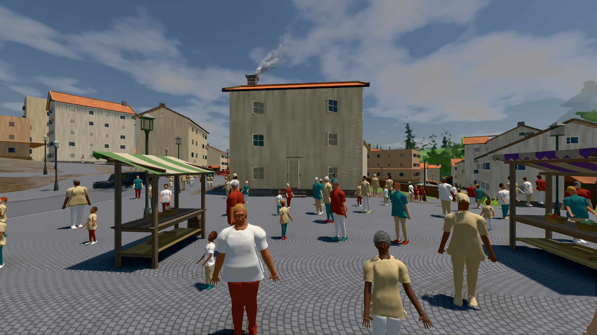

# GPU-PROBE f94fece1 — NACHGEGEBEN

Zweig `a-haltung` · Kopf f94fece163fd2beb3a176117e7678ce9a128bc00 · Läufer omen-gtx1060 · 23.11. 16:34 · Wanduhr ab Push 762 s · Lauf https://github.com/MiguellD/AnazhRealm/actions/runs/45204422880

Ruf: `bild:stadt-voll@0.5 gate:pruefbuehne-licht gate:weltbild-frost:echt gate:studio-begehen gate:webgl-probe`

## Läufer omen-gtx1060 — NACHGEGEBEN

GPU NVIDIA GeForce GTX 1060 · npm ci 130 s (package-lock 9d598369)
Schloss /c/Users/micha/AppData/Local/Temp/claude/gpu-schloss hält „ci-runner 45204422880/1 probe“
- Hook 2026-11-23 16:22:49 start ci-runner 45204422880/1 probe: wartet auf Schloss von 'omen-punkte-gtx-sitzung'
- Hook 2026-11-23 16:23:36 start ci-runner 45204422880/1 probe: verwaistes Schloss 'omen-punkte-gtx-sitzung' geloest - sein Halter pid 4036 lebt nicht
- Hook 2026-11-23 16:23:36 start ci-runner 45204422880/1 probe: Schloss genommen (refs/heads/a-haltung f94fece163fd2beb3a176117e7678ce9a128bc00 ws=C:\actions-runner\_work\AnazhRealm\AnazhRealm)

### bild:stadt-voll@0.5 — GRÜN · 172 s · Läufer omen-gtx1060

Adapter: [linse-gpu] nvidia/pascal

```text
Kamera des Spiels → Blick (14.9 m): 842.49 57.57 451.79 857.31 57.57 450.33
 "abnahme": "ABNAHME GRÜN · beweis · Sicht 0.0 % · Leib im Vordergrund 6.9 % (Leib bewohner 6.9 %) · Leiber näher als 6 m: 3 von 3 ganz (23 Teile) · Ziel Blickziel im Bild frei 14.89 m · Luma 105.8 σ 36 schwarz 0.1 % weiß 0.0 % · Stand 18.546.383 · Bühne summer sunny 0.50 Tiere gehalten · Gerät WebGPU nvidia pascal · Inhalt bauSatz 23.0 % (≥ 2.0 %) Luma 98, bewohner 9.9 % (≥ 1.0 %) Luma 105",
```



### gate:pruefbuehne-licht — GRÜN · 76 s · Läufer omen-gtx1060

Adapter: [linse-gpu] nvidia/pascal

```text
  S0 BODEN-PROGRAMM 1/1: 103347 Zeichen WGSL (Ratsche ≤ 104162) · Pipeline asynchron → GRÜN · kalt 1247 · 1188 · 1208 · 1155 · 1074 · 1059 · 1075 · 1125 · 1205 ms, Median 1155 ms · ÷ K17 derselben Sitzung 0,79 (Auskunft, kein Zeit-Urteil)
✅ S0 BILD GRÜN: die Feuerstelle trägt den Feuerkreis aus 2 m in der Ausgabe · Nacht {"luma":21.8,"schwarz":0,"gesetz":22.75} (59 s, nvidia/pascal · Holz kienspan)
```

### gate:weltbild-frost:echt — NACHGEGEBEN · 122 s · Läufer omen-gtx1060

Adapter: [linse-gpu] nvidia/pascal · NACHGEGEBEN: Karten-Job „echt omen (GPU-Wände auf der Karte)“ (Lauf 45205910314) wartet auf diesen Läufer (omen-gpu)

```text

> anazhrealm@18.546.383 gate:weltbild-frost:echt
> node scripts/diag-weltbild-frost.cjs --echt

[linse-gpu] nvidia/pascal
```

### gate:studio-begehen — NACHGEGEBEN · 4 s · Läufer omen-gtx1060

Adapter: ungenannt (die Probe nannte keinen Browser-Adapter) · NACHGEGEBEN: Karten-Job „echt omen (GPU-Wände auf der Karte)“ (Lauf 45205910314) wartet auf diesen Läufer (omen-gpu)

```text
NACHGEGEBEN: Karten-Job „echt omen (GPU-Wände auf der Karte)“ (Lauf 45205910314) wartet auf diesen Läufer (omen-gpu)
```

### gate:webgl-probe — NACHGEGEBEN · 4 s · Läufer omen-gtx1060

Adapter: ungenannt (die Probe nannte keinen Browser-Adapter) · NACHGEGEBEN: Karten-Job „echt omen (GPU-Wände auf der Karte)“ (Lauf 45205910314) wartet auf diesen Läufer (omen-gpu)

```text
NACHGEGEBEN: Karten-Job „echt omen (GPU-Wände auf der Karte)“ (Lauf 45205910314) wartet auf diesen Läufer (omen-gpu)
```
