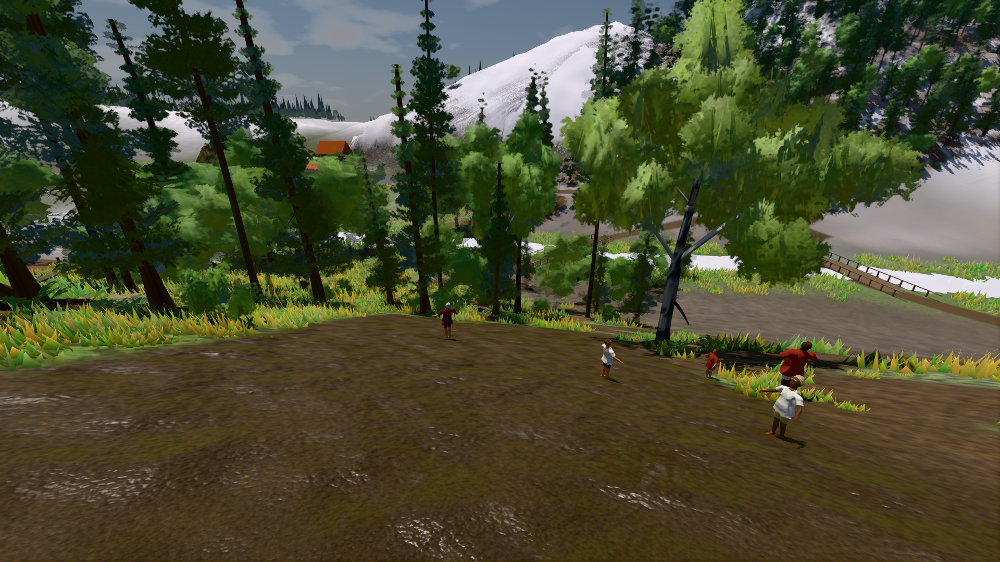
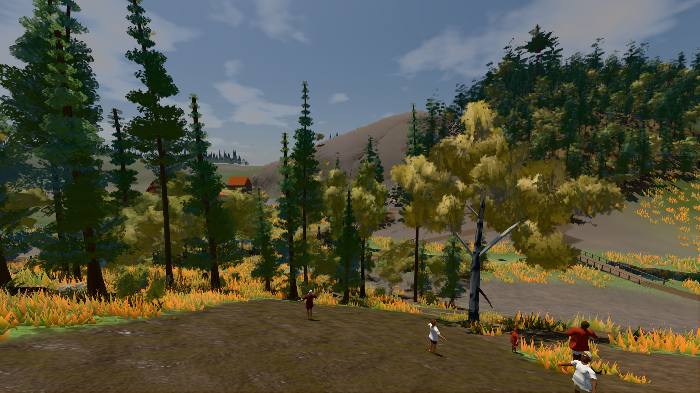
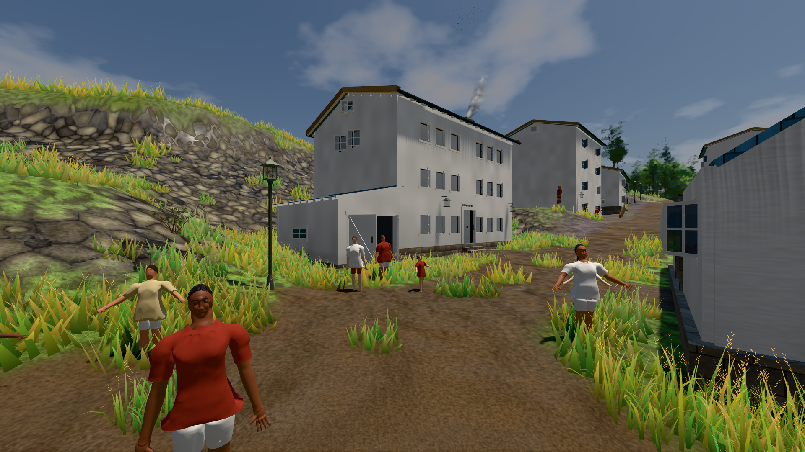

# GPU-PROBE 5819db1d — GRÜN

Zweig `acker-furche-vorher` · Kopf 5819db1d755dc21901f7cebaf45e13dd5bd14791 · Läufer gtx1050-desktop · 23.11. 21:20 · Wanduhr ab Push 714 s · Lauf https://github.com/MiguellD/AnazhRealm/actions/runs/45256317440

Ruf: `bild:acker@0.5 bild:acker-fern@0.5 bild:dorf@0.5 gate:webgl-probe`

## Läufer gtx1050-desktop — GRÜN

GPU NVIDIA GeForce GTX 1050 · node_modules bleiben (package-lock 1709300b)
Schloss /c/Users/User/AppData/Local/Temp/claude/gpu-schloss hält „ci-runner 45256317440/1 probe“
- Hook 2026-11-23 21:09:24 start ci-runner 45256317440/1 probe: Schloss genommen (refs/heads/acker-furche-vorher 5819db1d755dc21901f7cebaf45e13dd5bd14791 ws=C:\actions-runner\_work\AnazhRealm\AnazhRealm)

### bild:acker@0.5 — GRÜN · 183 s · Läufer gtx1050-desktop

Adapter: [linse-gpu] nvidia/pascal

```text
Kamera des Spiels → Blick (3.0 m): -635.53 56.15 -843.95 -637.30 55.03 -841.80
 "abnahme": "ABNAHME GRÜN · beweis · Sicht 0.0 % · Ziel Blickziel im Bild frei 3 m · Luma 73 σ 42.7 schwarz 0.0 % weiß 0.0 % · Stand 18.546.386 · Bühne spring sunny 0.50 Tiere gehalten · Gerät WebGPU nvidia pascal · Inhalt bodenSatz 49.5 % (≥ 15.0 %) Luma 87",
```



### bild:acker-fern@0.5 — GRÜN · 185 s · Läufer gtx1050-desktop

Adapter: [linse-gpu] nvidia/pascal

```text
Kamera des Spiels → Blick (17.4 m): -635.53 56.15 -843.95 -646.58 54.55 -830.60
 "abnahme": "ABNAHME GRÜN · beweis · Sicht 0.0 % · Leib im Vordergrund 0.2 % (Leib bewohner 0.2 %) · Ziel Blickziel im Bild frei 17.4 m · Luma 81.5 σ 40.1 schwarz 0.0 % weiß 0.0 % · Stand 18.546.386 · Bühne autumn sunny 0.50 Tiere gehalten · Gerät WebGPU nvidia pascal · Inhalt bodenSatz 29.2 % (≥ 15.0 %) Luma 83",
```



### bild:dorf@0.5 — GRÜN · 160 s · Läufer gtx1050-desktop

Adapter: [linse-gpu] nvidia/pascal

```text
Kamera des Spiels → Blick (12.9 m): -715.86 49.01 -932.69 -702.99 49.01 -931.86
 "abnahme": "ABNAHME GRÜN · beweis · Sicht 0.0 % · Leib im Vordergrund 4.2 % (Leib bewohner 4.2 %) · Leiber näher als 6 m: 1 von 1 ganz (7 Teile) · Ziel Blickziel im Bild frei 12.9 m · Luma 94.4 σ 30.8 schwarz 0.1 % weiß 0.0 % · Stand 18.546.386 · Bühne summer sunny 0.50 Tiere gehalten · Gerät WebGPU nvidia pascal · Inhalt bauSatz 20.2 % (≥ 2.0 %) Luma 96",
```



### gate:webgl-probe — GRÜN · 114 s · Läufer gtx1050-desktop

Adapter: [linse-gpu] webgl2/NVIDIA GeForce GTX 1050 (0x00001C81) Direct3D11 vs_5_0 ps_5_0

```text
✅ GRÜN — die Kein-WebGPU-Geschichte ist BEWIESEN: der erzwungene WebGL2-Rückfall bootet eine LEBENDE, sichtbare Welt; die WGSL-Konsumenten + Bundles ruhen hinter der EINEN Backend-Wand, der Rückfall ist LAUT benannt, der Fern-Ring trägt auf CPU.
```
