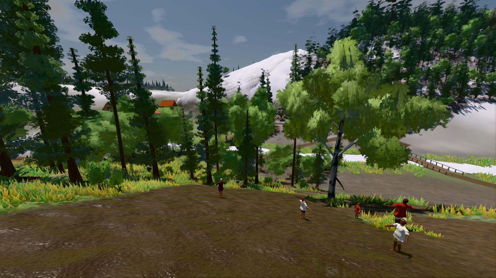
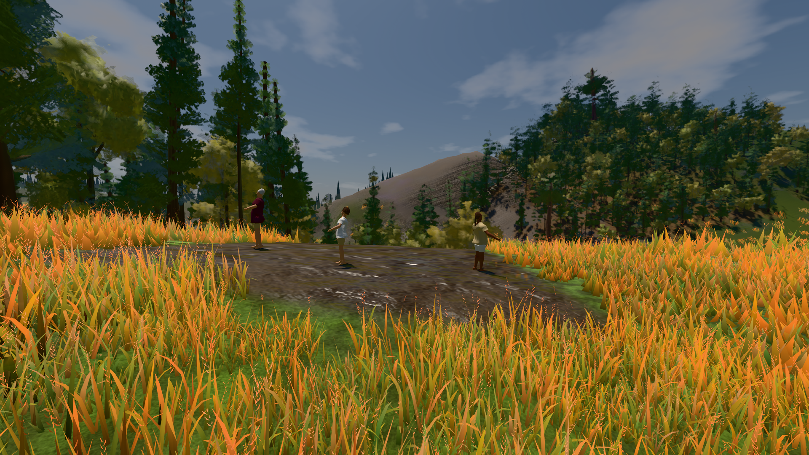
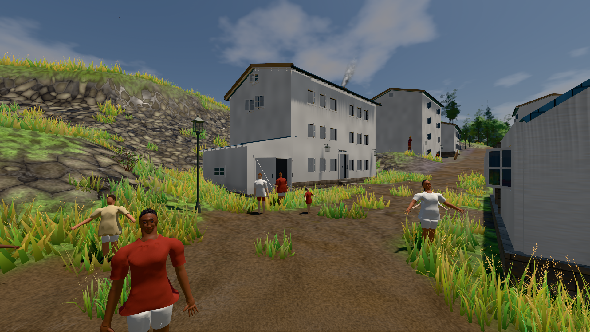

# GPU-PROBE 043473f7 — ROT

Zweig `acker-furche` · Kopf 043473f792fd7ad0ab1e2f88a623a85c0318033d · Läufer gtx1050-desktop · 23.11. 20:46 · Wanduhr ab Push 814 s · Lauf https://github.com/MiguellD/AnazhRealm/actions/runs/45250148633

Ruf: `bild:acker@0.5 bild:acker-fern@0.5 bild:dorf@0.5 gate:pruefbuehne-licht gate:webgl-probe`

## Läufer gtx1050-desktop — ROT

GPU NVIDIA GeForce GTX 1050 · npm ci 36 s (package-lock 1709300b)
Schloss /c/Users/User/AppData/Local/Temp/claude/gpu-schloss hält „ci-runner 45250148633/1 probe“
- Hook 2026-11-23 20:33:40 start ci-runner 45250148633/1 probe: Schloss genommen (refs/heads/acker-furche 043473f792fd7ad0ab1e2f88a623a85c0318033d ws=C:\actions-runner\_work\AnazhRealm\AnazhRealm)

### bild:acker@0.5 — ROT · 185 s · Läufer gtx1050-desktop

Adapter: [linse-gpu] nvidia/pascal · "fehler": "ABNAHME ROT [Ziel Blickziel am Fuß nicht im Bild (ndc [0,-1.134])] · beweis · Sicht 0.0 % · Ziel Blickziel am Fuß NICHT im Bild frei 2 m · Luma 79.2 σ 45 schwarz 0.0 % weiß 0.0 % · Stand 18.546.386 · Bühne spr

```text
Kamera des Spiels → Blick (2.0 m): -635.53 56.15 -843.95 -636.77 55.70 -842.45
 "fehler": "ABNAHME ROT [Ziel Blickziel am Fuß nicht im Bild (ndc [0,-1.134])] · beweis · Sicht 0.0 % · Ziel Blickziel am Fuß NICHT im Bild frei 2 m · Luma 79.2 σ 45 schwarz 0.0 % weiß 0.0 % · Stand 18.546.386 · Bühne spring sunny 0.50 Tiere gehalten · Gerät WebGPU nvidia pascal · Inhalt bodenSatz 38.6 % (≥ 15.0 %) Luma 95 · ROT-Bild C:\\actions-runner\\_work\\_temp\\probe\\043473f7-acker-0.5-rot.png",
```



### bild:acker-fern@0.5 — GRÜN · 185 s · Läufer gtx1050-desktop

Adapter: [linse-gpu] nvidia/pascal

```text
Kamera des Spiels → Blick (12.0 m): -622.36 59.05 -859.87 -630.00 58.41 -850.64
 "abnahme": "ABNAHME GRÜN · beweis · Sicht 0.0 % · Ziel Blickziel im Bild frei 12 m · Luma 90.5 σ 37.9 schwarz 0.0 % weiß 0.0 % · Stand 18.546.386 · Bühne autumn sunny 0.50 Tiere gehalten · Gerät WebGPU nvidia pascal · Inhalt bodenSatz 20.5 % (≥ 15.0 %) Luma 80",
```



### bild:dorf@0.5 — GRÜN · 157 s · Läufer gtx1050-desktop

Adapter: [linse-gpu] nvidia/pascal

```text
Kamera des Spiels → Blick (12.9 m): -715.86 49.01 -932.69 -702.99 49.01 -931.86
 "abnahme": "ABNAHME GRÜN · beweis · Sicht 0.0 % · Leib im Vordergrund 4.2 % (Leib bewohner 4.2 %) · Leiber näher als 6 m: 1 von 1 ganz (7 Teile) · Ziel Blickziel im Bild frei 12.9 m · Luma 94.4 σ 30.9 schwarz 0.1 % weiß 0.0 % · Stand 18.546.386 · Bühne summer sunny 0.50 Tiere gehalten · Gerät WebGPU nvidia pascal · Inhalt bauSatz 20.2 % (≥ 2.0 %) Luma 96",
```



### gate:pruefbuehne-licht — GRÜN · 94 s · Läufer gtx1050-desktop

Adapter: [linse-gpu] nvidia/pascal

```text
  S0 BODEN-PROGRAMM 1/1: 103347 Zeichen WGSL (Ratsche ≤ 104162) · Pipeline asynchron → GRÜN · kalt 1818 · 1752 · 1738 · 1760 · 1879 · 1732 · 1817 · 1719 · 1762 ms, Median 1760 ms · ÷ K17 derselben Sitzung 0,76 (Auskunft, kein Zeit-Urteil)
✅ S0 BILD GRÜN: die Feuerstelle trägt den Feuerkreis aus 2 m in der Ausgabe · Nacht {"luma":21.9,"schwarz":0,"gesetz":22.79} (68 s, nvidia/pascal · Holz kienspan)
```

### gate:webgl-probe — GRÜN · 87 s · Läufer gtx1050-desktop

Adapter: [linse-gpu] webgl2/NVIDIA GeForce GTX 1050 (0x00001C81) Direct3D11 vs_5_0 ps_5_0

```text
✅ GRÜN — die Kein-WebGPU-Geschichte ist BEWIESEN: der erzwungene WebGL2-Rückfall bootet eine LEBENDE, sichtbare Welt; die WGSL-Konsumenten + Bundles ruhen hinter der EINEN Backend-Wand, der Rückfall ist LAUT benannt, der Fern-Ring trägt auf CPU.
```
