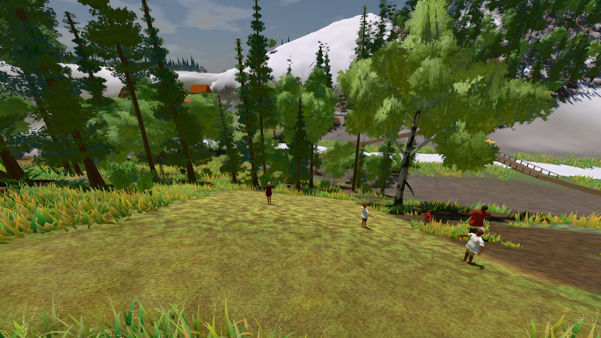
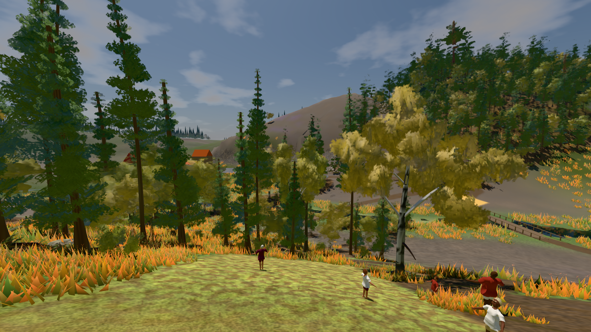
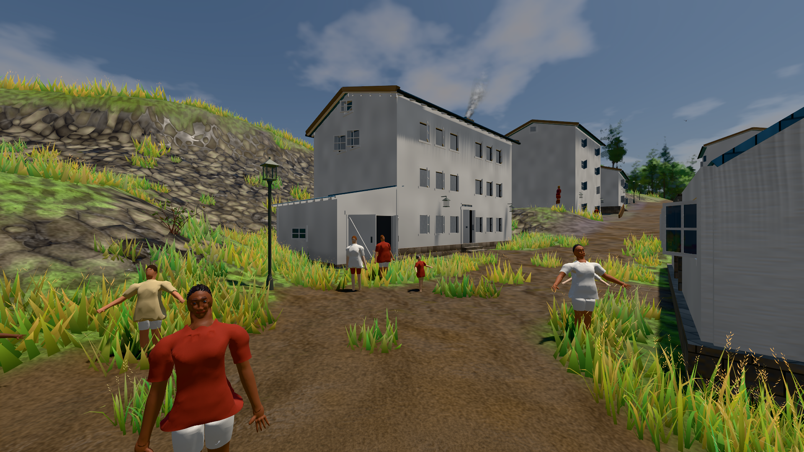

# GPU-PROBE d5077a7c — ROT

Zweig `acker-furche` · Kopf d5077a7cf903028fcacdd62bb7a09d7f21288861 · Läufer radeon-890m · 23.11. 21:15 · Wanduhr ab Push 1347 s · Lauf https://github.com/MiguellD/AnazhRealm/actions/runs/45253526200

Ruf: `bild:acker@0.5 bild:acker-fern@0.5 bild:dorf@0.5 gate:pruefbuehne-licht gate:webgl-probe`

## Läufer radeon-890m — ROT

GPU AMD Radeon(TM) 890M Graphics · npm ci 82 s (package-lock 1709300b)
Schloss /c/Users/micha/AppData/Local/Temp/claude/gpu-schloss hält „ci-runner 45253526200/1 probe“
- Hook 2026-11-23 20:54:19 start ci-runner 45253526200/1 probe: wartet auf Schloss von 'kiste-nachher 2026-11-23T20:51:53+01:00 pid=41196'
- Hook 2026-11-23 20:54:40 start ci-runner 45253526200/1 probe: Schloss genommen (refs/heads/acker-furche d5077a7cf903028fcacdd62bb7a09d7f21288861 ws=C:\actions-runner\_work\AnazhRealm\AnazhRealm)

### bild:acker@0.5 — GRÜN · 170 s · Läufer radeon-890m

Adapter: [linse-gpu] amd/rdna-3

```text
Kamera des Spiels → Blick (3.0 m): -635.53 56.15 -843.95 -637.30 55.03 -841.80
 "abnahme": "ABNAHME GRÜN · beweis · Sicht 0.0 % · Ziel Blickziel im Bild frei 3 m · Luma 99.3 σ 42.8 schwarz 0.0 % weiß 0.0 % · Stand 18.546.386 · Bühne spring sunny 0.50 Tiere gehalten · Gerät WebGPU amd rdna-3 · Inhalt bodenSatz 45.9 % (≥ 15.0 %) Luma 126",
```



### bild:acker-fern@0.5 — GRÜN · 180 s · Läufer radeon-890m

Adapter: [linse-gpu] amd/rdna-3

```text
Kamera des Spiels → Blick (17.4 m): -635.53 56.15 -843.95 -646.58 54.55 -830.60
 "abnahme": "ABNAHME GRÜN · beweis · Sicht 0.0 % · Leib im Vordergrund 0.2 % (Leib bewohner 0.2 %) · Ziel Blickziel im Bild frei 17.4 m · Luma 96.3 σ 39.3 schwarz 0.0 % weiß 0.0 % · Stand 18.546.386 · Bühne autumn sunny 0.50 Tiere gehalten · Gerät WebGPU amd rdna-3 · Inhalt bodenSatz 27.2 % (≥ 15.0 %) Luma 120",
```



### bild:dorf@0.5 — GRÜN · 197 s · Läufer radeon-890m

Adapter: [linse-gpu] amd/rdna-3

```text
Kamera des Spiels → Blick (12.9 m): -715.86 49.01 -932.69 -702.99 49.01 -931.86
 "abnahme": "ABNAHME GRÜN · beweis · Sicht 0.0 % · Leib im Vordergrund 4.0 % (Leib bewohner 4.0 %) · Leiber näher als 6 m: 1 von 1 ganz (7 Teile) · Ziel Blickziel im Bild frei 12.9 m · Luma 94.5 σ 30.8 schwarz 0.1 % weiß 0.0 % · Stand 18.546.386 · Bühne summer sunny 0.50 Tiere gehalten · Gerät WebGPU amd rdna-3 · Inhalt bauSatz 20.2 % (≥ 2.0 %) Luma 95",
```



### gate:pruefbuehne-licht — ROT · 152 s · Läufer radeon-890m

Adapter: [linse-gpu] amd/rdna-3 · ⛔ S0 Boden-Programm: 106919 Zeichen WGSL (Budget ≤ 104162) — die Ratsche des Programms (der Stand + seine Luft, sie fällt nur): jedes Zeichen übersetzt der GPU-Prozess vor dem ersten Bild

```text
  S0 BODEN-PROGRAMM 1/1: 106919 Zeichen WGSL (Ratsche ≤ 104162) · Pipeline asynchron → GRÜN · kalt 1504 · 1207 · 1119 · 1258 · 1038 · 1089 · 948 · 1125 · 1002 ms, Median 1119 ms · ÷ K17 derselben Sitzung 0,82 (Auskunft, kein Zeit-Urteil)
    ⛔ S0 Boden-Programm: 106919 Zeichen WGSL (Budget ≤ 104162) — die Ratsche des Programms (der Stand + seine Luft, sie fällt nur): jedes Zeichen übersetzt der GPU-Prozess vor dem ersten Bild
⛔ S0 BILD ROT · Nacht {"luma":21.8,"schwarz":0,"gesetz":22.71} (48 s, amd/rdna-3 · Holz kienspan)
```

### gate:webgl-probe — GRÜN · 96 s · Läufer radeon-890m

Adapter: [linse-gpu] webgl2/AMD Radeon(TM) 890M Graphics (0x0000150E) Direct3D11 vs_5_0 ps_5_0

```text
✅ GRÜN — die Kein-WebGPU-Geschichte ist BEWIESEN: der erzwungene WebGL2-Rückfall bootet eine LEBENDE, sichtbare Welt; die WGSL-Konsumenten + Bundles ruhen hinter der EINEN Backend-Wand, der Rückfall ist LAUT benannt, der Fern-Ring trägt auf CPU.
```
