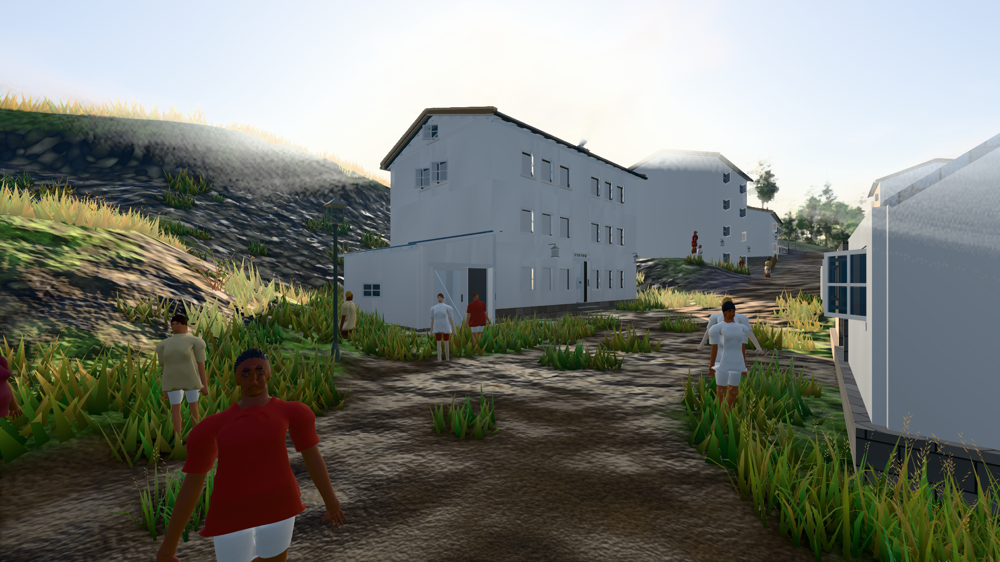

# GPU-PROBE ce824b76 — NACHGEGEBEN

Zweig `acker-kette` · Kopf ce824b76e8b71dd991d3bcb5e7702d1afbbe0431 · Läufer radeon-890m · 23.11. 04:28 · Wanduhr ab Push 1346 s · Lauf https://github.com/MiguellD/AnazhRealm/actions/runs/45103919454

Ruf: `gate:pruefbuehne-licht gate:weltbild-frost:echt gate:studio-begehen bild:dorf@0.3 gate:webgl-probe`

## Läufer radeon-890m — NACHGEGEBEN

GPU AMD Radeon(TM) 890M Graphics · npm ci 92 s (package-lock 46829d76)
Schloss /c/Users/micha/AppData/Local/Temp/claude/gpu-schloss hält „ci-runner 45103919454/1 probe“
- Hook 2026-11-23 04:06:44 start ci-runner 45103919454/1 probe: wartet auf Schloss von 'heap-dorf 2026-11-23T04:06:05+01:00 pid=39216'
- Hook 2026-11-23 04:11:24 start ci-runner 45103919454/1 probe: Schloss genommen (refs/heads/acker-kette ce824b76e8b71dd991d3bcb5e7702d1afbbe0431 ws=C:\actions-runner\_work\AnazhRealm\AnazhRealm)

### gate:pruefbuehne-licht — GRÜN · 82 s · Läufer radeon-890m

Adapter: [linse-gpu] amd/rdna-3

```text
  S0 BODEN-PROGRAMM 1/1: 103347 Zeichen WGSL (Ratsche ≤ 104162) · Pipeline asynchron → GRÜN · kalt 834 · 758 · 957 · 1585 · 943 · 879 · 850 · 1063 · 818 ms, Median 879 ms · ÷ K17 derselben Sitzung 0,80 (Auskunft, kein Zeit-Urteil)
✅ S0 BILD GRÜN: die Feuerstelle trägt den Feuerkreis aus 2 m in der Ausgabe · Nacht {"luma":21.8,"schwarz":0,"gesetz":22.71} (42 s, amd/rdna-3 · Holz kienspan)
```

### gate:weltbild-frost:echt — NACHGEGEBEN · 346 s · Läufer radeon-890m

Adapter: [linse-gpu] amd/rdna-3 · NACHGEGEBEN: Vorfahrt-Blick gescheitert: fetch failed

```text
  ✅ S5 die geteilten Stoffe sammeln keine Hörer (die Render-Objekte des Einzelstücks lösen sich) — 8 Stoffe, dispose-Hörer 15 → 15 über 18 Werte
  ✅ S5 der JS-Speicher bleibt beschränkt (kein Welt-Satz verdichtet im Fenster) — 262.7 → 263.3 MB über 18 Werte (Soll ≤ +10 MB)
  ✅ S6 Mitspieler-Erscheinungen (10 Peers human, Abschied): keine Welt-Geometrie, kein Welt-Stoff entsorgt — 0 von 126 Entsorgungen trafen die Welt (0 Geometrien + 0 Stoffe einzeln): 
  ✅ S6 die Probe gießt zehn Erscheinungen (jede ihre Vorlagen) — 10 Leiber, Memo-Spitze 30 (vor 10)
  ✅ S6 das Ofen-Memo ist begrenzt: nach dem Abschied bleiben höchstens OFEN_MEMO_RUHEND Vorlagen ohne Leib — Memo 10 → Spitze 30 → 12 (Grenze +2)
  ✅ S6 der JS-Speicher fällt mit dem Abschied zurück — 261.5 → 265.6 MB nach 10 Erscheinungen und Abschied (Soll ≤ +20 MB)
  ✅ Nachlauf: kein verspätetes Wort einer Validierung
  ✅ P2 kein writeBuffer schief: der Pfad und ein Index ungerader Länge der Ich-Bühne — 259907 writeBuffer, keiner schief
  ✅ T1 die Index-Wache nennt den Index über der Vertex-Zahl beim Namen — Vendor- und Storage-Index — gezeichnet nach 58 Bildern · Scene/frost-taeter-bereich: Index 3 ≥ 3 Vertices im gezeichneten Bereich | Scene/frost-taeter-speicher: Index 3 ≥ 3 Vertices im gezeichneten Bereich
  ✅ T3 die Puffer-Wache nennt den schiefen writeBuffer beim Namen, WebGPU wirft — frost-taeter-puffer · Uint16Array · Versatz 0 · 6 B · q.writeBuffer (stamm/dirigent-ankunft.js:253:36) < pptr:;page.%3Ccomputed%3E%20(C%3A%5Cactions-runner%5C_work%5CAnazhRealm%5Cgpu-probe%5Cscripts%5Clib%5Cwelt-boot.cjs%3A1110%3A22):6:23 · geworfen: Failed to execute 'writeBuffer' on 'GPUQueue': Number of bytes to write must be a multiple of 4
```

### gate:studio-begehen — GRÜN · 191 s · Läufer radeon-890m

Adapter: [linse-gpu] amd/rdna-3

```text
  ✅ Selbsttest „huelle" macht B1 Hülle nach Promotion + B1 Hülle nach Demotion rot — B1 Hülle nach Promotion: 10 von 10 Häusern zu | B1 Hülle nach Demotion: 0 von 2 Häusern (Geister)
  ✅ Selbsttest „kopf" macht B3 Kopf rot — B3 Kopf: 27 von 120 Treppen-Läufen enden im Solid
  ✅ Selbsttest „kappe" macht B3 Steigen rot — B3 Steigen: 21 von 24 Treppen erreichen ihre Höhe (EG→OG 9/9 · OG→OG 12/12 · Speicher 0/3)
  ✅ Selbsttest „spur" macht B3 Steigen rot — B3 Steigen: 15 von 24 Treppen erreichen ihre Höhe (EG→OG 9/9 · OG→OG 3/12 · Speicher 3/3)
  ✅ Selbsttest „austritt" macht B3 Kopfraum rot — B3 Kopfraum: 14 Austritte unter 1.7 m (min 0.99 m — der Kopf steht im Dach: #0 635014 provenzalisch/kirche sattel speicher 1.69 · #0 635014 provenzalisch/kirche sattel speicher 1.68 · #2 723323 provenzalisch/pfarrhaus sattel speicher 1.2 · #2 723323 provenzalisch/pfarrhaus sattel speicher 1.21 · #3 773412 italienisch/wohnhaus sattel speicher 1 · #3 773412 italienisch/wohnhaus sattel speicher 0.99 · #8 351993 provenzalisch/wohnhaus sattel speicher 1.26 · #8 351993 provenzalisch/wohnhaus sattel speicher 1.15 · #8 351993 provenzali
  ✅ Selbsttest „dachlos" macht B3 Dach rot — B3 Dach: 7 Speicher-Austritte ohne Dach über dem Kopf (der Lauf steigt durch das Dach)
  ✅ Selbsttest „ruecken" macht B3 Speicher rot — B3 Speicher: 2 Häuser mit Dachraum ohne Speicherlauf, obwohl am First Kopfraum steht (#0 635014 provenzalisch/kirche Speicher zu: First 2.68 m, Stufe 0.2 m, Stehraum 3.21 m · #2 723323 provenzalisch/pfarrhaus Speicher zu: First 2.80 m, Stufe 0.2 m, Stehraum 3.54 m)
  ✅ Selbsttest „platte" macht B4 Keller-Decke rot — B4 Keller-Decke = Boden-Platte in 7 von 8
  ✅ Selbsttest „flach" macht B5 Weltgrund rot — B5 Weltgrund: die Häuser stehen eben (Spanne 0 m)
✅ gate:studio-begehen grün
```

### bild:dorf@0.3 — GRÜN · 78 s · Läufer radeon-890m

Adapter: [linse-gpu] amd/rdna-3

```text
Kamera des Spiels → Blick (12.9 m): -715.86 49.01 -932.69 -702.99 49.01 -931.86
 "abnahme": "ABNAHME GRÜN · beweis · Sicht 0.0 % · Leib im Vordergrund 4.9 % (Leib bewohner 4.9 %) · Leiber näher als 6 m: 1 von 1 ganz (7 Teile) · Ziel Blickziel im Bild frei 12.9 m · Luma 121.3 σ 81.2 schwarz 0.0 % weiß 6.3 % · Stand 18.546.377 · Bühne summer sunny 0.30 Tiere gehalten · Gerät WebGPU amd rdna-3 · Inhalt bauSatz 20.2 % (≥ 2.0 %) Luma 121",
```



### gate:webgl-probe — GRÜN · 59 s · Läufer radeon-890m

Adapter: [linse-gpu] webgl2/AMD Radeon(TM) 890M Graphics (0x0000150E) Direct3D11 vs_5_0 ps_5_0

```text
✅ GRÜN — die Kein-WebGPU-Geschichte ist BEWIESEN: der erzwungene WebGL2-Rückfall bootet eine LEBENDE, sichtbare Welt; die WGSL-Konsumenten + Bundles ruhen hinter der EINEN Backend-Wand, der Rückfall ist LAUT benannt, der Fern-Ring trägt auf CPU.
```
