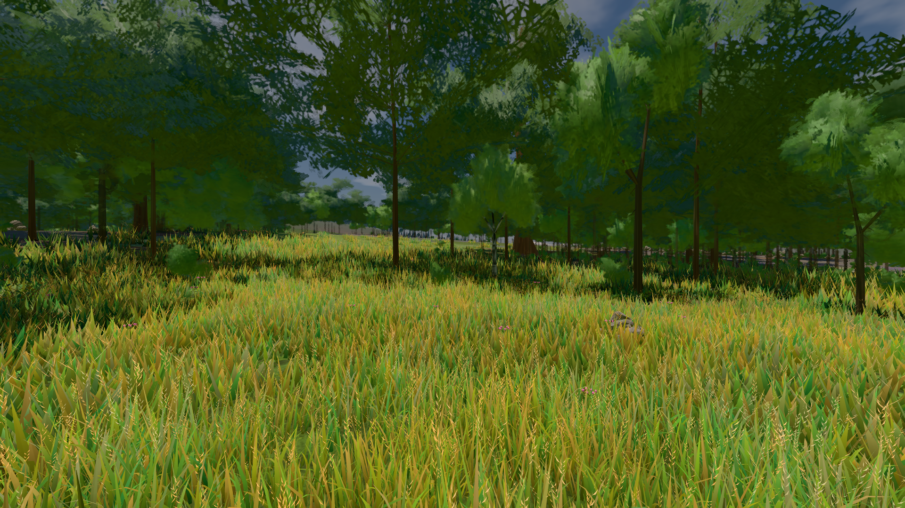

# GPU-PROBE 8eeace75 — GRÜN

Zweig `altlast-in-die-karte` · Kopf 8eeace75c73084490b8d6572108a52afa8912689 · Läufer radeon-890m · 19.11. 17:21 · Wanduhr ab Push 517 s · Lauf https://github.com/MiguellD/AnazhRealm/actions/runs/44563494965

Ruf: `bild:wiese@0.5`

## Läufer radeon-890m — GRÜN

GPU AMD Radeon(TM) 890M Graphics · npm ci 87 s (package-lock b38d03a8)
Schloss /c/Users/micha/AppData/Local/Temp/claude/gpu-schloss hält „ci-runner 44563494965/1 probe“
- Hook 2026-11-19 17:13:12 start ci-runner 44563494965/1 probe: wartet auf Schloss von 'herde-v14 2026-11-19T17:08:54+01:00 pid=27056'
- Hook 2026-11-19 17:14:44 start ci-runner 44563494965/1 probe: Schloss genommen (refs/heads/altlast-in-die-karte 8eeace75c73084490b8d6572108a52afa8912689 ws=C:\actions-runner\_work\AnazhRealm\AnazhRealm)

### bild:wiese@0.5 — GRÜN · 69 s · Läufer radeon-890m

Adapter: [linse-gpu] amd/rdna-3

```text
Kamera des Spiels → Blick (10.0 m): -280.40 29.71 -1045.60 -289.61 29.71 -1049.50
 "abnahme": "ABNAHME GRÜN · beweis · Sicht 0.0 % · Ziel Blickziel im Bild frei 10 m · Luma 81.5 σ 39.3 schwarz 0.0 % weiß 0.0 % · Stand 18.546.343 · Bühne summer sunny 0.50 Tiere gehalten · Gerät WebGPU amd rdna-3 · Inhalt nahWiese 48.2 % (≥ 15.0 %) h 107° Luma 117",
```


