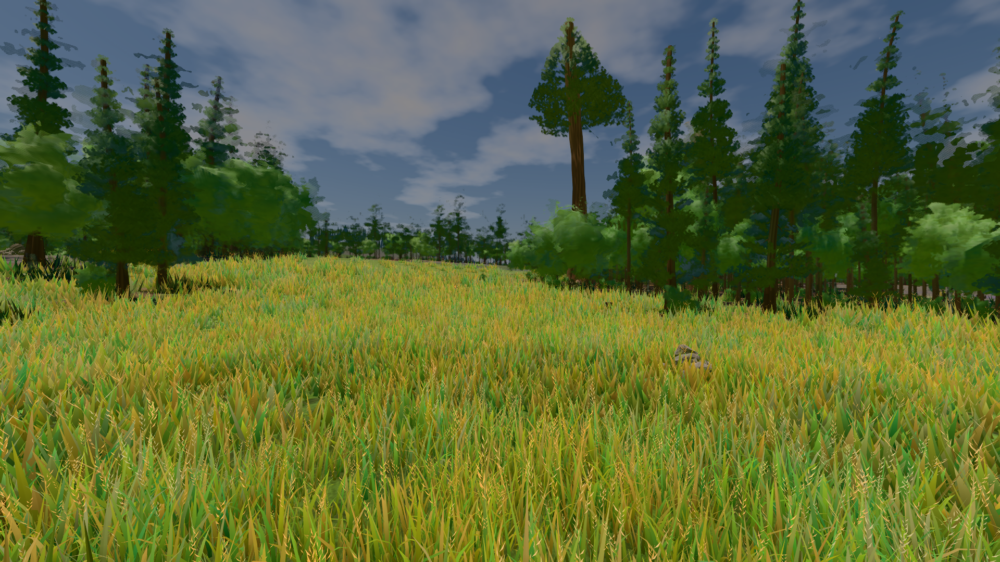

# GPU-PROBE 59080c51 — ROT

Zweig `auge-der-art` · Kopf 59080c51f0650cbe2d87f6968681a23c934f2e38 · Läufer omen-gtx1060 · 24.11. 05:34 · Wanduhr ab Push 1478 s · Lauf https://github.com/MiguellD/AnazhRealm/actions/runs/45324405415

Ruf: `gate:kreatur-leben gate:kreatur-takt bild:wiese@0.5 gate:webgl-probe`

## Läufer omen-gtx1060 — ROT

GPU NVIDIA GeForce GTX 1060 · npm ci 47 s (package-lock 0e22d7b0)
Schloss /c/Users/micha/AppData/Local/Temp/claude/gpu-schloss hält „ci-runner 45324405415/1 probe“
- Hook 2026-11-24 05:13:36 start ci-runner 45324405415/1 probe: wartet auf Schloss von 'omen-punkte-gtx-sitzung'
- Hook 2026-11-24 05:15:52 start ci-runner 45324405415/1 probe: Schloss genommen (refs/heads/auge-der-art 59080c51f0650cbe2d87f6968681a23c934f2e38 ws=C:\actions-runner\_work\AnazhRealm\AnazhRealm)

### gate:kreatur-leben — GRÜN · 66 s · Läufer omen-gtx1060

Adapter: ungenannt (die Probe nannte keinen Browser-Adapter)

```text
  ✅ Das Erbe im Kern, Selbsttest: die Nische der neuen Achse ohne Eichung (das Mittel der Rate rückt) fällt ROT — leben-core selbsttest ROT: eichung 0.953572245737432
  ✅ Bestand = Gesetz: Lauf 4 zahlengleich (Saat 1 · 2, Jahre 0–40, Spur von Wolf und Beute gegen die Vorlage)
  ✅ Bestand = Gesetz, Selbsttest: der Mutant V½ 246 → 300 fällt ROT
  ✅ Gau, der Akt (E2): „aus“ nimmt den Kopf, „ein“ setzt ihn mit seinem Leib, ein fremder Takt-Stempel wirft
  ✅ Gau, Determinismus (G3): zwei Läufe byte-gleich · EIN „aus“ am Takt 100 weicht ab · derselbe Akt wieder byte-gleich
  ✅ Gau, Stand-Rundreise (G4): packen → entpacken → weiterrechnen = durchrechnen, byte-gleich (521872 Bytes am 32er-Raster)
  ✅ Gau, Selbsttest: der Mutant „der Akt wirkt an einer Kopie“ fällt ROT
  ✅ Gau, Selbsttest: der Mutant „der Wirt verliert den Akt“ fällt ROT
  ✅ Gau, Selbsttest: der Mutant „der Stand vergisst die Fraß-Schicht“ fällt ROT
✅ GRÜN — DIE KREATUR-SEELE IST GESCHLOSSEN: jedes Aktions-Profil zeigt auf ein Feld der Haltung.
```

### gate:kreatur-takt — ROT · 595 s · Läufer omen-gtx1060

Adapter: ungenannt (die Probe nannte keinen Browser-Adapter) · DECKEL 480 s

```text
       ✅ der Täter macht die Probe ROT und wird beim Namen genannt — die Linse sieht ihn
  ❌ begegnung [Täter begegnung-steht] {"sicht":{"begegnung-starr":{"wer":"kind/kind #16036","furcht":1,"zuS":[null,null,null,0],"amEreignis":76,"begegnungM":3,"imBild":[null,null,null,true],"dMin":[2,1.307,1.307,1.758],"beruehrt":[0,0,0,0],"fort":20,"weichOrt":[-127.6,-122.6]},"begegnung-steht":{"wer":"kind/kind #16036","furcht":1,"zuS":[0.25,0.083,0.083,0.1],"amEreignis":70,"begegnungM":3,"imBild":[true,true,true,true],"dMin":[2,0.007,0.007,0.007],"beruehrt":[0,60,60,60],"fort":20,"weichOrt":[-127.6,-122.6]},"begegnung-vergessen":{"wer":"kind/kind #16036","furcht":0,"zuS":[0.25,0,0,0],"amE
       ✅ der Täter macht die Probe ROT und wird beim Namen genannt — die Linse sieht ihn
  ❌ begegnung [Täter begegnung-vergessen] {"sicht":{"begegnung-starr":{"wer":"kind/kind #16036","furcht":1,"zuS":[null,null,null,0],"amEreignis":76,"begegnungM":3,"imBild":[null,null,null,true],"dMin":[2,1.307,1.307,1.758],"beruehrt":[0,0,0,0],"fort":20,"weichOrt":[-127.6,-122.6]},"begegnung-steht":{"wer":"kind/kind #16036","furcht":1,"zuS":[0.25,0.083,0.083,0.1],"amEreignis":70,"begegnungM":3,"imBild":[true,true,true,true],"dMin":[2,0.007,0.007,0.007],"beruehrt":[0,60,60,60],"fort":20,"weichOrt":[-127.6,-122.6]},"begegnung-vergessen":{"wer":"kind/kind #16036","furcht":0,"zuS":[0.25,0,0,0],
       ✅ der Täter macht die Probe ROT und wird beim Namen genannt — die Linse sieht ihn
  ❌ begegnung [Täter begegnung-bleibt] {"sicht":{"begegnung-starr":{"wer":"kind/kind #16036","furcht":1,"zuS":[null,null,null,0],"amEreignis":76,"begegnungM":3,"imBild":[null,null,null,true],"dMin":[2,1.307,1.307,1.758],"beruehrt":[0,0,0,0],"fort":20,"weichOrt":[-127.6,-122.6]},"begegnung-steht":{"wer":"kind/kind #16036","furcht":1,"zuS":[0.25,0.083,0.083,0.1],"amEreignis":70,"begegnungM":3,"imBild":[true,true,true,true],"dMin":[2,0.007,0.007,0.007],"beruehrt":[0,60,60,60],"fort":20,"weichOrt":[-127.6,-122.6]},"begegnung-vergessen":{"wer":"kind/kind #16036","furcht":0,"zuS":[0.25,0,0,0],"am
       ✅ der Täter macht die Probe ROT und wird beim Namen genannt — die Linse sieht ihn
  ❌ begegnung [Täter begegnung-zugebaut] {"sicht":{"begegnung-starr":{"wer":"kind/kind #16036","furcht":1,"zuS":[null,null,null,0],"amEreignis":76,"begegnungM":3,"imBild":[null,null,null,true],"dMin":[2,1.307,1.307,1.758],"beruehrt":[0,0,0,0],"fort":20,"weichOrt":[-127.6,-122.6]},"begegnung-steht":{"wer":"kind/kind #16036","furcht":1,"zuS":[0.25,0.083,0.083,0.1],"amEreignis":70,"begegnungM":3,"imBild":[true,true,true,true],"dMin":[2,0.007,0.007,0.007],"beruehrt":[0,60,60,60],"fort":20,"weichOrt":[-127.6,-122.6]},"begegnung-vergessen":{"wer":"kind/kind #16036","furcht":0,"zuS":[0.25,0,0,0],"
       ✅ der Täter macht die Probe ROT und wird beim Namen genannt — die Linse sieht ihn
✅ SELBST-TEST GRÜN — jeder Täter macht seine Probe rot und wird beim Namen genannt (46 Täter), jede Probe ist im Grund grün (8).
```

### bild:wiese@0.5 — GRÜN · 53 s · Läufer omen-gtx1060

Adapter: [linse-gpu] nvidia/pascal

```text
Kamera des Spiels → Blick (10.0 m): -280.40 29.71 -1045.60 -289.61 29.71 -1049.50
 "abnahme": "ABNAHME GRÜN · beweis · Sicht 0.0 % · Ziel Blickziel im Bild frei 10 m · Luma 99.2 σ 35.5 schwarz 0.0 % weiß 0.0 % · Stand 18.546.391 · Bühne summer sunny 0.50 Tiere gehalten · Gerät WebGPU nvidia pascal · Inhalt nahWiese 48.5 % (≥ 15.0 %) h 107° Luma 123",
```



### gate:webgl-probe — GRÜN · 51 s · Läufer omen-gtx1060

Adapter: [linse-gpu] webgl2/NVIDIA GeForce GTX 1060 (0x00001C60) Direct3D11 vs_5_0 ps_5_0

```text
✅ GRÜN — die Kein-WebGPU-Geschichte ist BEWIESEN: der erzwungene WebGL2-Rückfall bootet eine LEBENDE, sichtbare Welt; die WGSL-Konsumenten + Bundles ruhen hinter der EINEN Backend-Wand, der Rückfall ist LAUT benannt, der Fern-Ring trägt auf CPU.
```
