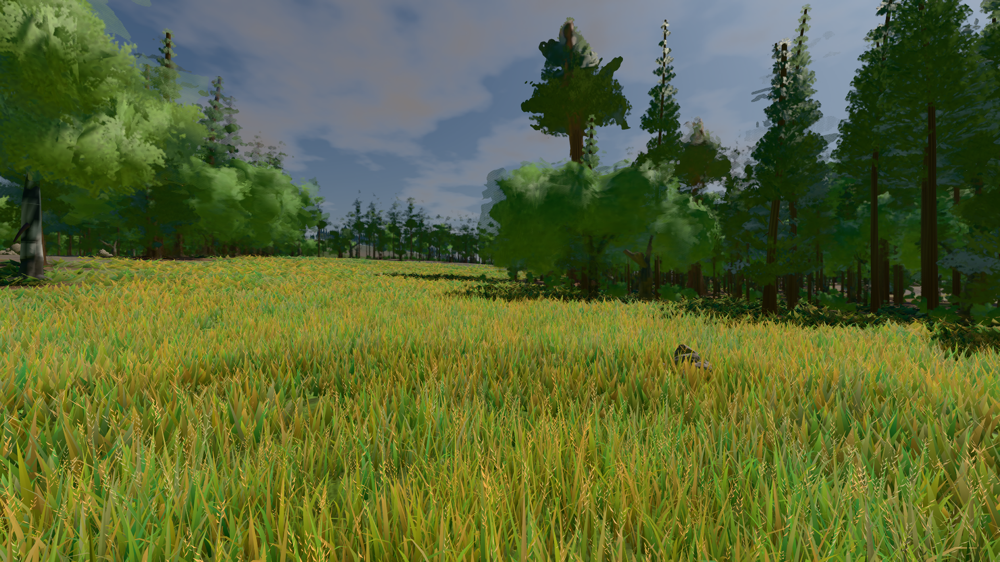

# GPU-PROBE c4dcd25c — GRÜN

Zweig `bahn-klima-2` · Kopf c4dcd25c8df149f535bdf6d753dc82920461c9d7 · Läufer gtx1050-desktop · 27.11. 02:08 · Wanduhr ab Push 711 s · Lauf https://github.com/MiguellD/AnazhRealm/actions/runs/45919701475

Ruf: `bild:wiese@0.5 gate:webgl-probe`

## Läufer gtx1050-desktop — GRÜN

GPU NVIDIA GeForce GTX 1050 · node_modules bleiben (package-lock 5f861a84)
Schloss /c/Users/User/AppData/Local/Temp/claude/gpu-schloss hält „ci-runner 45919701475/1 probe“
- Hook 2026-11-27 02:01:29 start ci-runner 45919701475/1 probe: wartet auf Schloss von 'hand-macher-gtx-sitzung'
- Hook 2026-11-27 02:01:44 start ci-runner 45919701475/1 probe: Schloss genommen (refs/heads/bahn-klima-2 c4dcd25c8df149f535bdf6d753dc82920461c9d7 ws=C:\actions-runner\_work\AnazhRealm\AnazhRealm)

### bild:wiese@0.5 — GRÜN · 106 s · Läufer gtx1050-desktop

Adapter: [linse-gpu] nvidia/pascal

```text
Kamera des Spiels → Blick (10.0 m): -280.40 29.71 -1045.60 -289.61 29.71 -1049.50
 "abnahme": "ABNAHME GRÜN · beweis · Sicht 0.0 % · Ziel Blickziel im Bild frei 10 m · Luma 97 σ 38.3 schwarz 0.0 % weiß 0.0 % · Stand 18.546.444 · Bühne summer sunny 0.50 Tiere gehalten · Gerät WebGPU nvidia pascal · Inhalt nahWiese 48.4 % (≥ 15.0 %) h 106° Luma 117",
```



### gate:webgl-probe — GRÜN · 112 s · Läufer gtx1050-desktop

Adapter: [linse-gpu] webgl2/NVIDIA GeForce GTX 1050 (0x00001C81) Direct3D11 vs_5_0 ps_5_0

```text
✅ GRÜN — die Kein-WebGPU-Geschichte ist BEWIESEN: der erzwungene WebGL2-Rückfall bootet eine LEBENDE, sichtbare Welt; die WGSL-Konsumenten + Bundles ruhen hinter der EINEN Backend-Wand, der Rückfall ist LAUT benannt, der Fern-Ring trägt auf CPU.
```
