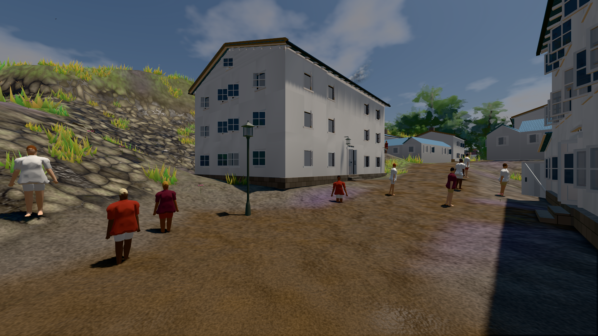

# GPU-PROBE 64b7fac1 — ROT

Zweig `bau-rezept-tuer` · Kopf 64b7fac1d4be10f27977b327750dba9fb034d817 · Läufer gtx1050-desktop · 20.11. 11:29 · Wanduhr ab Push 3441 s · Lauf https://github.com/MiguellD/AnazhRealm/actions/runs/44711557986

Ruf: `gate:kreatur-leben gate:haus-welt bild:dorf@0.5`

## Läufer gtx1050-desktop — ROT

GPU NVIDIA GeForce GTX 1050 · node_modules bleiben (package-lock 6407f3da)
Schloss /c/Users/User/AppData/Local/Temp/claude/gpu-schloss hält „ci-runner 44711557986/1 probe“
- Hook 2026-11-20 10:49:31 start ci-runner 44711557986/1 probe: Schloss genommen (refs/heads/bau-rezept-tuer 64b7fac1d4be10f27977b327750dba9fb034d817 ws=C:\actions-runner\_work\AnazhRealm\AnazhRealm)

### gate:kreatur-leben — GRÜN · 14 s · Läufer gtx1050-desktop

Adapter: ungenannt (die Probe nannte keinen Browser-Adapter)

```text
  ✅ je Stimmung alle=[min,max] (min ≤ max)
  ✅ Aktions-Profile nutzen nur bekannte MOTION-Felder
  ✅ groessen-Bänder strikt aufsteigend (bis-Schwellen)
✅ GRÜN — DIE KREATUR-SEELE IST GESCHLOSSEN: jedes Aktions-Profil zeigt auf ein Feld der Haltung.
```

### gate:haus-welt — ROT · 2205 s · Läufer gtx1050-desktop

Adapter: ungenannt (die Probe nannte keinen Browser-Adapter) · DECKEL 960 s

```text
[stall-akte] Stderr [3716:8172:1120/111545.225:ERROR:google_apis\gcm\engine\mcs_client.cc:702]   Error code: 401  Error message: Authentication Failed: wrong_secret
[stall-akte] Stderr [3716:760:1120/111839.994:ERROR:services\on_device_model\public\cpp\service_client.cc:37] Unexpected on_device_model service disconnect; reason: 1, description: Error loading backend.
[stall-akte] Stderr [3716:8172:1120/111545.225:ERROR:google_apis\gcm\engine\mcs_client.cc:702]   Error code: 401  Error message: Authentication Failed: wrong_secret
[stall-akte] Stderr [3716:760:1120/111839.994:ERROR:services\on_device_model\public\cpp\service_client.cc:37] Unexpected on_device_model service disconnect; reason: 1, description: Error loading backend.
[stall-akte] Stderr [3716:8172:1120/111545.225:ERROR:google_apis\gcm\engine\mcs_client.cc:702]   Error code: 401  Error message: Authentication Failed: wrong_secret
[stall-akte] Stderr [3716:760:1120/111839.994:ERROR:services\on_device_model\public\cpp\service_client.cc:37] Unexpected on_device_model service disconnect; reason: 1, description: Error loading backend.
[stall-akte] Stderr [3716:8172:1120/111545.225:ERROR:google_apis\gcm\engine\mcs_client.cc:702]   Error code: 401  Error message: Authentication Failed: wrong_secret
[stall-akte] Stderr [3716:760:1120/111839.994:ERROR:services\on_device_model\public\cpp\service_client.cc:37] Unexpected on_device_model service disconnect; reason: 1, description: Error loading backend.
[stall-akte] Stderr [3716:8172:1120/111545.225:ERROR:google_apis\gcm\engine\mcs_client.cc:702]   Error code: 401  Error message: Authentication Failed: wrong_secret
[stall-akte] Stderr [3716:760:1120/111839.994:ERROR:services\on_device_model\public\cpp\service_client.cc:37] Unexpected on_device_model service disconnect; reason: 1, description: Error loading backend.
```

### bild:dorf@0.5 — GRÜN · 152 s · Läufer gtx1050-desktop

Adapter: [linse-gpu] nvidia/pascal

```text
Kamera des Spiels → Blick (11.6 m): -688.22 46.09 -880.02 -676.75 46.09 -878.28
 "abnahme": "ABNAHME GRÜN · beweis · Sicht 0.0 % · Ziel Blickziel im Bild frei 11.6 m · Luma 81.3 σ 31.1 schwarz 0.2 % weiß 0.0 % · Stand 18.546.350 · Bühne summer sunny 0.50 Tiere gehalten · Gerät WebGPU nvidia pascal · Inhalt bauSatz 20.5 % (≥ 2.0 %) Luma 87",
```


