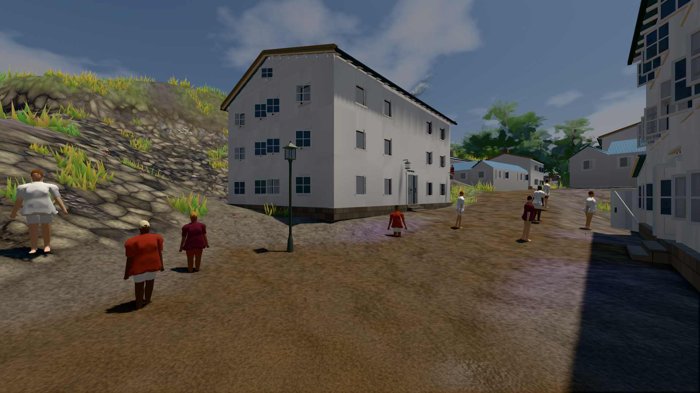

# GPU-PROBE aa57d6b0 — ROT

Zweig `bau-rezept-tuer` · Kopf aa57d6b0bcc1ae2a50fa8d86ad5afae0d4442375 · Läufer gtx1050-desktop · 20.11. 10:02 · Wanduhr ab Push 4209 s · Lauf https://github.com/MiguellD/AnazhRealm/actions/runs/44698119300

Ruf: `gate:kreatur-leben gate:haus-welt bild:dorf@0.5`

## Läufer gtx1050-desktop — ROT

GPU NVIDIA GeForce GTX 1050 · npm ci 49 s (package-lock 6407f3da)
Schloss /c/Users/User/AppData/Local/Temp/claude/gpu-schloss hält „ci-runner 44698119300/2 probe“
- Hook 2026-11-20 09:17:59 start ci-runner 44698119300/2 probe: Schloss genommen (refs/heads/bau-rezept-tuer aa57d6b0bcc1ae2a50fa8d86ad5afae0d4442375 ws=C:\actions-runner\_work\AnazhRealm\AnazhRealm)

### gate:kreatur-leben — GRÜN · 19 s · Läufer gtx1050-desktop

Adapter: ungenannt (die Probe nannte keinen Browser-Adapter)

```text
  ✅ je Stimmung alle=[min,max] (min ≤ max)
  ✅ Aktions-Profile nutzen nur bekannte MOTION-Felder
  ✅ groessen-Bänder strikt aufsteigend (bis-Schwellen)
✅ GRÜN — DIE KREATUR-SEELE IST GESCHLOSSEN: jedes Aktions-Profil zeigt auf ein Feld der Haltung.
```

### gate:haus-welt — ROT · 2385 s · Läufer gtx1050-desktop

Adapter: ungenannt (die Probe nannte keinen Browser-Adapter) · DECKEL 960 s

```text
[stall-akte] Stderr [8640:11168:1120/094909.055:ERROR:services\on_device_model\public\cpp\service_client.cc:37] Unexpected on_device_model service disconnect; reason: 1, description: Error loading backend.
[stall-akte] Stderr [8640:11168:1120/094909.055:ERROR:services\on_device_model\public\cpp\service_client.cc:37] Unexpected on_device_model service disconnect; reason: 1, description: Error loading backend.
[stall-akte] Stderr [8640:11168:1120/094909.055:ERROR:services\on_device_model\public\cpp\service_client.cc:37] Unexpected on_device_model service disconnect; reason: 1, description: Error loading backend.
[stall-akte] Stderr [8640:11168:1120/094909.055:ERROR:services\on_device_model\public\cpp\service_client.cc:37] Unexpected on_device_model service disconnect; reason: 1, description: Error loading backend.
[stall-akte] Stderr [8640:11168:1120/094909.055:ERROR:services\on_device_model\public\cpp\service_client.cc:37] Unexpected on_device_model service disconnect; reason: 1, description: Error loading backend.
[stall-akte] Stderr [8640:11168:1120/094909.055:ERROR:services\on_device_model\public\cpp\service_client.cc:37] Unexpected on_device_model service disconnect; reason: 1, description: Error loading backend.
[stall-akte] Stderr [8640:11168:1120/094909.055:ERROR:services\on_device_model\public\cpp\service_client.cc:37] Unexpected on_device_model service disconnect; reason: 1, description: Error loading backend.
[stall-akte] Stderr [8640:11168:1120/094909.055:ERROR:services\on_device_model\public\cpp\service_client.cc:37] Unexpected on_device_model service disconnect; reason: 1, description: Error loading backend.
[stall-akte] Stderr [8640:11168:1120/094909.055:ERROR:services\on_device_model\public\cpp\service_client.cc:37] Unexpected on_device_model service disconnect; reason: 1, description: Error loading backend.
[stall-akte] Stderr [8640:11168:1120/094909.055:ERROR:services\on_device_model\public\cpp\service_client.cc:37] Unexpected on_device_model service disconnect; reason: 1, description: Error loading backend.
```

### bild:dorf@0.5 — GRÜN · 147 s · Läufer gtx1050-desktop

Adapter: [linse-gpu] nvidia/pascal

```text
Kamera des Spiels → Blick (11.6 m): -688.22 46.09 -880.02 -676.75 46.09 -878.28
 "abnahme": "ABNAHME GRÜN · beweis · Sicht 0.0 % · Ziel Blickziel im Bild frei 11.6 m · Luma 81.3 σ 31.1 schwarz 0.2 % weiß 0.0 % · Stand 18.546.350 · Bühne summer sunny 0.50 Tiere gehalten · Gerät WebGPU nvidia pascal · Inhalt bauSatz 20.5 % (≥ 2.0 %) Luma 87",
```


