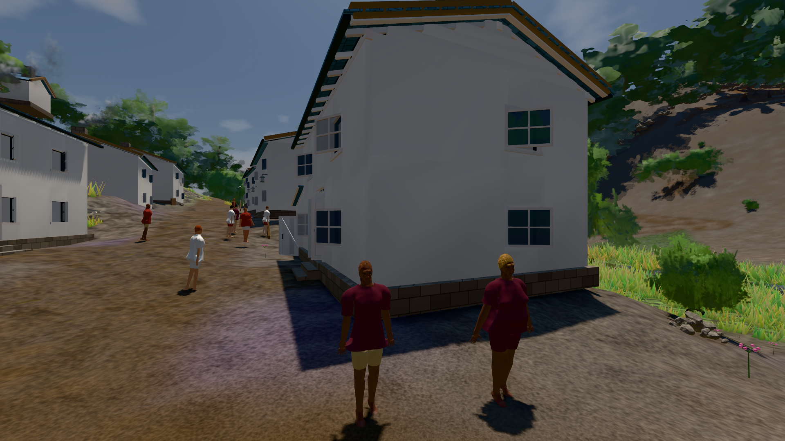

# GPU-PROBE 6db7b96d — GRÜN

Zweig `beobachter-ein-weg` · Kopf 6db7b96d8bdd332fbae889754c642c21044646d3 · Läufer radeon-890m · 20.11. 02:17 · Wanduhr ab Push 543 s · Lauf https://github.com/MiguellD/AnazhRealm/actions/runs/44651355343

Ruf: `bild:dorf@0.5`

## Läufer radeon-890m — GRÜN

GPU AMD Radeon(TM) 890M Graphics · node_modules bleiben (package-lock 20e3f8f6)
Schloss /c/Users/micha/AppData/Local/Temp/claude/gpu-schloss hält „ci-runner 44651355343/1 probe“
- Hook 2026-11-20 02:15:12 start ci-runner 44651355343/1 probe: Schloss genommen (refs/heads/beobachter-ein-weg 6db7b96d8bdd332fbae889754c642c21044646d3 ws=C:\actions-runner\_work\AnazhRealm\AnazhRealm)

### bild:dorf@0.5 — GRÜN · 76 s · Läufer radeon-890m

Adapter: [linse-gpu] amd/rdna-3

```text
Kamera des Spiels → Blick (5.2 m): -704.22 39.69 -880.02 -703.01 39.69 -874.96
 "abnahme": "ABNAHME GRÜN · beweis · Sicht 0.0 % · Ziel Blickziel im Bild frei 5.2 m · Luma 76.1 σ 30.8 schwarz 0.2 % weiß 0.0 % · Stand 18.546.346 · Bühne summer sunny 0.50 Tiere gehalten · Gerät WebGPU amd rdna-3 · Inhalt bauSatz 29.7 % (≥ 2.0 %) Luma 80",
```


