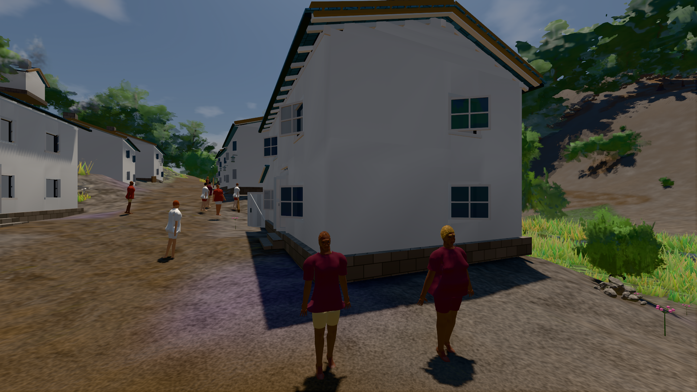

# GPU-PROBE a7f1d6db — GRÜN

Zweig `beobachter-ein-weg` · Kopf a7f1d6dbcb2864b8414e6c05db52ae927dcadb95 · Läufer gtx1050-desktop · 20.11. 04:19 · Wanduhr ab Push 984 s · Lauf https://github.com/MiguellD/AnazhRealm/actions/runs/44665087586

Ruf: `bild:dorf@0.5`

## Läufer gtx1050-desktop — GRÜN

GPU NVIDIA GeForce GTX 1050 · node_modules bleiben (package-lock 20e3f8f6)
Schloss /c/Users/User/AppData/Local/Temp/claude/gpu-schloss hält „ci-runner 44665087586/1 probe“
- Hook 2026-11-20 04:09:37 start ci-runner 44665087586/1 probe: Schloss genommen (refs/heads/beobachter-ein-weg a7f1d6dbcb2864b8414e6c05db52ae927dcadb95 ws=C:\actions-runner\_work\AnazhRealm\AnazhRealm)

### bild:dorf@0.5 — GRÜN · 157 s · Läufer gtx1050-desktop

Adapter: [linse-gpu] nvidia/pascal

```text
Kamera des Spiels → Blick (5.2 m): -704.22 39.69 -880.02 -703.01 39.69 -874.96
 "abnahme": "ABNAHME GRÜN · beweis · Sicht 0.0 % · Ziel Blickziel im Bild frei 5.2 m · Luma 75.8 σ 30.9 schwarz 0.2 % weiß 0.0 % · Stand 18.546.346 · Bühne summer sunny 0.50 Tiere gehalten · Gerät WebGPU nvidia pascal · Inhalt bauSatz 29.7 % (≥ 2.0 %) Luma 79",
```


