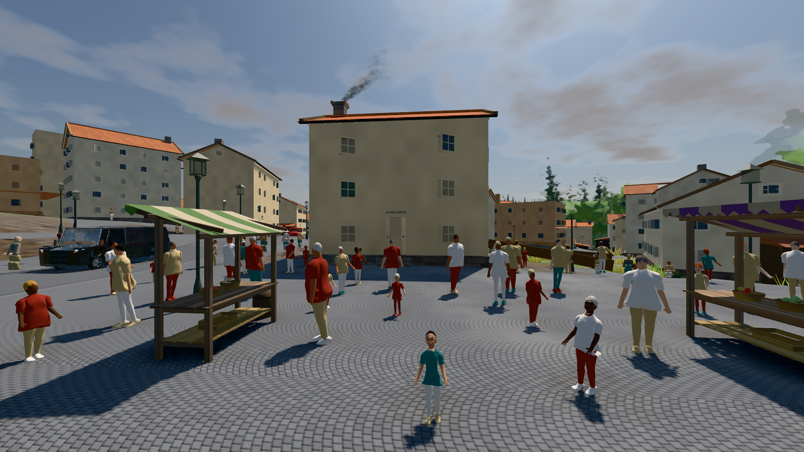

# GPU-PROBE d4cb242f — GRÜN

Zweig `bewohner-satz` · Kopf d4cb242fab1058d42e2be354a0bde76f0f87308b · Läufer radeon-890m · 24.11. 01:02 · Wanduhr ab Push 278 s · Lauf https://github.com/MiguellD/AnazhRealm/actions/runs/45293269211

Ruf: `bild:stadt-voll@0.42 gate:webgl-probe`

## Läufer radeon-890m — GRÜN

GPU AMD Radeon(TM) 890M Graphics · npm ci 58 s (package-lock e2430794)
Schloss /c/Users/micha/AppData/Local/Temp/claude/gpu-schloss hält „ci-runner 45293269211/1 probe“
- Hook 2026-11-24 00:58:31 start ci-runner 45293269211/1 probe: Schloss genommen (refs/heads/bewohner-satz d4cb242fab1058d42e2be354a0bde76f0f87308b ws=C:\actions-runner\_work\AnazhRealm\AnazhRealm)

### bild:stadt-voll@0.42 — GRÜN · 137 s · Läufer radeon-890m

Adapter: [linse-gpu] amd/rdna-3

```text
Kamera des Spiels → Blick (14.9 m): 842.49 57.57 451.79 857.31 57.57 450.33
 "abnahme": "ABNAHME GRÜN · beweis · Sicht 0.0 % · Leib im Vordergrund 2.8 % (Leib bewohner 2.8 %) · Leiber näher als 6 m: 2 von 2 ganz (16 Teile) · Ziel Blickziel im Bild frei 14.89 m · Luma 111.5 σ 44.3 schwarz 0.1 % weiß 0.0 % · Stand 18.546.387 · Bühne summer sunny 0.42 Tiere gehalten · Gerät WebGPU amd rdna-3 · Inhalt bauSatz 23.2 % (≥ 2.0 %) Luma 86, bewohner 5.7 % (≥ 1.0 %) Luma 85",
```



### gate:webgl-probe — GRÜN · 36 s · Läufer radeon-890m

Adapter: [linse-gpu] webgl2/AMD Radeon(TM) 890M Graphics (0x0000150E) Direct3D11 vs_5_0 ps_5_0

```text
✅ GRÜN — die Kein-WebGPU-Geschichte ist BEWIESEN: der erzwungene WebGL2-Rückfall bootet eine LEBENDE, sichtbare Welt; die WGSL-Konsumenten + Bundles ruhen hinter der EINEN Backend-Wand, der Rückfall ist LAUT benannt, der Fern-Ring trägt auf CPU.
```
