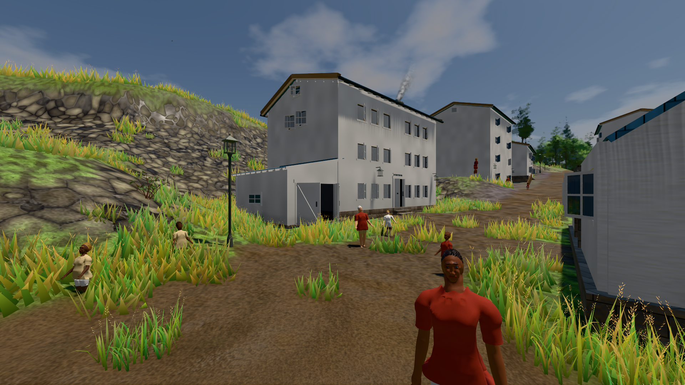
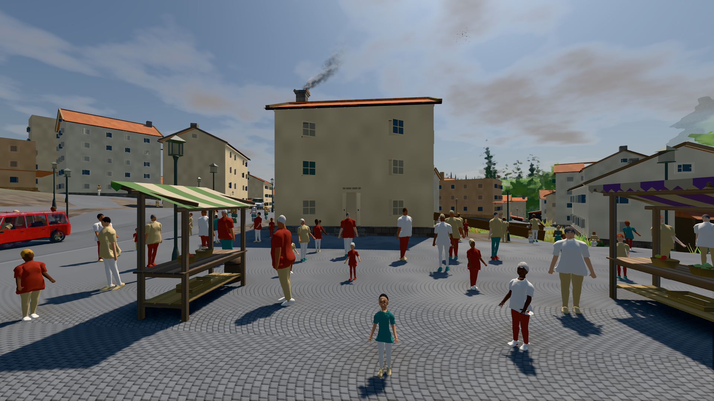

# GPU-PROBE 69faa000 — GRÜN

Zweig `blick-bewohner-satz` · Kopf 69faa000b1c36fd684fb3132c46e114ed22aa052 · Läufer gtx1050-desktop · 24.11. 03:42 · Wanduhr ab Push 1417 s · Lauf https://github.com/MiguellD/AnazhRealm/actions/runs/45311453621

Ruf: `bild:dorf@0.5 bild:stadt-voll@0.42 gate:webgl-probe`

## Läufer gtx1050-desktop — GRÜN

GPU NVIDIA GeForce GTX 1050 · node_modules bleiben (package-lock c7645867)
Schloss /c/Users/User/AppData/Local/Temp/claude/gpu-schloss hält „ci-runner 45311453621/1 probe“
- Hook 2026-11-24 03:23:13 start ci-runner 45311453621/1 probe: wartet auf Schloss von 'hand front-stoff (Claude)'
- Hook 2026-11-24 03:23:28 start ci-runner 45311453621/1 probe: Schloss genommen (refs/heads/blick-bewohner-satz 69faa000b1c36fd684fb3132c46e114ed22aa052 ws=C:\actions-runner\_work\AnazhRealm\AnazhRealm)

### bild:dorf@0.5 — GRÜN · 166 s · Läufer gtx1050-desktop

Adapter: [linse-gpu] nvidia/pascal

```text
Kamera des Spiels → Blick (12.9 m): -715.86 49.01 -932.69 -702.99 49.01 -931.86
 "abnahme": "ABNAHME GRÜN · beweis · Sicht 0.0 % · Leib im Vordergrund 3.1 % (Leib bewohner 3.1 %) · Leiber näher als 6 m: 1 von 1 ganz (6 Teile) · Ziel Blickziel im Bild frei 12.9 m · Luma 93.9 σ 31.3 schwarz 0.1 % weiß 0.0 % · Stand 18.546.388 · Bühne summer sunny 0.50 Tiere gehalten · Gerät WebGPU nvidia pascal · Inhalt bauSatz 20.4 % (≥ 2.0 %) Luma 95",
```



### bild:stadt-voll@0.42 — GRÜN · 317 s · Läufer gtx1050-desktop

Adapter: [linse-gpu] nvidia/pascal

```text
Kamera des Spiels → Blick (14.9 m): 842.49 57.57 451.79 857.31 57.57 450.33
 "abnahme": "ABNAHME GRÜN · beweis · Sicht 0.0 % · Leib im Vordergrund 2.6 % (Leib bewohner 2.6 %) · Leiber näher als 6 m: 2 von 2 ganz (16 Teile) · Ziel Blickziel im Bild frei 14.89 m · Luma 111.6 σ 43.8 schwarz 0.1 % weiß 0.0 % · Stand 18.546.388 · Bühne summer sunny 0.42 Tiere gehalten · Gerät WebGPU nvidia pascal · Inhalt bauSatz 23.2 % (≥ 2.0 %) Luma 86, bewohner 5.7 % (≥ 1.0 %) Luma 84",
```



### gate:webgl-probe — GRÜN · 119 s · Läufer gtx1050-desktop

Adapter: [linse-gpu] webgl2/NVIDIA GeForce GTX 1050 (0x00001C81) Direct3D11 vs_5_0 ps_5_0

```text
✅ GRÜN — die Kein-WebGPU-Geschichte ist BEWIESEN: der erzwungene WebGL2-Rückfall bootet eine LEBENDE, sichtbare Welt; die WGSL-Konsumenten + Bundles ruhen hinter der EINEN Backend-Wand, der Rückfall ist LAUT benannt, der Fern-Ring trägt auf CPU.
```
