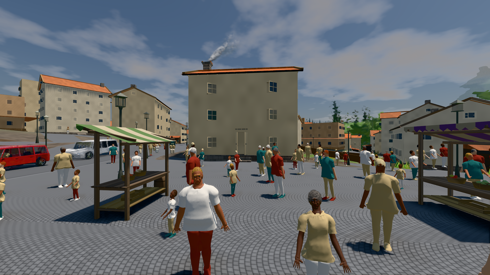
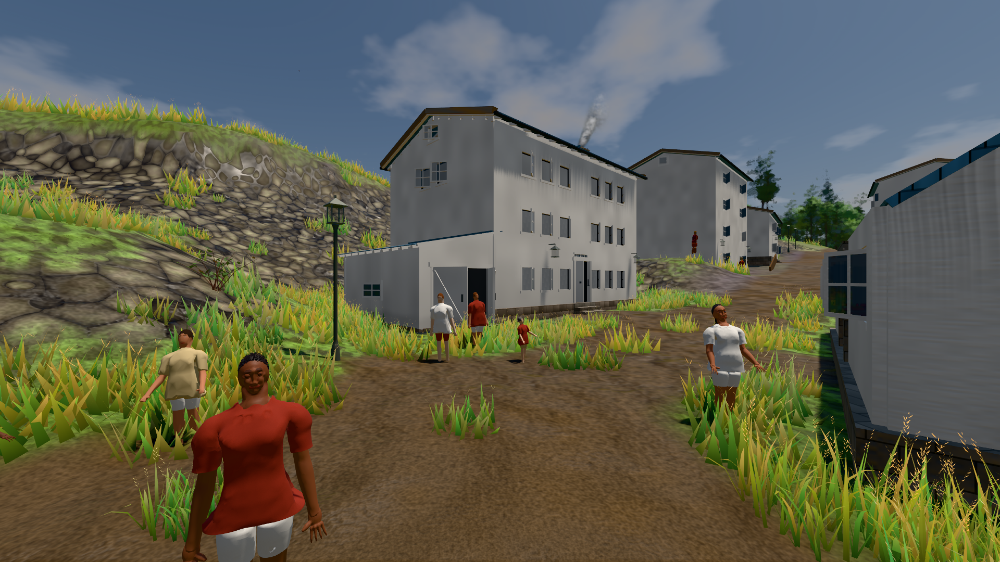

# GPU-PROBE 2e5e3299 — GRÜN

Zweig `blick-front-stoff` · Kopf 2e5e329940857b899e13bc87fad17a72f3c6a51c · Läufer gtx1050-desktop · 24.11. 03:23 · Wanduhr ab Push 1170 s · Lauf https://github.com/MiguellD/AnazhRealm/actions/runs/45309580103

Ruf: `bild:stadt-voll@0.5 bild:dorf@0.5 gate:webgl-probe`

## Läufer gtx1050-desktop — GRÜN

GPU NVIDIA GeForce GTX 1050 · npm ci 62 s (package-lock c7645867)
Schloss /c/Users/User/AppData/Local/Temp/claude/gpu-schloss hält „ci-runner 45309580103/1 probe“
- Hook 2026-11-24 03:09:07 start ci-runner 45309580103/1 probe: wartet auf Schloss von 'hand front-stoff (Claude)'
- Hook 2026-11-24 03:09:38 start ci-runner 45309580103/1 probe: Schloss genommen (refs/heads/blick-front-stoff 2e5e329940857b899e13bc87fad17a72f3c6a51c ws=C:\actions-runner\_work\AnazhRealm\AnazhRealm)

### bild:stadt-voll@0.5 — GRÜN · 336 s · Läufer gtx1050-desktop

Adapter: [linse-gpu] nvidia/pascal

```text
Kamera des Spiels → Blick (14.9 m): 842.49 57.57 451.79 857.31 57.57 450.33
 "abnahme": "ABNAHME GRÜN · beweis · Sicht 0.0 % · Leib im Vordergrund 7.5 % (Leib bewohner 7.5 %) · Leiber näher als 6 m: 3 von 3 ganz (23 Teile) · Ziel Blickziel im Bild frei 14.89 m · Luma 105.3 σ 36.3 schwarz 0.1 % weiß 0.0 % · Stand 18.546.388 · Bühne summer sunny 0.50 Tiere gehalten · Gerät WebGPU nvidia pascal · Inhalt bauSatz 23.0 % (≥ 2.0 %) Luma 97, bewohner 9.9 % (≥ 1.0 %) Luma 105",
```



### bild:dorf@0.5 — GRÜN · 170 s · Läufer gtx1050-desktop

Adapter: [linse-gpu] nvidia/pascal

```text
Kamera des Spiels → Blick (12.9 m): -715.86 49.01 -932.69 -702.99 49.01 -931.86
 "abnahme": "ABNAHME GRÜN · beweis · Sicht 0.0 % · Leib im Vordergrund 4.0 % (Leib bewohner 4.0 %) · Leiber näher als 6 m: 1 von 1 ganz (7 Teile) · Ziel Blickziel im Bild frei 12.9 m · Luma 94.4 σ 30.4 schwarz 0.1 % weiß 0.0 % · Stand 18.546.388 · Bühne summer sunny 0.50 Tiere gehalten · Gerät WebGPU nvidia pascal · Inhalt bauSatz 20.2 % (≥ 2.0 %) Luma 95",
```



### gate:webgl-probe — GRÜN · 110 s · Läufer gtx1050-desktop

Adapter: [linse-gpu] webgl2/NVIDIA GeForce GTX 1050 (0x00001C81) Direct3D11 vs_5_0 ps_5_0

```text
✅ GRÜN — die Kein-WebGPU-Geschichte ist BEWIESEN: der erzwungene WebGL2-Rückfall bootet eine LEBENDE, sichtbare Welt; die WGSL-Konsumenten + Bundles ruhen hinter der EINEN Backend-Wand, der Rückfall ist LAUT benannt, der Fern-Ring trägt auf CPU.
```
