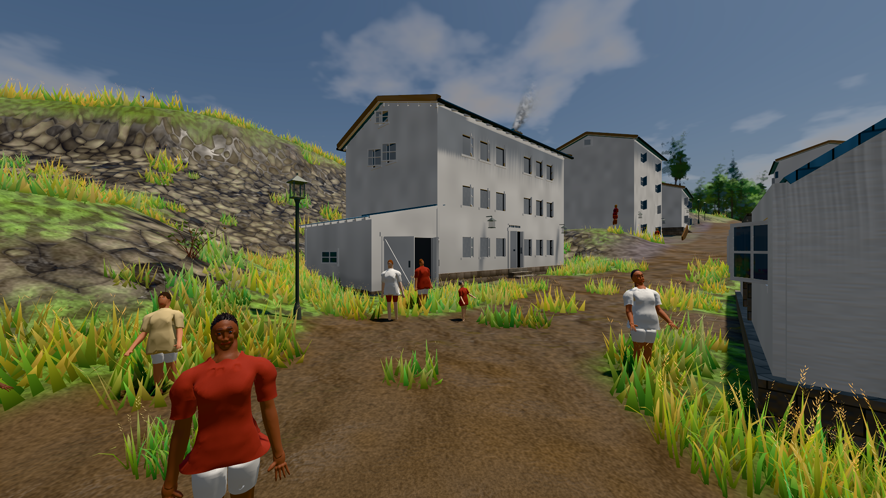
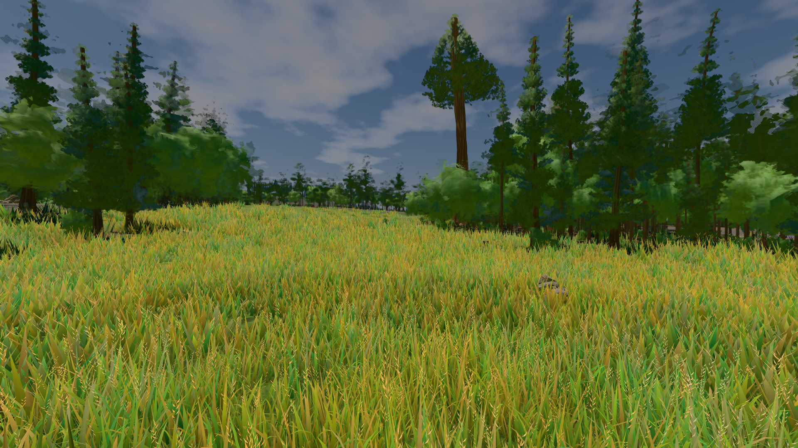

# GPU-PROBE b5a01590 — GRÜN

Zweig `blick-wetter-am-ort-2` · Kopf b5a015907c0014f5dfcaff74762982bf03baa23a · Läufer radeon-890m · 24.11. 01:29 · Wanduhr ab Push 599 s · Lauf https://github.com/MiguellD/AnazhRealm/actions/runs/45296271347

Ruf: `bild:dorf@0.5 bild:wiese@0.5 gate:webgl-probe`

## Läufer radeon-890m — GRÜN

GPU AMD Radeon(TM) 890M Graphics · npm ci 162 s (package-lock e2430794)
Schloss /c/Users/micha/AppData/Local/Temp/claude/gpu-schloss hält „ci-runner 45296271347/1 probe“
- Hook 2026-11-24 01:21:43 start ci-runner 45296271347/1 probe: Schloss genommen (refs/heads/blick-wetter-am-ort-2 b5a015907c0014f5dfcaff74762982bf03baa23a ws=C:\actions-runner\_work\AnazhRealm\AnazhRealm)

### bild:dorf@0.5 — GRÜN · 78 s · Läufer radeon-890m

Adapter: [linse-gpu] amd/rdna-3

```text
Kamera des Spiels → Blick (12.9 m): -715.86 49.01 -932.69 -702.99 49.01 -931.86
 "abnahme": "ABNAHME GRÜN · beweis · Sicht 0.0 % · Leib im Vordergrund 3.8 % (Leib bewohner 3.8 %) · Leiber näher als 6 m: 1 von 1 ganz (7 Teile) · Ziel Blickziel im Bild frei 12.9 m · Luma 94.4 σ 30.6 schwarz 0.1 % weiß 0.0 % · Stand 18.546.387 · Bühne summer sunny 0.50 Tiere gehalten · Gerät WebGPU amd rdna-3 · Inhalt bauSatz 20.2 % (≥ 2.0 %) Luma 95",
```



### bild:wiese@0.5 — GRÜN · 50 s · Läufer radeon-890m

Adapter: [linse-gpu] amd/rdna-3

```text
Kamera des Spiels → Blick (10.0 m): -280.40 29.71 -1045.60 -289.61 29.71 -1049.50
 "abnahme": "ABNAHME GRÜN · beweis · Sicht 0.0 % · Ziel Blickziel im Bild frei 10 m · Luma 99.2 σ 35.6 schwarz 0.0 % weiß 0.0 % · Stand 18.546.387 · Bühne summer sunny 0.50 Tiere gehalten · Gerät WebGPU amd rdna-3 · Inhalt nahWiese 48.5 % (≥ 15.0 %) h 107° Luma 123",
```



### gate:webgl-probe — GRÜN · 47 s · Läufer radeon-890m

Adapter: [linse-gpu] webgl2/AMD Radeon(TM) 890M Graphics (0x0000150E) Direct3D11 vs_5_0 ps_5_0

```text
✅ GRÜN — die Kein-WebGPU-Geschichte ist BEWIESEN: der erzwungene WebGL2-Rückfall bootet eine LEBENDE, sichtbare Welt; die WGSL-Konsumenten + Bundles ruhen hinter der EINEN Backend-Wand, der Rückfall ist LAUT benannt, der Fern-Ring trägt auf CPU.
```
