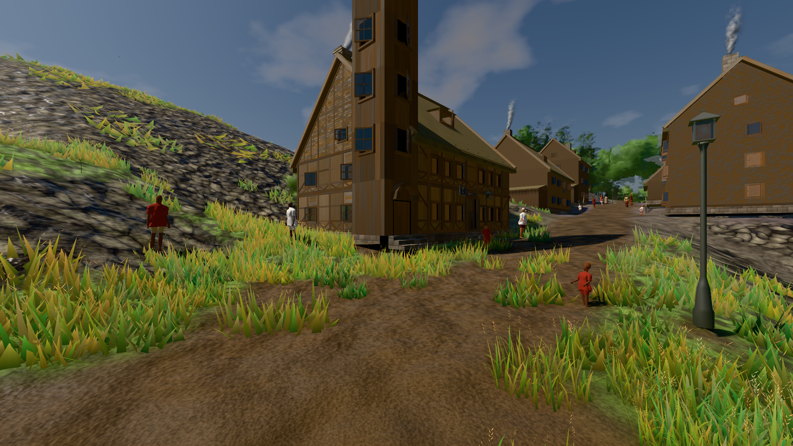
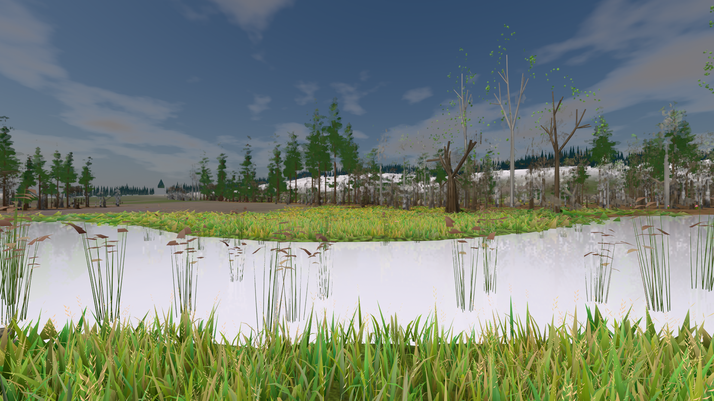

# GPU-PROBE b5ffb77f — GRÜN

Zweig `boden-korn-kopf2` · Kopf b5ffb77fe97959c7dd43574cc6f4462862c509fe · Läufer radeon-890m · 27.11. 20:03 · Wanduhr ab Push 894 s · Lauf https://github.com/MiguellD/AnazhRealm/actions/runs/46052137916

Ruf: `gate:webgl-probe bild:dorf@0.5 bild:ufer@0.5`

## Läufer radeon-890m — GRÜN

GPU AMD Radeon(TM) 890M Graphics · node_modules bleiben (package-lock e497fad1)
Schloss /c/Users/micha/AppData/Local/Temp/claude/gpu-schloss hält „ci-runner 46052137916/2 probe“
- Hook 2026-11-27 19:57:18 start ci-runner 46052137916/2 probe: wartet auf Schloss von ''
- Hook 2026-11-27 19:57:36 start ci-runner 46052137916/2 probe: Schloss genommen (refs/heads/boden-korn-kopf2 b5ffb77fe97959c7dd43574cc6f4462862c509fe ws=C:\actions-runner\_work\AnazhRealm\AnazhRealm)

### gate:webgl-probe — GRÜN · 65 s · Läufer radeon-890m

Adapter: [linse-gpu] webgl2/AMD Radeon(TM) 890M Graphics (0x0000150E) Direct3D11 vs_5_0 ps_5_0

```text
✅ GRÜN — die Kein-WebGPU-Geschichte ist BEWIESEN: der erzwungene WebGL2-Rückfall bootet eine LEBENDE, sichtbare Welt; die WGSL-Konsumenten + Bundles ruhen hinter der EINEN Backend-Wand, der Rückfall ist LAUT benannt, der Fern-Ring trägt auf CPU.
```

### bild:dorf@0.5 — GRÜN · 93 s · Läufer radeon-890m

Adapter: [linse-gpu] amd/rdna-3

```text
Kamera des Spiels → Blick (11.3 m): -720.31 44.15 -922.46 -709.17 44.15 -920.56
 "abnahme": "ABNAHME GRÜN · beweis · Sicht 0.0 % · Ziel Blickziel im Bild frei 11.3 m · Luma 81.8 σ 29.6 schwarz 0.4 % weiß 0.0 % · Stand 18.546.456 · Bühne summer sunny 0.50 Tiere gehalten · Gerät WebGPU amd rdna-3 · Inhalt bauSatz 17.0 % (≥ 2.0 %) Luma 60",
```



### bild:ufer@0.5 — GRÜN · 53 s · Läufer radeon-890m

Adapter: [linse-gpu] amd/rdna-3

```text
Kamera des Spiels → Blick (39.1 m): -118.00 24.33 -838.00 -91.79 24.33 -808.99
 "abnahme": "ABNAHME GRÜN · beweis · Sicht 0.0 % · Ziel Blickziel im Bild frei 39.1 m · Luma 129.8 σ 51.5 schwarz 0.0 % weiß 0.0 % · Stand 18.546.456 · Bühne spring sunny 0.50 Tiere gehalten · Gerät WebGPU amd rdna-3 · Inhalt nahWiese 21.8 % (≥ 5.0 %) h 114° Luma 135, wasserSatz 21.7 % (≥ 2.0 %) Luma 213",
```


