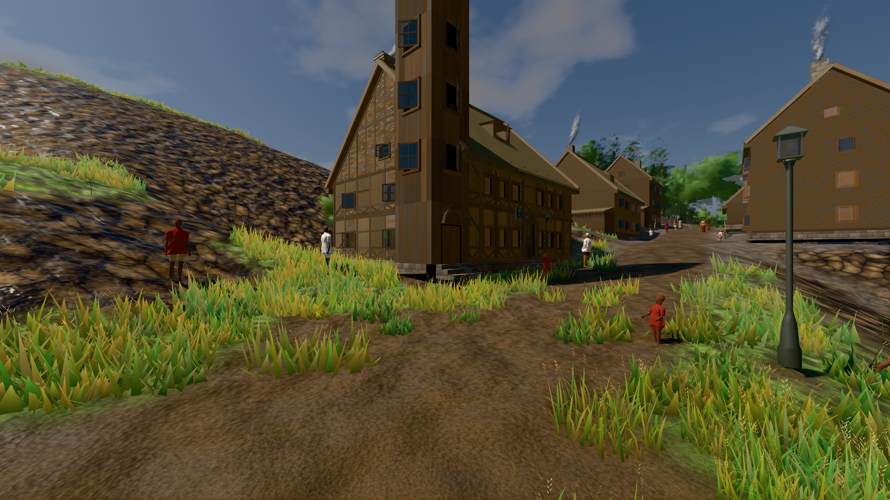
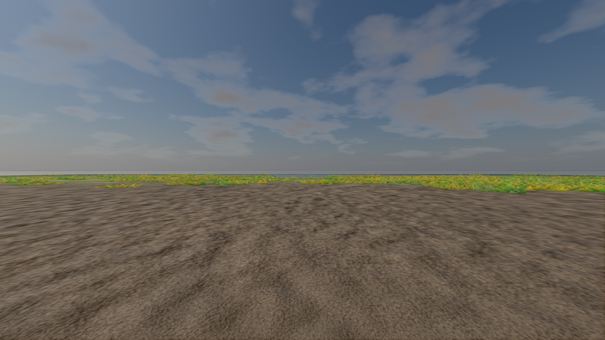

# GPU-PROBE 08e47d8b — ROT

Zweig `boden-korn` · Kopf 08e47d8bcce1b5e924872954720f4412c26a61da · Läufer gtx1050-desktop · 27.11. 22:01 · Wanduhr ab Push 1022 s · Lauf https://github.com/MiguellD/AnazhRealm/actions/runs/46065675653

Ruf: `gate:webgl-probe bild:dorf@0.5 bild:buehne@0.5 gate:hoehlen-sicht`

## Läufer gtx1050-desktop — ROT

GPU NVIDIA GeForce GTX 1050 · npm ci 45 s (package-lock 23a52b43)
Schloss /c/Users/User/AppData/Local/Temp/claude/gpu-schloss hält „ci-runner 46065675653/1 probe“
- Hook 2026-11-27 21:50:11 start ci-runner 46065675653/1 probe: Schloss genommen (refs/heads/boden-korn 08e47d8bcce1b5e924872954720f4412c26a61da ws=C:\actions-runner\_work\AnazhRealm\AnazhRealm)

### gate:webgl-probe — GRÜN · 145 s · Läufer gtx1050-desktop

Adapter: [linse-gpu] webgl2/NVIDIA GeForce GTX 1050 (0x00001C81) Direct3D11 vs_5_0 ps_5_0

```text
✅ GRÜN — die Kein-WebGPU-Geschichte ist BEWIESEN: der erzwungene WebGL2-Rückfall bootet eine LEBENDE, sichtbare Welt; die WGSL-Konsumenten + Bundles ruhen hinter der EINEN Backend-Wand, der Rückfall ist LAUT benannt, der Fern-Ring trägt auf CPU.
```

### bild:dorf@0.5 — GRÜN · 217 s · Läufer gtx1050-desktop

Adapter: [linse-gpu] nvidia/pascal

```text
Kamera des Spiels → Blick (11.3 m): -720.31 44.15 -922.46 -709.17 44.15 -920.56
 "abnahme": "ABNAHME GRÜN · beweis · Sicht 0.0 % · Ziel Blickziel im Bild frei 11.3 m · Luma 79.9 σ 29.9 schwarz 0.4 % weiß 0.0 % · Stand 18.546.458 · Bühne summer sunny 0.50 Tiere gehalten · Gerät WebGPU nvidia pascal · Inhalt bauSatz 17.0 % (≥ 2.0 %) Luma 60",
```



### bild:buehne@0.5 — ROT · 62 s · Läufer gtx1050-desktop

Adapter: [linse-gpu] nvidia/pascal · "fehler": "ABNAHME ROT [Ziel Blickziel verdeckt von an Punkt 1 Gelände in 26.57 m] · beweis · Sicht 0.0 % · Ziel Blickziel im Bild VERDECKT 120 m · Luma 106.7 σ 20.6 schwarz 0.0 % weiß 0.0 % · Stand 18.546.458 · Bühne su

```text
Kamera des Spiels → Blick (120.0 m): 300.00 11.46 0.00 420.00 11.46 0.00
 "fehler": "ABNAHME ROT [Ziel Blickziel verdeckt von an Punkt 1 Gelände in 26.57 m] · beweis · Sicht 0.0 % · Ziel Blickziel im Bild VERDECKT 120 m · Luma 106.7 σ 20.6 schwarz 0.0 % weiß 0.0 % · Stand 18.546.458 · Bühne summer sunny 0.50 Tiere gehalten · Gerät WebGPU nvidia pascal · Inhalt bodenSatz 46.0 % (≥ 10.0 %) Luma 93 · ROT-Bild C:\\actions-runner\\_work\\_temp\\probe\\08e47d8b-buehne-0.5-rot.png",
```



### gate:hoehlen-sicht — GRÜN · 145 s · Läufer gtx1050-desktop

Adapter: ungenannt (die Probe nannte keinen Browser-Adapter)

```text
  ✅ Selbsttest „Boden-Stoff ohne Klima" → rot: LESER OHNE KLIMA: der Boden-Stoff `_bodenFarbeAt` (stamm/gelaende-boden.js) färbt 120 von 123 Pfad-Punkten am Ort der Terra rossa wie in der Heimat — er liest die Palette des Studios statt der Erde des Orts (`ortErde`)
  ✅ Selbsttest „Ohne Pfad" → rot: LEER: (p) Leser: kein Pfad-Punkt (`_pathFieldAt` > 0,3) im Feld — der Boden-Stoff prüfte nichts
  ✅ Selbsttest „Ohne Erde des Klimas" → rot: LEER: (p) Erde des Klimas: das Gesetz trägt keine Erde des Orts (gelaende-core `ortErde` fehlt)
  ✅ Selbsttest „Graph bricht" → rot: CODE: der Boden-Stoff baut keinen Graph (x) — die Proben (f) messen nichts
  ✅ Selbsttest „Eigene Ziehung" → rot: CODE: der Detail-Term (`_terrainGeologyAlbedo`) rechnet nicht das Gesetz (eigene Ziehung fract(sin)) — im Shader fährt ein Zwilling
  ✅ Selbsttest „Kante nach Metern (main e71f2721)" → rot: KANTE NACH METERN: der Farb-Graph des Chunk-Stoffs trägt keine Pixel-Sicht der Fels-Kante (`_terrainGeologyAlbedo`, `_anazhPixelSicht` „kante“) — die Kante der Fuge (0,08 m) blendet nur nach Metern, ein Pixel trägt sie ganz: der Stein funkelt hell und dunkel je Pixel (w28-funkeln, 65010917 `bild:dorf@0.42`)
  ✅ Selbsttest „Kante ohne Schirm" → rot: KANTE OHNE SCHIRM: 1 Pixel-Sicht(en) der Fels-Kante lesen die Schirm-Größe nicht (`screenSize`) — die Sicht folgt nicht dem Pixel
  ✅ Selbsttest „Rechenwerk falsch" → rot: RECHENWERK: das TSL-Rechenwerk (`_felsRechenwerkTSL`) rechnet nicht das Gesetz — max. Abstand 0.31 an 400 Punkten
✅ SELBSTTEST GRÜN — jeder injizierte Täter fällt rot und wird beim Namen genannt.
✅ GRÜN — HÖHLEN-SICHT — jede sichtbare Höhlen-Fläche steht im Abschnitt, kein Licht-Leck, Main = Worker.
```
