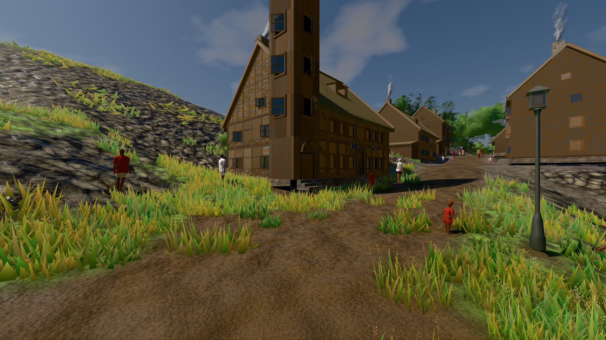
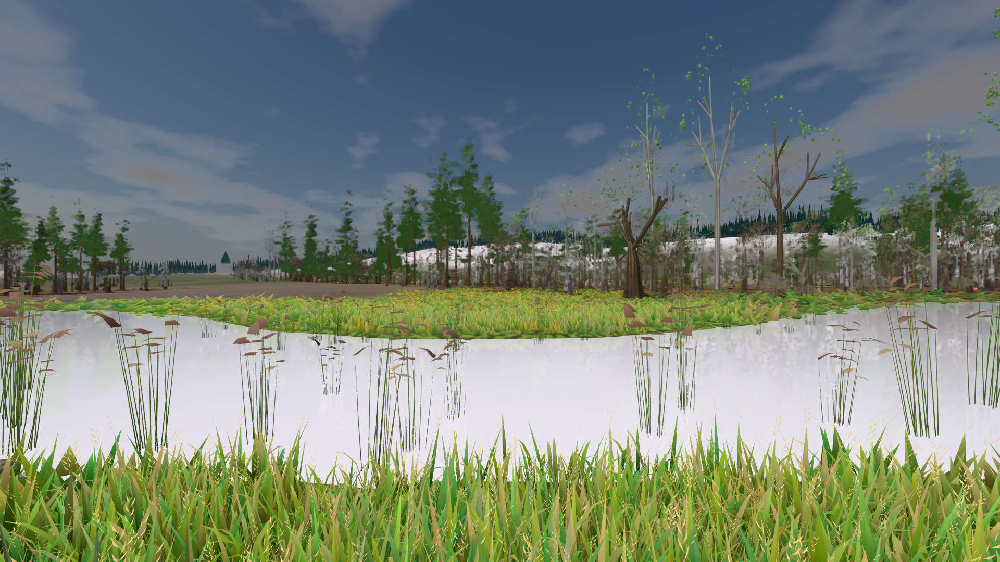

# GPU-PROBE 14c43592 — GRÜN

Zweig `boden-korn` · Kopf 14c4359298a0dae00764432e225a8e39aa334fcd · Läufer gtx1050-desktop · 27.11. 15:35 · Wanduhr ab Push 2309 s · Lauf https://github.com/MiguellD/AnazhRealm/actions/runs/46011529073

Ruf: `gate:webgl-probe bild:dorf@0.5 bild:ufer@0.5`

## Läufer gtx1050-desktop — GRÜN

GPU NVIDIA GeForce GTX 1050 · node_modules bleiben (package-lock a873c59e)
Schloss /c/Users/User/AppData/Local/Temp/claude/gpu-schloss hält „ci-runner 46011529073/1 probe“
- Hook 2026-11-27 15:06:39 start ci-runner 46011529073/1 probe: Schloss genommen (refs/heads/boden-korn 14c4359298a0dae00764432e225a8e39aa334fcd ws=C:\actions-runner\_work\AnazhRealm\AnazhRealm)

### gate:webgl-probe — GRÜN · 119 s · Läufer gtx1050-desktop

Adapter: [linse-gpu] webgl2/NVIDIA GeForce GTX 1050 (0x00001C81) Direct3D11 vs_5_0 ps_5_0

```text
✅ GRÜN — die Kein-WebGPU-Geschichte ist BEWIESEN: der erzwungene WebGL2-Rückfall bootet eine LEBENDE, sichtbare Welt; die WGSL-Konsumenten + Bundles ruhen hinter der EINEN Backend-Wand, der Rückfall ist LAUT benannt, der Fern-Ring trägt auf CPU.
```

### bild:dorf@0.5 — GRÜN · 214 s · Läufer gtx1050-desktop

Adapter: [linse-gpu] nvidia/pascal

```text
Kamera des Spiels → Blick (11.3 m): -720.31 44.15 -922.46 -709.17 44.15 -920.56
 "abnahme": "ABNAHME GRÜN · beweis · Sicht 0.0 % · Ziel Blickziel im Bild frei 11.3 m · Luma 81.7 σ 29.7 schwarz 0.4 % weiß 0.0 % · Stand 18.546.453 · Bühne summer sunny 0.50 Tiere gehalten · Gerät WebGPU nvidia pascal · Inhalt bauSatz 17.0 % (≥ 2.0 %) Luma 60",
```



### bild:ufer@0.5 — GRÜN · 105 s · Läufer gtx1050-desktop

Adapter: [linse-gpu] nvidia/pascal

```text
Kamera des Spiels → Blick (39.1 m): -118.00 24.33 -838.00 -91.79 24.33 -808.99
 "abnahme": "ABNAHME GRÜN · beweis · Sicht 0.0 % · Ziel Blickziel im Bild frei 39.1 m · Luma 130.6 σ 50.8 schwarz 0.0 % weiß 0.0 % · Stand 18.546.453 · Bühne spring sunny 0.50 Tiere gehalten · Gerät WebGPU nvidia pascal · Inhalt nahWiese 23.0 % (≥ 5.0 %) h 114° Luma 139, wasserSatz 21.2 % (≥ 2.0 %) Luma 213",
```


