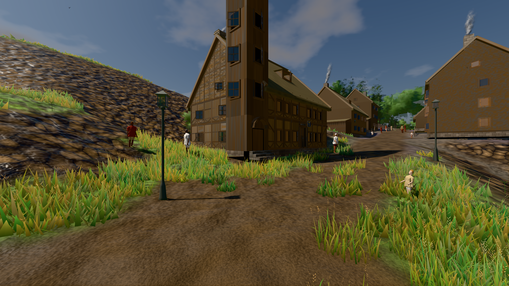
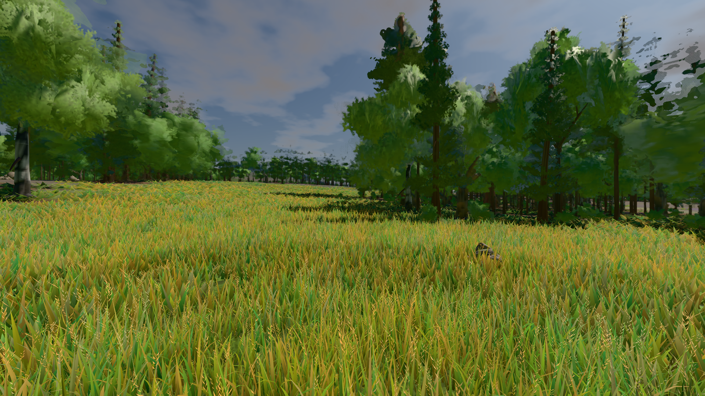

# GPU-PROBE 60d1bce3 — GRÜN

Zweig `boden-korn` · Kopf 60d1bce336613c58574a681de7e155cc60b28eed · Läufer omen-gtx1060 · 28.11. 04:53 · Wanduhr ab Push 875 s · Lauf https://github.com/MiguellD/AnazhRealm/actions/runs/46103851828

Ruf: `gate:webgl-probe bild:dorf@0.5 bild:wiese@0.5 gate:hoehlen-sicht`

## Läufer omen-gtx1060 — GRÜN

GPU NVIDIA GeForce GTX 1060 · npm ci 52 s (package-lock 7f3f9045)
Schloss /c/Users/micha/AppData/Local/Temp/claude/gpu-schloss hält „ci-runner 46103851828/1 probe“
- Hook 2026-11-28 04:40:32 start ci-runner 46103851828/1 probe: Schloss genommen (refs/heads/boden-korn 60d1bce336613c58574a681de7e155cc60b28eed ws=C:\actions-runner\_work\AnazhRealm\AnazhRealm)

### gate:webgl-probe — GRÜN · 56 s · Läufer omen-gtx1060

Adapter: [linse-gpu] webgl2/NVIDIA GeForce GTX 1060 (0x00001C60) Direct3D11 vs_5_0 ps_5_0

```text
✅ GRÜN — die Kein-WebGPU-Geschichte ist BEWIESEN: der erzwungene WebGL2-Rückfall bootet eine LEBENDE, sichtbare Welt; die WGSL-Konsumenten + Bundles ruhen hinter der EINEN Backend-Wand, der Rückfall ist LAUT benannt, der Fern-Ring trägt auf CPU.
```

### bild:dorf@0.5 — GRÜN · 96 s · Läufer omen-gtx1060

Adapter: [linse-gpu] nvidia/pascal

```text
Kamera des Spiels → Blick (11.3 m): -720.31 44.15 -922.46 -709.17 44.15 -920.56
 "abnahme": "ABNAHME GRÜN · beweis · Sicht 0.0 % · Ziel Blickziel im Bild frei 11.3 m · Luma 80.1 σ 30 schwarz 0.4 % weiß 0.0 % · Stand 18.546.465 · Bühne summer sunny 0.50 Tiere gehalten · Gerät WebGPU nvidia pascal · Inhalt bauSatz 17.0 % (≥ 2.0 %) Luma 59",
```



### bild:wiese@0.5 — GRÜN · 54 s · Läufer omen-gtx1060

Adapter: [linse-gpu] nvidia/pascal

```text
Kamera des Spiels → Blick (10.0 m): -280.40 29.71 -1045.60 -289.61 29.71 -1049.50
 "abnahme": "ABNAHME GRÜN · beweis · Sicht 0.0 % · Ziel Blickziel im Bild frei 10 m · Luma 99 σ 37.1 schwarz 0.0 % weiß 0.0 % · Stand 18.546.465 · Bühne summer sunny 0.50 Tiere gehalten · Gerät WebGPU nvidia pascal · Inhalt nahWiese 48.2 % (≥ 15.0 %) h 106° Luma 117",
```



### gate:hoehlen-sicht — GRÜN · 92 s · Läufer omen-gtx1060

Adapter: ungenannt (die Probe nannte keinen Browser-Adapter)

```text
  ✅ Selbsttest „Boden-Stoff ohne Klima" → rot: LESER OHNE KLIMA: der Boden-Stoff `_bodenFarbeAt` (stamm/gelaende-boden.js) färbt 120 von 123 Pfad-Punkten am Ort der Terra rossa wie in der Heimat — er liest die Palette des Studios statt der Erde des Orts (`ortErde`)
  ✅ Selbsttest „Ohne Pfad" → rot: LEER: (p) Leser: kein Pfad-Punkt (`_pathFieldAt` > 0,3) im Feld — der Boden-Stoff prüfte nichts
  ✅ Selbsttest „Ohne Erde des Klimas" → rot: LEER: (p) Erde des Klimas: das Gesetz trägt keine Erde des Orts (gelaende-core `ortErde` fehlt)
  ✅ Selbsttest „Graph bricht" → rot: CODE: der Boden-Stoff baut keinen Graph (x) — die Proben (f) messen nichts
  ✅ Selbsttest „Eigene Ziehung" → rot: CODE: der Detail-Term (`_terrainGeologyAlbedo`) rechnet nicht das Gesetz (eigene Ziehung fract(sin)) — im Shader fährt ein Zwilling
  ✅ Selbsttest „Kante nach Metern (main e71f2721)" → rot: KANTE NACH METERN: der Farb-Graph des Chunk-Stoffs trägt keine Pixel-Sicht der Fels-Kante (`_terrainGeologyAlbedo`, `_anazhPixelSicht` „kante“) — die Kante der Fuge (0,08 m) blendet nur nach Metern, ein Pixel trägt sie ganz: der Stein funkelt hell und dunkel je Pixel (w28-funkeln, 65010917 `bild:dorf@0.42`)
  ✅ Selbsttest „Kante ohne Schirm" → rot: KANTE OHNE SCHIRM: 1 Pixel-Sicht(en) der Fels-Kante lesen die Schirm-Größe nicht (`screenSize`) — die Sicht folgt nicht dem Pixel
  ✅ Selbsttest „Rechenwerk falsch" → rot: RECHENWERK: das TSL-Rechenwerk (`_felsRechenwerkTSL`) rechnet nicht das Gesetz — max. Abstand 0.31 an 400 Punkten
✅ SELBSTTEST GRÜN — jeder injizierte Täter fällt rot und wird beim Namen genannt.
✅ GRÜN — HÖHLEN-SICHT — jede sichtbare Höhlen-Fläche steht im Abschnitt, kein Licht-Leck, Main = Worker.
```
