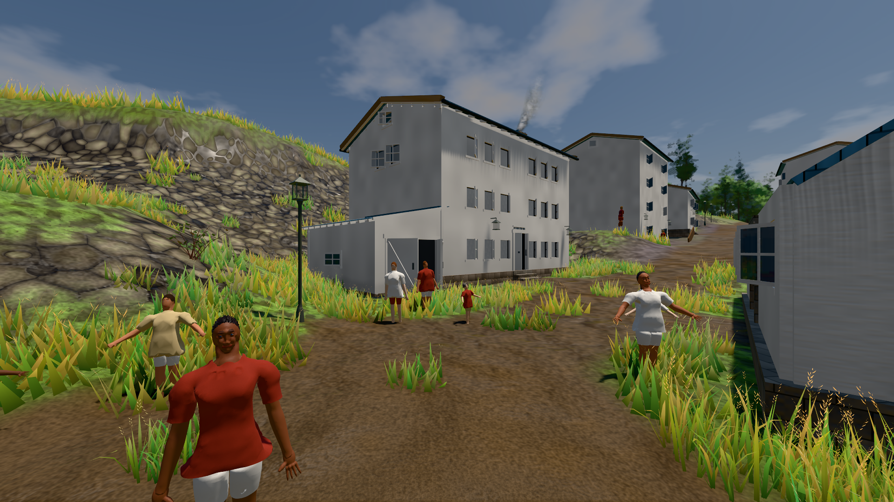

# GPU-PROBE 588d607b — GRÜN

Zweig `echt-ein-bein` · Kopf 588d607bf4b563523da1fb36f958c63c8ee67b7b · Läufer gtx1050-desktop · 23.11. 23:05 · Wanduhr ab Push 405 s · Lauf https://github.com/MiguellD/AnazhRealm/actions/runs/45275141671

Ruf: `bild:dorf@0.5 gate:webgl-probe`

## Läufer gtx1050-desktop — GRÜN

GPU NVIDIA GeForce GTX 1050 · node_modules bleiben (package-lock 1709300b)
Schloss /c/Users/User/AppData/Local/Temp/claude/gpu-schloss hält „ci-runner 45275141671/1 probe“
- Hook 2026-11-23 22:59:29 start ci-runner 45275141671/1 probe: wartet auf Schloss von 'hand front-stoff (Claude)'
- Hook 2026-11-23 23:00:30 start ci-runner 45275141671/1 probe: Schloss genommen (refs/heads/echt-ein-bein 588d607bf4b563523da1fb36f958c63c8ee67b7b ws=C:\actions-runner\_work\AnazhRealm\AnazhRealm)

### bild:dorf@0.5 — GRÜN · 164 s · Läufer gtx1050-desktop

Adapter: [linse-gpu] nvidia/pascal

```text
Kamera des Spiels → Blick (12.9 m): -715.86 49.01 -932.69 -702.99 49.01 -931.86
 "abnahme": "ABNAHME GRÜN · beweis · Sicht 0.0 % · Leib im Vordergrund 3.8 % (Leib bewohner 3.8 %) · Leiber näher als 6 m: 1 von 1 ganz (7 Teile) · Ziel Blickziel im Bild frei 12.9 m · Luma 94.4 σ 30.8 schwarz 0.1 % weiß 0.0 % · Stand 18.546.386 · Bühne summer sunny 0.50 Tiere gehalten · Gerät WebGPU nvidia pascal · Inhalt bauSatz 20.2 % (≥ 2.0 %) Luma 96",
```



### gate:webgl-probe — GRÜN · 125 s · Läufer gtx1050-desktop

Adapter: [linse-gpu] webgl2/NVIDIA GeForce GTX 1050 (0x00001C81) Direct3D11 vs_5_0 ps_5_0

```text
✅ GRÜN — die Kein-WebGPU-Geschichte ist BEWIESEN: der erzwungene WebGL2-Rückfall bootet eine LEBENDE, sichtbare Welt; die WGSL-Konsumenten + Bundles ruhen hinter der EINEN Backend-Wand, der Rückfall ist LAUT benannt, der Fern-Ring trägt auf CPU.
```
