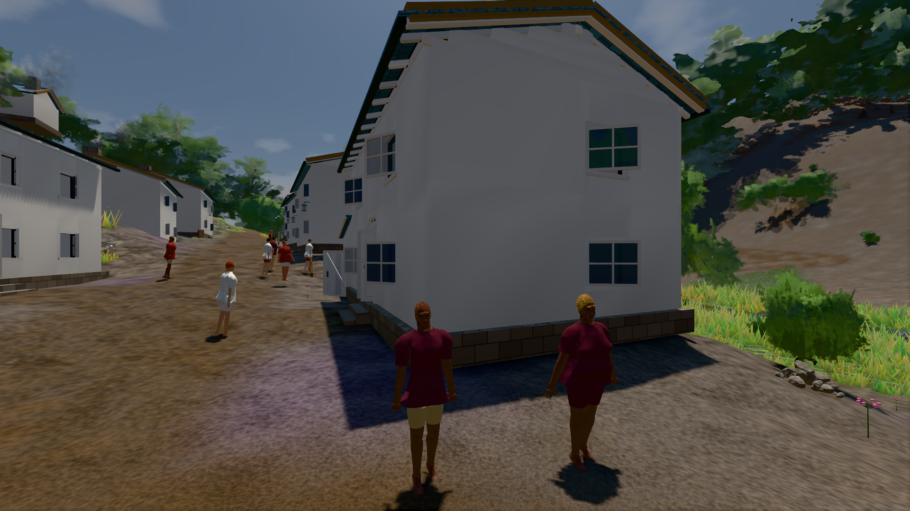

# GPU-PROBE c16c528c — GRÜN

Zweig `ein-schreiber-wand` · Kopf c16c528cc22507b535c11aef4536d1adb538cd7e · Läufer omen-gtx1060 · 20.11. 01:31 · Wanduhr ab Push 335 s · Lauf https://github.com/MiguellD/AnazhRealm/actions/runs/44645847269

Ruf: `bild:dorf@0.5`

## Läufer omen-gtx1060 — GRÜN

GPU NVIDIA GeForce GTX 1060 · npm ci 41 s (package-lock 20e3f8f6)
Schloss /c/Users/micha/AppData/Local/Temp/claude/gpu-schloss hält „ci-runner 44645847269/1 probe“
- Hook 2026-11-20 01:26:31 start ci-runner 44645847269/1 probe: wartet auf Schloss von 'omen-punkte-gtx-sitzung'
- Hook 2026-11-20 01:27:31 start ci-runner 44645847269/1 probe: Schloss genommen (refs/heads/ein-schreiber-wand c16c528cc22507b535c11aef4536d1adb538cd7e ws=C:\actions-runner\_work\AnazhRealm\AnazhRealm)

### bild:dorf@0.5 — GRÜN · 66 s · Läufer omen-gtx1060

Adapter: [linse-gpu] nvidia/pascal

```text
Kamera des Spiels → Blick (5.2 m): -704.22 39.69 -880.02 -703.01 39.69 -874.96
 "abnahme": "ABNAHME GRÜN · beweis · Sicht 0.0 % · Ziel Blickziel im Bild frei 5.2 m · Luma 75.8 σ 30.9 schwarz 0.2 % weiß 0.0 % · Stand 18.546.346 · Bühne summer sunny 0.50 Tiere gehalten · Gerät WebGPU nvidia pascal · Inhalt bauSatz 29.7 % (≥ 2.0 %) Luma 79",
```


