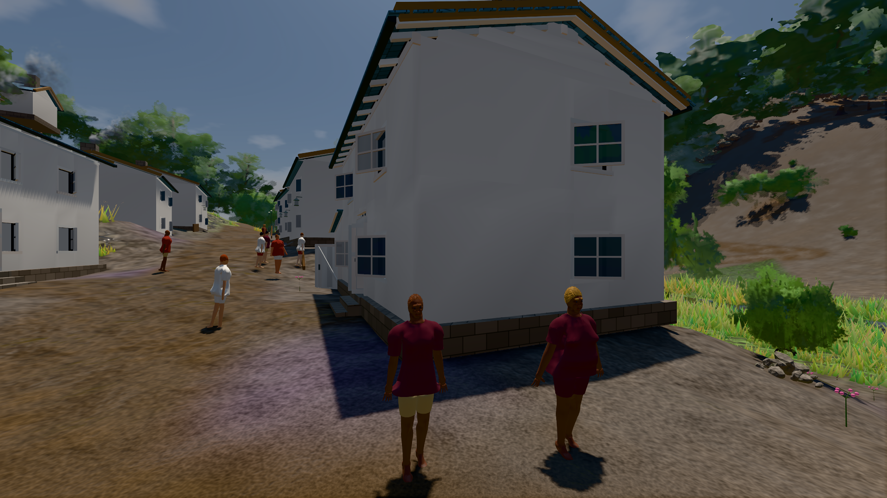

# GPU-PROBE c534b884 — GRÜN

Zweig `einheit-relief` · Kopf c534b88469c68b72cc27aa1401bb1bd1a93f93ed · Läufer omen-gtx1060 · 20.11. 03:25 · Wanduhr ab Push 447 s · Lauf https://github.com/MiguellD/AnazhRealm/actions/runs/44659833484

Ruf: `gate:haus-fern bild:dorf@0.5`

## Läufer omen-gtx1060 — GRÜN

GPU NVIDIA GeForce GTX 1060 · node_modules bleiben (package-lock 20e3f8f6)
Schloss /c/Users/micha/AppData/Local/Temp/claude/gpu-schloss hält „ci-runner 44659833484/1 probe“
- Hook 2026-11-20 03:19:01 start ci-runner 44659833484/1 probe: wartet auf Schloss von 'omen-samen-bild-neu'
- Hook 2026-11-20 03:19:16 start ci-runner 44659833484/1 probe: Schloss genommen (refs/heads/einheit-relief c534b88469c68b72cc27aa1401bb1bd1a93f93ed ws=C:\actions-runner\_work\AnazhRealm\AnazhRealm)

### gate:haus-fern — GRÜN · 253 s · Läufer omen-gtx1060

Adapter: ungenannt (die Probe nannte keinen Browser-Adapter)

```text
✅ GRÜN — jede Stufe wirft den grundriss-treuen Fernkörper, zeigt sich erst ≤ 1 px von der L0, kein Querfirst, der Körper liegt innen, jedes Türblatt sitzt an seinem Scharnier, jedes Fenster ist Glas in jeder Stufe.
```

### bild:dorf@0.5 — GRÜN · 68 s · Läufer omen-gtx1060

Adapter: [linse-gpu] nvidia/pascal

```text
Kamera des Spiels → Blick (5.2 m): -704.22 39.69 -880.02 -703.01 39.69 -874.96
 "abnahme": "ABNAHME GRÜN · beweis · Sicht 0.0 % · Ziel Blickziel im Bild frei 5.2 m · Luma 75.8 σ 30.9 schwarz 0.2 % weiß 0.0 % · Stand 18.546.346 · Bühne summer sunny 0.50 Tiere gehalten · Gerät WebGPU nvidia pascal · Inhalt bauSatz 29.7 % (≥ 2.0 %) Luma 79",
```


