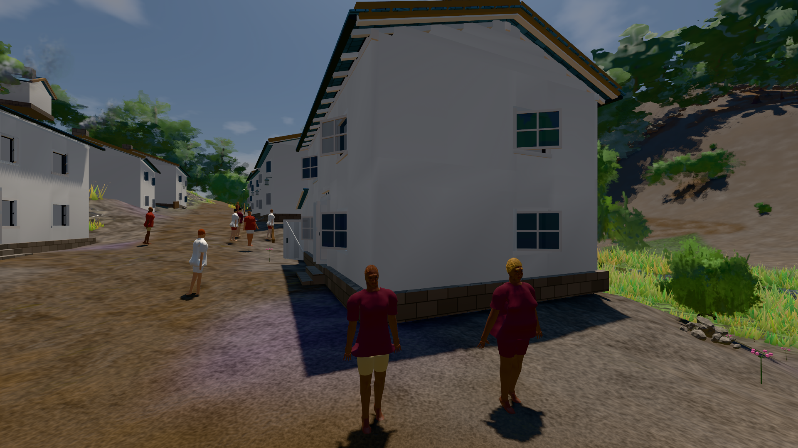

# GPU-PROBE cd583ea5 — GRÜN

Zweig `einheit-relief` · Kopf cd583ea57e105838b4f743fe09244b979814a9ae · Läufer radeon-890m · 20.11. 02:30 · Wanduhr ab Push 972 s · Lauf https://github.com/MiguellD/AnazhRealm/actions/runs/44652138480

Ruf: `gate:haus-fern bild:dorf@0.5`

## Läufer radeon-890m — GRÜN

GPU AMD Radeon(TM) 890M Graphics · node_modules bleiben (package-lock 20e3f8f6)
Schloss /c/Users/micha/AppData/Local/Temp/claude/gpu-schloss hält „ci-runner 44652138480/1 probe“
- Hook 2026-11-20 02:17:46 start ci-runner 44652138480/1 probe: wartet auf Schloss von 'laub-kante-4-paar 2026-11-20T02:17:23+01:00 pid=28244'
- Hook 2026-11-20 02:23:37 start ci-runner 44652138480/1 probe: Schloss genommen (refs/heads/einheit-relief cd583ea57e105838b4f743fe09244b979814a9ae ws=C:\actions-runner\_work\AnazhRealm\AnazhRealm)

### gate:haus-fern — GRÜN · 249 s · Läufer radeon-890m

Adapter: ungenannt (die Probe nannte keinen Browser-Adapter)

```text
✅ GRÜN — jede Stufe wirft den grundriss-treuen Fernkörper, zeigt sich erst ≤ 1 px von der L0, kein Querfirst, der Körper liegt innen, jedes Türblatt sitzt an seinem Scharnier, jedes Fenster ist Glas in jeder Stufe.
```

### bild:dorf@0.5 — GRÜN · 73 s · Läufer radeon-890m

Adapter: [linse-gpu] amd/rdna-3

```text
Kamera des Spiels → Blick (5.2 m): -704.22 39.69 -880.02 -703.01 39.69 -874.96
 "abnahme": "ABNAHME GRÜN · beweis · Sicht 0.0 % · Ziel Blickziel im Bild frei 5.2 m · Luma 76.1 σ 30.8 schwarz 0.2 % weiß 0.0 % · Stand 18.546.346 · Bühne summer sunny 0.50 Tiere gehalten · Gerät WebGPU amd rdna-3 · Inhalt bauSatz 29.7 % (≥ 2.0 %) Luma 80",
```


