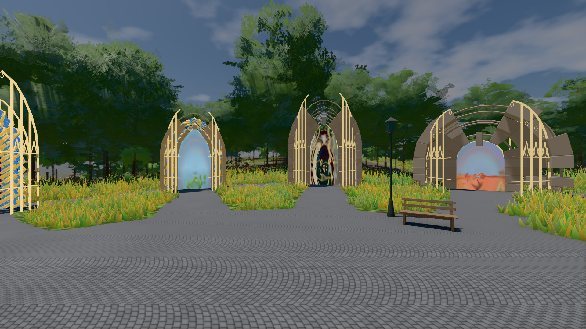

# GPU-PROBE 7de40594 — GRÜN

Zweig `einheit-sicht` · Kopf 7de40594fb7f22e5de1fdee131a8f945e49f1289 · Läufer omen-gtx1060 · 20.11. 05:15 · Wanduhr ab Push 477 s · Lauf https://github.com/MiguellD/AnazhRealm/actions/runs/44672294049

Ruf: `gate:sicht-arbeit gate:schatten-werfer bild:genesis@0.5`

## Läufer omen-gtx1060 — GRÜN

GPU NVIDIA GeForce GTX 1060 · npm ci 34 s (package-lock 983fa64e)
Schloss /c/Users/micha/AppData/Local/Temp/claude/gpu-schloss hält „ci-runner 44672294049/1 probe“
- Hook 2026-11-20 05:11:47 start ci-runner 44672294049/1 probe: wartet auf Schloss von 'omen-samen-settlement-alt'
- Hook 2026-11-20 05:12:02 start ci-runner 44672294049/1 probe: Schloss genommen (refs/heads/einheit-sicht 7de40594fb7f22e5de1fdee131a8f945e49f1289 ws=C:\actions-runner\_work\AnazhRealm\AnazhRealm)

### gate:sicht-arbeit — GRÜN · 26 s · Läufer omen-gtx1060

Adapter: ungenannt (die Probe nannte keinen Browser-Adapter)

```text
  ✅ Selbsttest „keine Dreh-Treue" → rot: LEER: keine Dreh-Treue gemessen — (D) prüfte nichts
  ✅ Selbsttest „die Fahrt ankert je Bild" → rot: FAHRT: 30 neue Anker in 30 Bildern zu 20 m/s — der Halt ist kürzer als der Weg (Kosten am Tempo)
  ✅ Selbsttest „die Fahrt hält ein Loch" → rot: FAHRT-TREUE: 3 Löcher gegen das Gesetz am Auge des Bilds: boden Zelle (Bild 12)
  ✅ Selbsttest „keine Zelle in der Fahrt" → rot: LEER: keine Fahrt gemessen (F) — keine Zelle im Frustum
  ✅ Selbsttest „keine Fahrt" → rot: LEER: keine Fahrt gemessen (F) — keine Zelle im Frustum
  ✅ Selbsttest „Fahrt ohne Weg hält" → rot: LINSE STUMPF: (F) ohne Weg hält der Anker (2 neue in 30 Bildern) — die Fahrt prüft den Weg nicht
  ✅ Selbsttest „Fahrt ohne Rand ohne Loch" → rot: LINSE STUMPF: (F) ohne den Rand des Wegs fehlt der gehaltenen Wahl keine Zelle (0 Löcher) — die Fahrt prüft den Rand nicht
  ✅ Selbsttest „Fahrt ohne Rand nicht gemessen" → rot: LINSE STUMPF: (F) ohne den Rand des Wegs fehlt der gehaltenen Wahl keine Zelle (undefined Löcher) — die Fahrt prüft den Rand nicht
✅ SELBSTTEST GRÜN — jeder injizierte Täter fällt rot und wird beim Namen genannt.
✅ GRÜN — SICHT-ARBEIT — in Ruhe rechnet kein Pass neu, jede neue Lage rechnet, die gehaltene Wahl ist die frische.
```

### gate:schatten-werfer — GRÜN · 26 s · Läufer omen-gtx1060

Adapter: ungenannt (die Probe nannte keinen Browser-Adapter)

```text
  ✅ S10 Selbsttest lief für beide Leser
  ✅ S11 Selbsttest: hält die Lage jede Drehung des Lichts (ohne Rand-Prüfung), wählt keine Kaskade über dem Rand neu, und es fehlen Werfer — K8 rot — {"g":[0.01224,0.02745,0.05167],"b":[0.00204,0.00458,0.00861],"l":41,"neu":[false,false,false],"n":["k0: __k8:schwarm","k0: __k8:schwarm","k0: __k8:schwarm"]}
  ✅ S12 Selbsttest: fällt der Licht-Rand aus `_passTrifft`, fehlen in der Folge Werfer — K8 rot — {"g":[0.00204,0.00439,0.00827],"b":[0.00204,0.00458,0.00861],"l":4,"neu":[true,true,true],"n":["k0: __k8:schwarm","k0: __k8:schwarm","k1: __k8:schwarm"]}
  ✅ S13 Selbsttest: fällt die Halb-Regel des Lichts (Halt bis zum ganzen Rand), steht die Grenze beim ganzen Budget — K8 rot — {"g":[0.004,0.00897,0.01688],"b":[0.00204,0.00458,0.00861],"l":0,"neu":[true,true,true],"n":[]}
  ✅ S14 Selbsttest: die alte Maske der Kaskaden-Kamera (Welt + Zwilling) sieht Nicht-Werfer — W10 rot, beim Namen — Masken 5/5/5 (Soll 4) · 166 gesehen, 40 Werfer, 1 Lichter — 126 falsch: himmel (gesehen) | himmel-sterne (gesehen) | himmel-sonne (gesehen) | Mesh (gesehen) | SkinnedMesh (gesehen) | vogel (gesehen) | bauSatz (gesehen)
  ✅ S15 Selbsttest: ein Licht ohne Wurf-Ebene sieht die Kaskade nicht — W10 rot, beim Namen — Masken 4/4/4 (Soll 4) · 40 gesehen, 40 Werfer, 2 Lichter — 1 Lichter ohne Wurf-Ebene: __w10:licht
  ✅ S4 Selbsttest: die Absenz-Regel fängt beide alten Frustum-Schreiber der Tiere
  ✅ S5 Selbsttest: das Addon-_updateShadowBounds schreibt die Kaskaden-Kamera
  ✅ S7 Selbsttest: eine zweite Szenen-Tiefe macht Z2 rot — Zeile 167206 `viewportDepthTexture(`
GRÜN schatten-werfer
```

### bild:genesis@0.5 — GRÜN · 46 s · Läufer omen-gtx1060

Adapter: [linse-gpu] nvidia/pascal

```text
Kamera des Spiels → Blick (10.0 m): 0.00 92.40 0.00 -10.00 92.40 0.00
 "abnahme": "ABNAHME GRÜN · beweis · Sicht 0.0 % · Ziel Blickziel im Bild frei 10 m · Luma 98.3 σ 35.9 schwarz 0.0 % weiß 0.0 % · Stand 18.546.347 · Bühne summer sunny 0.50 Tiere gehalten · Gerät WebGPU nvidia pascal · Inhalt bodenSatz 36.9 % (≥ 15.0 %) Luma 109, portal-membran 2.7 % (≥ 0.3 %) Luma 139",
```


