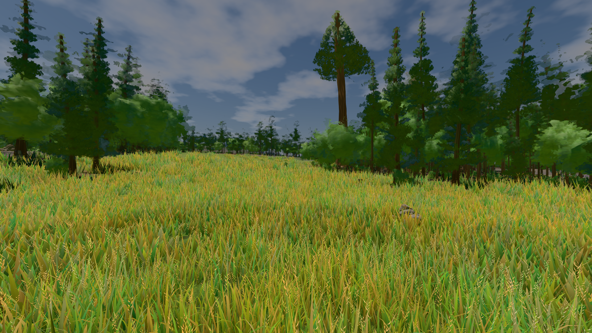

# GPU-PROBE 6a548391 — GRÜN

Zweig `erbe-geburt` · Kopf 6a54839170ef064b8e77a391c9a5928b05dd3b94 · Läufer gtx1050-desktop · 24.11. 02:12 · Wanduhr ab Push 675 s · Lauf https://github.com/MiguellD/AnazhRealm/actions/runs/45301777757

Ruf: `gate:kreatur-leben bild:wiese@0.5 gate:webgl-probe`

## Läufer gtx1050-desktop — GRÜN

GPU NVIDIA GeForce GTX 1050 · node_modules bleiben (package-lock e2430794)
Schloss /c/Users/User/AppData/Local/Temp/claude/gpu-schloss hält „ci-runner 45301777757/1 probe“
- Hook 2026-11-24 02:03:42 start ci-runner 45301777757/1 probe: wartet auf Schloss von 'hand front-stoff (Claude)'
- Hook 2026-11-24 02:03:57 start ci-runner 45301777757/1 probe: Schloss genommen (refs/heads/erbe-geburt 6a54839170ef064b8e77a391c9a5928b05dd3b94 ws=C:\actions-runner\_work\AnazhRealm\AnazhRealm)

### gate:kreatur-leben — GRÜN · 140 s · Läufer gtx1050-desktop

Adapter: ungenannt (die Probe nannte keinen Browser-Adapter)

```text
  ✅ Das Erbe im Kern, Selbsttest: die Nische der neuen Achse ohne Eichung (das Mittel der Rate rückt) fällt ROT — leben-core selbsttest ROT: eichung 0.953572245737432
  ✅ Bestand = Gesetz: Lauf 4 zahlengleich (Saat 1 · 2, Jahre 0–40, Spur von Wolf und Beute gegen die Vorlage)
  ✅ Bestand = Gesetz, Selbsttest: der Mutant V½ 246 → 300 fällt ROT
  ✅ Gau, der Akt (E2): „aus“ nimmt den Kopf, „ein“ setzt ihn mit seinem Leib, ein fremder Takt-Stempel wirft
  ✅ Gau, Determinismus (G3): zwei Läufe byte-gleich · EIN „aus“ am Takt 100 weicht ab · derselbe Akt wieder byte-gleich
  ✅ Gau, Stand-Rundreise (G4): packen → entpacken → weiterrechnen = durchrechnen, byte-gleich (521872 Bytes am 32er-Raster)
  ✅ Gau, Selbsttest: der Mutant „der Akt wirkt an einer Kopie“ fällt ROT
  ✅ Gau, Selbsttest: der Mutant „der Wirt verliert den Akt“ fällt ROT
  ✅ Gau, Selbsttest: der Mutant „der Stand vergisst die Fraß-Schicht“ fällt ROT
✅ GRÜN — DIE KREATUR-SEELE IST GESCHLOSSEN: jedes Aktions-Profil zeigt auf ein Feld der Haltung.
```

### bild:wiese@0.5 — GRÜN · 96 s · Läufer gtx1050-desktop

Adapter: [linse-gpu] nvidia/pascal

```text
Kamera des Spiels → Blick (10.0 m): -280.40 29.71 -1045.60 -289.61 29.71 -1049.50
 "abnahme": "ABNAHME GRÜN · beweis · Sicht 0.0 % · Ziel Blickziel im Bild frei 10 m · Luma 99.3 σ 35.6 schwarz 0.0 % weiß 0.0 % · Stand 18.546.387 · Bühne summer sunny 0.50 Tiere gehalten · Gerät WebGPU nvidia pascal · Inhalt nahWiese 48.5 % (≥ 15.0 %) h 107° Luma 123",
```



### gate:webgl-probe — GRÜN · 120 s · Läufer gtx1050-desktop

Adapter: [linse-gpu] webgl2/NVIDIA GeForce GTX 1050 (0x00001C81) Direct3D11 vs_5_0 ps_5_0

```text
✅ GRÜN — die Kein-WebGPU-Geschichte ist BEWIESEN: der erzwungene WebGL2-Rückfall bootet eine LEBENDE, sichtbare Welt; die WGSL-Konsumenten + Bundles ruhen hinter der EINEN Backend-Wand, der Rückfall ist LAUT benannt, der Fern-Ring trägt auf CPU.
```
