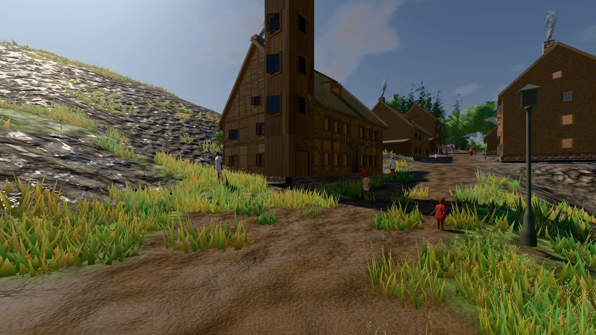

# GPU-PROBE 03cafd96 — GRÜN

Zweig `erdbau-boeschung` · Kopf 03cafd96e03bcae00a3d60af8797973aff04063d · Läufer radeon-890m · 26.11. 05:02 · Wanduhr ab Push 2062 s · Lauf https://github.com/MiguellD/AnazhRealm/actions/runs/45749137785

Ruf: `bild:dorf@0.42 gate:webgl-probe`

## Läufer radeon-890m — GRÜN

GPU AMD Radeon(TM) 890M Graphics · npm ci 408 s (package-lock 3c2dc512)
Schloss /c/Users/micha/AppData/Local/Temp/claude/gpu-schloss hält „ci-runner 45749137785/1 probe“
- Hook 2026-11-26 04:38:55 start ci-runner 45749137785/1 probe: wartet auf Schloss von 'bewegungs-feld-abab 2026-11-26T04:34:11+01:00 pid=32460'
- Hook 2026-11-26 04:46:45 start ci-runner 45749137785/1 probe: Schloss genommen (refs/heads/erdbau-boeschung 03cafd96e03bcae00a3d60af8797973aff04063d ws=C:\actions-runner\_work\AnazhRealm\AnazhRealm)

### bild:dorf@0.42 — GRÜN · 124 s · Läufer radeon-890m

Adapter: [linse-gpu] amd/rdna-3

```text
Kamera des Spiels → Blick (11.3 m): -720.31 44.15 -922.46 -709.17 44.15 -920.56
 "abnahme": "ABNAHME GRÜN · beweis · Sicht 0.0 % · Ziel Blickziel im Bild frei 11.3 m · Luma 89.3 σ 47 schwarz 0.4 % weiß 0.0 % · Stand 18.546.427 · Bühne summer sunny 0.42 Tiere gehalten · Gerät WebGPU amd rdna-3 · Inhalt bauSatz 17.0 % (≥ 2.0 %) Luma 37",
```



### gate:webgl-probe — GRÜN · 57 s · Läufer radeon-890m

Adapter: [linse-gpu] webgl2/AMD Radeon(TM) 890M Graphics (0x0000150E) Direct3D11 vs_5_0 ps_5_0

```text
✅ GRÜN — die Kein-WebGPU-Geschichte ist BEWIESEN: der erzwungene WebGL2-Rückfall bootet eine LEBENDE, sichtbare Welt; die WGSL-Konsumenten + Bundles ruhen hinter der EINEN Backend-Wand, der Rückfall ist LAUT benannt, der Fern-Ring trägt auf CPU.
```
