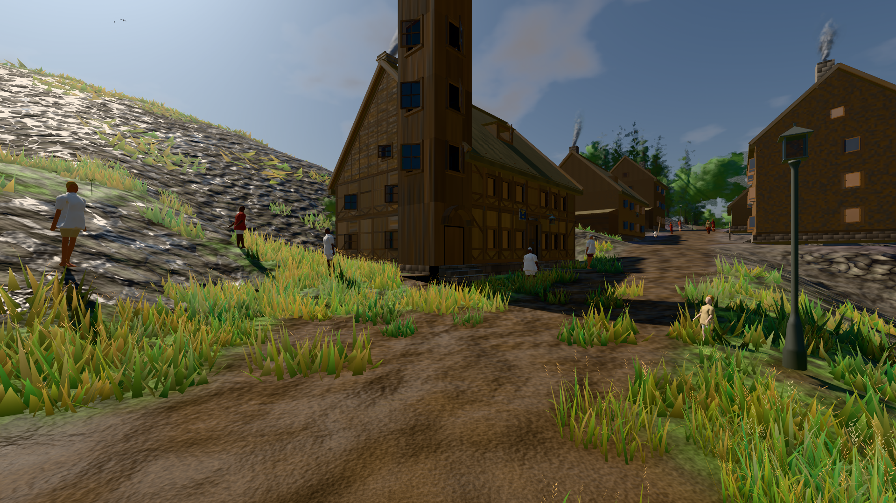

# GPU-PROBE a133198b — GRÜN

Zweig `erdbau-boeschung` · Kopf a133198b90dc16e316ad3672252232614ca05035 · Läufer radeon-890m · 26.11. 02:22 · Wanduhr ab Push 708 s · Lauf https://github.com/MiguellD/AnazhRealm/actions/runs/45733928067

Ruf: `bild:dorf@0.42 gate:webgl-probe`

## Läufer radeon-890m — GRÜN

GPU AMD Radeon(TM) 890M Graphics · node_modules bleiben (package-lock 12cdff91)
Schloss /c/Users/micha/AppData/Local/Temp/claude/gpu-schloss hält „ci-runner 45733928067/1 probe“
- Hook 2026-11-26 02:13:26 start ci-runner 45733928067/1 probe: wartet auf Schloss von 'bewegungs-feld-nachher 2026-11-26T02:11:06+01:00 pid=14648'
- Hook 2026-11-26 02:14:04 start ci-runner 45733928067/1 probe: verwaistes Schloss 'bewegungs-feld-nachher 2026-11-26T02:11:06+01:00 pid=14648' geloest - Halter pid=14648 lebt nicht
- Hook 2026-11-26 02:14:05 start ci-runner 45733928067/1 probe: Schloss genommen (refs/heads/erdbau-boeschung a133198b90dc16e316ad3672252232614ca05035 ws=C:\actions-runner\_work\AnazhRealm\AnazhRealm)

### bild:dorf@0.42 — GRÜN · 87 s · Läufer radeon-890m

Adapter: [linse-gpu] amd/rdna-3

```text
Kamera des Spiels → Blick (11.3 m): -720.31 44.15 -922.46 -709.17 44.15 -920.56
 "abnahme": "ABNAHME GRÜN · beweis · Sicht 0.0 % · Ziel Blickziel im Bild frei 11.3 m · Luma 89.3 σ 47.2 schwarz 0.3 % weiß 0.0 % · Stand 18.546.425 · Bühne summer sunny 0.42 Tiere gehalten · Gerät WebGPU amd rdna-3 · Inhalt bauSatz 16.9 % (≥ 2.0 %) Luma 37",
```



### gate:webgl-probe — GRÜN · 44 s · Läufer radeon-890m

Adapter: [linse-gpu] webgl2/AMD Radeon(TM) 890M Graphics (0x0000150E) Direct3D11 vs_5_0 ps_5_0

```text
✅ GRÜN — die Kein-WebGPU-Geschichte ist BEWIESEN: der erzwungene WebGL2-Rückfall bootet eine LEBENDE, sichtbare Welt; die WGSL-Konsumenten + Bundles ruhen hinter der EINEN Backend-Wand, der Rückfall ist LAUT benannt, der Fern-Ring trägt auf CPU.
```
