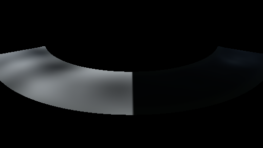
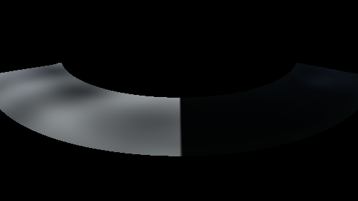
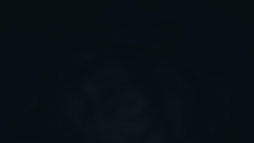

# GPU-PROBE b260c380 — GRÜN

Zweig `erdbau-graben` · Kopf b260c380daee4196c9e80fc16e80f989e7a78da5 · Läufer omen-gtx1060 · 27.11. 06:28 · Wanduhr ab Push 911 s · Lauf https://github.com/MiguellD/AnazhRealm/actions/runs/45944504288

Ruf: `gate:werk-im-wasser gate:gelaende-realismus gate:wasser-leben:bild gate:fern-wasser gate:webgl-probe`

## Läufer omen-gtx1060 — GRÜN

GPU NVIDIA GeForce GTX 1060 · npm ci 54 s (package-lock 90c059e7)
Schloss /c/Users/micha/AppData/Local/Temp/claude/gpu-schloss hält „ci-runner 45944504288/1 probe“
- Hook 2026-11-27 06:13:44 start ci-runner 45944504288/1 probe: Schloss genommen (refs/heads/erdbau-graben b260c380daee4196c9e80fc16e80f989e7a78da5 ws=C:\actions-runner\_work\AnazhRealm\AnazhRealm)

### gate:werk-im-wasser — GRÜN · 246 s · Läufer omen-gtx1060

Adapter: ungenannt (die Probe nannte keinen Browser-Adapter)

```text
  ✅ Selbsttest „Kern: das Gas wirkt am stehenden Motor (keine Ruhe unter Vollgas)" → rot: K4 über der Ansaugung (0.77 m) fuhr er 0.08 m
  ✅ Selbsttest „Z Brücke quert (90° über 12 m Wasser)" → grün: (nichts)
  ✅ Selbsttest „Z Brücke quert schräg (45°)" → grün: (nichts)
  ✅ Selbsttest „Z Brücke im Lauf (0°)" → rot: Z: bruecke_jochfeld liegt längs 0.80 m im Wasser (das Ufer quer 6 m, längs Infinity m)
  ✅ Selbsttest „Z Brücke im Maß von z397 (12° zum Lauf)" → rot: Z: bruecke_jochfeld liegt längs 0.80 m im Wasser (das Ufer quer 7 m, längs 29 m)
  ✅ Selbsttest „Z Joch tiefer als sein Pfahl (4 m Wasser)" → rot: Z: bruecke_jochfeld steht tiefer als sein Pfahl, 4.00 m im Wasser (der Pfahl trägt 3.5 m)
  ✅ Selbsttest „Z Steg im Flachwasser (0,80 m unter der ganzen Hülle)" → grün: (nichts)
  ✅ Selbsttest „Z Steg tiefer als sein Pfahl (3,1 m Wasser)" → rot: Z: steg_stegfeld steht tiefer als sein Pfahl, 3.10 m im Wasser (der Pfahl trägt 2.6 m)
✅ SELBSTTEST GRÜN — jeder injizierte Täter fällt rot und wird beim Namen genannt.
WERK-IM-WASSER GRÜN
```

### gate:gelaende-realismus — GRÜN · 129 s · Läufer omen-gtx1060

Adapter: ungenannt (die Probe nannte keinen Browser-Adapter)

```text
  ✅ genesis: größte Stufe 0,50 m je 0,5 m an 140.5/-185, 47,77 m neben der Fläche: Höhe 80,68 → 79,99 m (Natur 80,91 → 80,72 m) · 0/846564 Kanten über 0,6 m · 377 Splats · 7568 ms
  ✅ stadt-voll (dorf 7 300): größte Stufe 0,51 m je 0,5 m an 974/145, 10,06 m neben der Fläche: Höhe 51,16 → 50,34 m (Natur 49,91 → 49,60 m) · 0/1191040 Kanten über 0,6 m · 6034 Splats · 29371 ms
  ✅ dorf 20 8: größte Stufe 0,50 m je 0,5 m an -833.5/-872.5, 47,51 m neben der Fläche: Höhe 73,28 → 72,42 m (Natur 73,77 → 73,40 m) · 0/264528 Kanten über 0,6 m · 190 Splats · 2702 ms
  ✅ dorf 12 18: größte Stufe 0,50 m je 0,5 m an -1800.5/-956, 47,47 m neben der Fläche: Höhe 61,15 → 60,48 m (Natur 60,62 → 60,45 m) · 0/267862 Kanten über 0,6 m · 619 Splats · 4493 ms
  ✅ SELBSTTEST (der harte Schnitt bei 16 m eingepflanzt): ROT beim Namen — genesis: größte Stufe 19,92 m je 0,5 m an 103.5/-279.5, 16,32 m neben der Fläche: Höhe 52,34 → 72,52 m (Natur 52,34 → 52,61 m) · 1263/846564 Kanten über 0,6 m · 377 Splats · 7418 ms
✅ BÖSCHUNGS-LINSE GRÜN: 4 Erdbauten ohne Stufe über 0,6 m je 0,5 m
  Selbsttest-Gerade (jedes Glied seine Sehne): w-sweepalpha0001-aaaaaa 5 Fenster, Sinuosität 1 → ✅ rot erkannt
  Selbsttest-Störung (Bett-Tiefe des alten Gesetzes, Saat anazh-realm-seed): Senken>1m 9.2/km² · Dorfplätze 4 → ✅ SELBSTTEST GRÜN: die Störung färbt den Boden rot
  Selbsttest-Weltgrenze (Regenesis ohne Grenze in w-sweepalpha0001-aaaaaa): Rondell 90.31 m über Boden 37.64 m → ✅ rot erkannt
✅ GEBAUTER BODEN GRÜN: Senken und Dorfplätze im Korridor, 3 Saaten
```

### gate:wasser-leben:bild — GRÜN · 30 s · Läufer omen-gtx1060

Adapter: [linse-gpu] nvidia/pascal

```text
  ✅ B8 Weißkappe: Flaute 0.00 % · Wind 0,8 4.45 % der See · B9 Glanz der Zenit-Sonne: frei 45.92 · hinter dem Grat 3.67 (Luma-Mittel der Mitte)
WASSER-LEBEN GRÜN
```








### gate:fern-wasser — GRÜN · 38 s · Läufer omen-gtx1060

Adapter: ungenannt (die Probe nannte keinen Browser-Adapter)

```text
  ✅ DAS FERN-WASSER STEHT: atlas-treu, ring-löchrig (kein Doppel-Wasser), voll gedeckt, Lifecycle sauber.
  ✅ DAS FERN-WASSER STEHT: atlas-treu, ring-löchrig (kein Doppel-Wasser), voll gedeckt, Lifecycle sauber.
```

### gate:webgl-probe — GRÜN · 47 s · Läufer omen-gtx1060

Adapter: [linse-gpu] webgl2/NVIDIA GeForce GTX 1060 (0x00001C60) Direct3D11 vs_5_0 ps_5_0

```text
✅ GRÜN — die Kein-WebGPU-Geschichte ist BEWIESEN: der erzwungene WebGL2-Rückfall bootet eine LEBENDE, sichtbare Welt; die WGSL-Konsumenten + Bundles ruhen hinter der EINEN Backend-Wand, der Rückfall ist LAUT benannt, der Fern-Ring trägt auf CPU.
```
