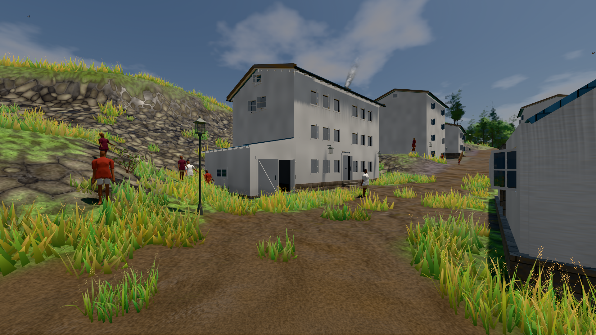

# GPU-PROBE 86697613 — ROT

Zweig `fahrzeug-gattung` · Kopf 86697613f759f052a98bdc1d463cb11415e25450 · Läufer gtx1050-desktop · 24.11. 13:27 · Wanduhr ab Push 1656 s · Lauf https://github.com/MiguellD/AnazhRealm/actions/runs/45389218297

Ruf: `bild:dorf@0.5 gate:pruefbuehne-licht gate:weltbild-frost:echt gate:studio-begehen gate:webgl-probe`

## Läufer gtx1050-desktop — ROT

GPU NVIDIA GeForce GTX 1050 · npm ci 103 s (package-lock 663c8152)
Schloss /c/Users/User/AppData/Local/Temp/claude/gpu-schloss hält „ci-runner 45389218297/1 probe“
- Hook 2026-11-24 13:00:23 start ci-runner 45389218297/1 probe: Schloss genommen (refs/heads/fahrzeug-gattung 86697613f759f052a98bdc1d463cb11415e25450 ws=C:\actions-runner\_work\AnazhRealm\AnazhRealm)

### bild:dorf@0.5 — GRÜN · 223 s · Läufer gtx1050-desktop

Adapter: [linse-gpu] nvidia/pascal

```text
Kamera des Spiels → Blick (12.9 m): -715.86 49.01 -932.69 -702.99 49.01 -931.86
 "abnahme": "ABNAHME GRÜN · beweis · Sicht 0.0 % · Ziel Blickziel im Bild frei 12.9 m · Luma 94.6 σ 28.8 schwarz 0.1 % weiß 0.0 % · Stand 18.546.402 · Bühne summer sunny 0.50 Tiere gehalten · Gerät WebGPU nvidia pascal · Inhalt bauSatz 20.3 % (≥ 2.0 %) Luma 94",
```



### gate:pruefbuehne-licht — ROT · 180 s · Läufer gtx1050-desktop

Adapter: [linse-gpu] nvidia/pascal · ⛔ S0 Boden-Programm: 108011 Zeichen WGSL (Budget ≤ 104162) — die Ratsche des Programms (der Stand + seine Luft, sie fällt nur): jedes Zeichen übersetzt der GPU-Prozess vor dem ersten Bild

```text
  S0 BODEN-PROGRAMM 1/1: 108011 Zeichen WGSL (Ratsche ≤ 104162) · Pipeline asynchron → GRÜN · kalt 2280 · 1973 · 2125 · 2333 · 2080 · 2582 · 2444 · 2380 · 2433 ms, Median 2333 ms · ÷ K17 derselben Sitzung 0,76 (Auskunft, kein Zeit-Urteil)
    ⛔ S0 Boden-Programm: 108011 Zeichen WGSL (Budget ≤ 104162) — die Ratsche des Programms (der Stand + seine Luft, sie fällt nur): jedes Zeichen übersetzt der GPU-Prozess vor dem ersten Bild
⛔ S0 BILD ROT · Nacht {"luma":21.8,"schwarz":0,"gesetz":22.76} (105 s, nvidia/pascal · Holz kienspan)
```

### gate:weltbild-frost:echt — GRÜN · 372 s · Läufer gtx1050-desktop

Adapter: [linse-gpu] nvidia/pascal

```text
  ✅ P2 kein writeBuffer schief: der Pfad und ein Index ungerader Länge der Ich-Bühne — 494367 writeBuffer, keiner schief
  ✅ T1 die Index-Wache nennt den Index über der Vertex-Zahl beim Namen — Vendor- und Storage-Index — gezeichnet nach 71 Bildern · Scene/frost-taeter-bereich: Index 3 ≥ 3 Vertices im gezeichneten Bereich | Scene/frost-taeter-speicher: Index 3 ≥ 3 Vertices im gezeichneten Bereich
  ✅ T3 die Puffer-Wache nennt den schiefen writeBuffer beim Namen, WebGPU wirft — frost-taeter-puffer · Uint16Array · Versatz 0 · 6 B · q.writeBuffer (stamm/dirigent-ankunft.js:253:36) < pptr:;page.%3Ccomputed%3E%20(C%3A%5Cactions-runner%5C_work%5CAnazhRealm%5Cgpu-probe%5Cscripts%5Clib%5Cwelt-boot.cjs%3A1131%3A22):6:23 · geworfen: Failed to execute 'writeBuffer' on 'GPUQueue': Number of bytes to write must be a multiple of 4
  ✅ T4 ein fremder Fehler im Bau einer Pipeline markiert keine Pipeline — der Abgriff schließt r184s Bereich, die GPU-Wache zählt den Fehler — 1 Bauten, 1 fremde Validierungen, 1 Bereiche geschlossen, GPU-Wache +1, Marken: keine
  ✅ T4 der Mutant (main 6699a813: r184s Fehler-Bereich bleibt über das Versprechen des Baus offen) markiert die Pipeline des Täters — 1 Bauten, 1 fremde Validierungen, 0 Bereiche geschlossen, GPU-Wache +1, Marken: renderPipeline_frost-taeter-fremd-mutant_3314 · T4 mit beiden Läufen in 3797 ms
  ✅ T2 die Index-Wache nennt den geweiteten Index beim Pfad — Group/BundleGroup/Group/mensch/torso/head/Mesh: 7962 × Uint32Array = 31848 B gebunden, der Puffer trägt 15924 B
  ✅ T2 die GPU-Wache des Spiels zählt die Validierung — {"n":191}
  ✅ T2 der eigene Hörer hört die Validierung (Device oder r184-Fehler-Bereich) — 378 Meldungen: konsole: THREE.Write range (bufferOffset: 0, size: 16) does not fit in [Buffer "frost-taeter-fremd"] size (8). | konsole: Index range (first: 0, count: 7962, format: IndexFormat::Uint32) does not fit in index buffer size (15924).
  ✅ T2 die Bild-Probe erkennt das stehende Bild — 2.37 % der Blöcke bewegt
✅ GRÜN — DIE FROST-WAND steht — durch Werkstatt, Ich- und Hof-Bühne trägt jeder Index-Puffer der Welt-GPU sein Format, kein Device meldet, das Bild folgt der Kamera; die Täter (Index über der Vertex-Zahl, ein fremd geweiteter Mensch-Index) nennen die Wachen beim Namen, ein fremder Fehler im Bau einer Pipeline markiert keine, und das stehende Bild wird erkannt.
```

### gate:studio-begehen — GRÜN · 558 s · Läufer gtx1050-desktop

Adapter: [linse-gpu] nvidia/pascal

```text
  ✅ Selbsttest „ruecken" macht B3 Speicher rot — B3 Speicher: 2 Häuser mit Dachraum ohne Speicherlauf, obwohl am First Kopfraum steht (#0 635014 provenzalisch/kirche Speicher zu: First 2.68 m, Stufe 0.2 m, Stehraum 3.21 m · #2 723323 provenzalisch/pfarrhaus Speicher zu: First 2.80 m, Stufe 0.2 m, Stehraum 3.54 m)
[stall-akte] Stderr [9792:5744:1124/131850.204:ERROR:services\on_device_model\public\cpp\service_client.cc:37] Unexpected on_device_model service disconnect; reason: 1, description: Error loading backend.
[stall-akte] Stderr [9792:2920:1124/131909.090:ERROR:google_apis\gcm\engine\mcs_client.cc:702]   Error code: 401  Error message: Authentication Failed: wrong_secret
  ✅ Selbsttest „platte" macht B4 Keller-Decke rot — B4 Keller-Decke = Boden-Platte in 7 von 8
[stall-akte] Stderr [9792:5744:1124/131850.204:ERROR:services\on_device_model\public\cpp\service_client.cc:37] Unexpected on_device_model service disconnect; reason: 1, description: Error loading backend.
[stall-akte] Stderr [9792:2920:1124/131909.090:ERROR:google_apis\gcm\engine\mcs_client.cc:702]   Error code: 401  Error message: Authentication Failed: wrong_secret
  ✅ Selbsttest „flach" macht B5 Weltgrund rot — B5 Weltgrund: die Häuser stehen eben (Spanne 0 m)
[stall-akte] Stderr [9792:5744:1124/131850.204:ERROR:services\on_device_model\public\cpp\service_client.cc:37] Unexpected on_device_model service disconnect; reason: 1, description: Error loading backend.
[stall-akte] Stderr [9792:2920:1124/131909.090:ERROR:google_apis\gcm\engine\mcs_client.cc:702]   Error code: 401  Error message: Authentication Failed: wrong_secret
✅ gate:studio-begehen grün
```

### gate:webgl-probe — GRÜN · 106 s · Läufer gtx1050-desktop

Adapter: [linse-gpu] webgl2/NVIDIA GeForce GTX 1050 (0x00001C81) Direct3D11 vs_5_0 ps_5_0

```text
✅ GRÜN — die Kein-WebGPU-Geschichte ist BEWIESEN: der erzwungene WebGL2-Rückfall bootet eine LEBENDE, sichtbare Welt; die WGSL-Konsumenten + Bundles ruhen hinter der EINEN Backend-Wand, der Rückfall ist LAUT benannt, der Fern-Ring trägt auf CPU.
```
