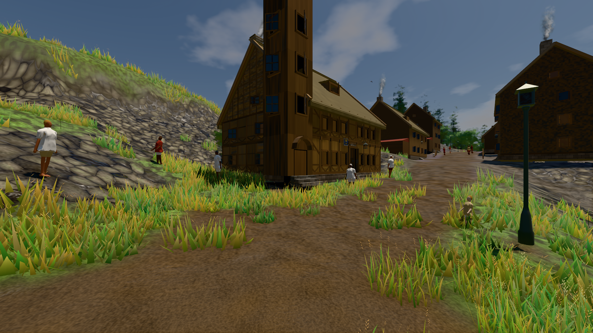

# GPU-PROBE 956c40f8 — GRÜN

Zweig `fahrzeug-gattung` · Kopf 956c40f880435cd5fb28e6e561f591916bcee990 · Läufer gtx1050-desktop · 25.11. 00:02 · Wanduhr ab Push 1314 s · Lauf https://github.com/MiguellD/AnazhRealm/actions/runs/45503089257

Ruf: `bild:dorf@0.5 gate:pruefbuehne-licht gate:weltbild-frost:echt gate:studio-begehen gate:webgl-probe`

## Läufer gtx1050-desktop — GRÜN

GPU NVIDIA GeForce GTX 1050 · node_modules bleiben (package-lock 33f59852)
Schloss /c/Users/User/AppData/Local/Temp/claude/gpu-schloss hält „ci-runner 45503089257/1 probe“
- Hook 2026-11-24 23:40:32 start ci-runner 45503089257/1 probe: Schloss genommen (refs/heads/fahrzeug-gattung 956c40f880435cd5fb28e6e561f591916bcee990 ws=C:\actions-runner\_work\AnazhRealm\AnazhRealm)

### bild:dorf@0.5 — GRÜN · 197 s · Läufer gtx1050-desktop

Adapter: [linse-gpu] nvidia/pascal

```text
Kamera des Spiels → Blick (11.3 m): -720.31 44.15 -922.46 -709.17 44.15 -920.56
 "abnahme": "ABNAHME GRÜN · beweis · Sicht 0.0 % · Ziel Blickziel im Bild frei 11.3 m · Luma 81.9 σ 34.3 schwarz 0.3 % weiß 0.0 % · Stand 18.546.406 · Bühne summer sunny 0.50 Tiere gehalten · Gerät WebGPU nvidia pascal · Inhalt bauSatz 16.9 % (≥ 2.0 %) Luma 36",
```



### gate:pruefbuehne-licht — GRÜN · 102 s · Läufer gtx1050-desktop

Adapter: [linse-gpu] nvidia/pascal

```text
  S0 BODEN-PROGRAMM 1/1: 108011 Zeichen WGSL (gebuchter Stand 108011, ±0 — Auskunft, kein Urteil) · Pipeline asynchron → GRÜN · kalt 2186 · 1947 · 1905 · 2420 · 2125 · 2068 · 1900 · 1997 · 2059 ms, Median 2059 ms · ÷ K17 derselben Sitzung 0,78 (Auskunft, kein Zeit-Urteil)
✅ S0 BILD GRÜN: die Feuerstelle trägt den Feuerkreis aus 2 m in der Ausgabe · Nacht {"luma":21.8,"schwarz":0,"gesetz":22.76} (76 s, nvidia/pascal · Holz kienspan)
```

### gate:weltbild-frost:echt — GRÜN · 309 s · Läufer gtx1050-desktop

Adapter: [linse-gpu] nvidia/pascal

```text
  ✅ P2 kein writeBuffer schief: der Pfad und ein Index ungerader Länge der Ich-Bühne — 506503 writeBuffer, keiner schief
  ✅ T1 die Index-Wache nennt den Index über der Vertex-Zahl beim Namen — Vendor- und Storage-Index — gezeichnet nach 70 Bildern · Scene/frost-taeter-bereich: Index 3 ≥ 3 Vertices im gezeichneten Bereich | Scene/frost-taeter-speicher: Index 3 ≥ 3 Vertices im gezeichneten Bereich
  ✅ T3 die Puffer-Wache nennt den schiefen writeBuffer beim Namen, WebGPU wirft — frost-taeter-puffer · Uint16Array · Versatz 0 · 6 B · q.writeBuffer (stamm/dirigent-ankunft.js:253:36) < pptr:;page.%3Ccomputed%3E%20(C%3A%5Cactions-runner%5C_work%5CAnazhRealm%5Cgpu-probe%5Cscripts%5Clib%5Cwelt-boot.cjs%3A1136%3A22):6:23 · geworfen: Failed to execute 'writeBuffer' on 'GPUQueue': Number of bytes to write must be a multiple of 4
  ✅ T4 ein fremder Fehler im Bau einer Pipeline markiert keine Pipeline — der Abgriff schließt r184s Bereich, die GPU-Wache zählt den Fehler — 1 Bauten, 1 fremde Validierungen, 1 Bereiche geschlossen, GPU-Wache +1, Marken: keine
  ✅ T4 der Mutant (main 6699a813: r184s Fehler-Bereich bleibt über das Versprechen des Baus offen) markiert die Pipeline des Täters — 2 Bauten, 2 fremde Validierungen, 0 Bereiche geschlossen, GPU-Wache +1, Marken: renderPipeline_frost-taeter-fremd-mutant_3587 · T4 mit beiden Läufen in 3086 ms
  ✅ T2 die Index-Wache nennt den geweiteten Index beim Pfad — Group/BundleGroup/Group/mensch/torso/head/Mesh: 7962 × Uint32Array = 31848 B gebunden, der Puffer trägt 15924 B
  ✅ T2 die GPU-Wache des Spiels zählt die Validierung — {"n":181}
  ✅ T2 der eigene Hörer hört die Validierung (Device oder r184-Fehler-Bereich) — 357 Meldungen: konsole: THREE.Write range (bufferOffset: 0, size: 16) does not fit in [Buffer "frost-taeter-fremd"] size (8). | konsole: THREE.Write range (bufferOffset: 0, size: 16) does not fit in [Buffer "frost-taeter-fremd"] size (8).
  ✅ T2 die Bild-Probe erkennt das stehende Bild — 1.04 % der Blöcke bewegt
✅ GRÜN — DIE FROST-WAND steht — durch Werkstatt, Ich- und Hof-Bühne trägt jeder Index-Puffer der Welt-GPU sein Format, kein Device meldet, das Bild folgt der Kamera; die Täter (Index über der Vertex-Zahl, ein fremd geweiteter Mensch-Index) nennen die Wachen beim Namen, ein fremder Fehler im Bau einer Pipeline markiert keine, und das stehende Bild wird erkannt.
```

### gate:studio-begehen — GRÜN · 497 s · Läufer gtx1050-desktop

Adapter: [linse-gpu] nvidia/pascal

```text
[stall-akte] Stderr [4368:2616:1124/235534.351:ERROR:google_apis\gcm\engine\mcs_client.cc:702]   Error code: 401  Error message: Authentication Failed: wrong_secret
  ✅ Selbsttest „platte" macht B4 Keller-Decke rot — B4 Keller-Decke = Boden-Platte in 7 von 8
[stall-akte] Stderr [4368:7856:1124/235403.247:ERROR:services\on_device_model\public\cpp\service_client.cc:37] Unexpected on_device_model service disconnect; reason: 1, description: Error loading backend.
[stall-akte] Stderr [4368:7440:1124/235521.746:ERROR:components\system_cpu\cpu_probe_win.cc:134] PdhGetFormattedCounterValue failed: Error (0x3AFC) while retrieving error. (0x800007D6)
[stall-akte] Stderr [4368:2616:1124/235534.351:ERROR:google_apis\gcm\engine\mcs_client.cc:702]   Error code: 401  Error message: Authentication Failed: wrong_secret
  ✅ Selbsttest „flach" macht B5 Weltgrund rot — B5 Weltgrund: die Häuser stehen eben (Spanne 0 m)
[stall-akte] Stderr [4368:7856:1124/235403.247:ERROR:services\on_device_model\public\cpp\service_client.cc:37] Unexpected on_device_model service disconnect; reason: 1, description: Error loading backend.
[stall-akte] Stderr [4368:7440:1124/235521.746:ERROR:components\system_cpu\cpu_probe_win.cc:134] PdhGetFormattedCounterValue failed: Error (0x3AFC) while retrieving error. (0x800007D6)
[stall-akte] Stderr [4368:2616:1124/235534.351:ERROR:google_apis\gcm\engine\mcs_client.cc:702]   Error code: 401  Error message: Authentication Failed: wrong_secret
✅ gate:studio-begehen grün
```

### gate:webgl-probe — GRÜN · 105 s · Läufer gtx1050-desktop

Adapter: [linse-gpu] webgl2/NVIDIA GeForce GTX 1050 (0x00001C81) Direct3D11 vs_5_0 ps_5_0

```text
✅ GRÜN — die Kein-WebGPU-Geschichte ist BEWIESEN: der erzwungene WebGL2-Rückfall bootet eine LEBENDE, sichtbare Welt; die WGSL-Konsumenten + Bundles ruhen hinter der EINEN Backend-Wand, der Rückfall ist LAUT benannt, der Fern-Ring trägt auf CPU.
```
