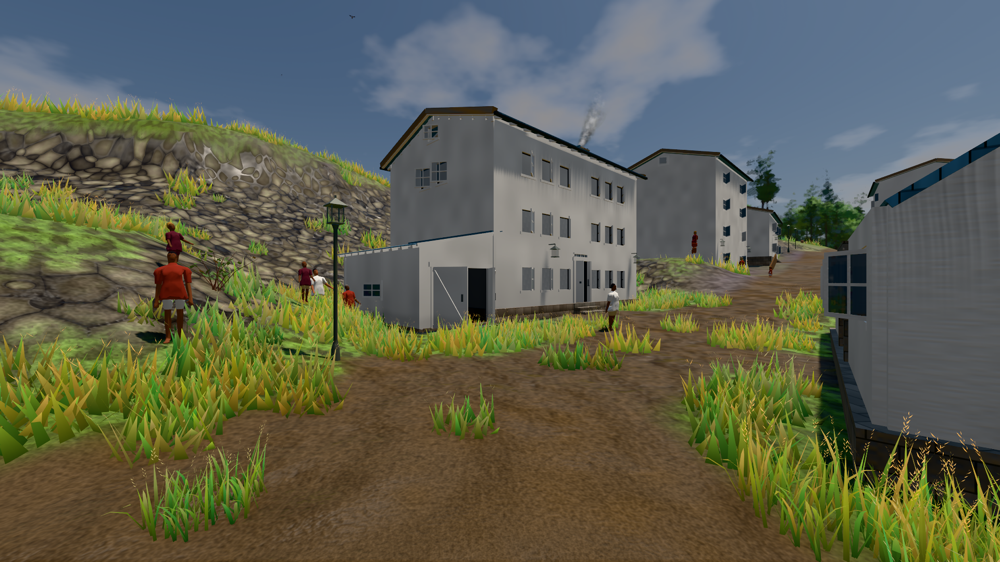

# GPU-PROBE e9c9bb54 — GRÜN

Zweig `fahrzeug-gattung` · Kopf e9c9bb54b00d77a19e5b06c5aa4bdfa7e28005e6 · Läufer omen-gtx1060 · 24.11. 21:17 · Wanduhr ab Push 474 s · Lauf https://github.com/MiguellD/AnazhRealm/actions/runs/45477778351

Ruf: `bild:dorf@0.5 gate:pruefbuehne-licht gate:weltbild-frost:echt gate:webgl-probe`

## Läufer omen-gtx1060 — GRÜN

GPU NVIDIA GeForce GTX 1060 · npm ci 55 s (package-lock e3ca965b)
Schloss /c/Users/micha/AppData/Local/Temp/claude/gpu-schloss hält „ci-runner 45477778351/1 probe“
- Hook 2026-11-24 21:09:41 start ci-runner 45477778351/1 probe: wartet auf Schloss von 'omen-punkte-gtx-sitzung'
- Hook 2026-11-24 21:10:11 start ci-runner 45477778351/1 probe: Schloss genommen (refs/heads/fahrzeug-gattung e9c9bb54b00d77a19e5b06c5aa4bdfa7e28005e6 ws=C:\actions-runner\_work\AnazhRealm\AnazhRealm)

### bild:dorf@0.5 — GRÜN · 82 s · Läufer omen-gtx1060

Adapter: [linse-gpu] nvidia/pascal

```text
Kamera des Spiels → Blick (12.9 m): -715.86 49.01 -932.69 -702.99 49.01 -931.86
 "abnahme": "ABNAHME GRÜN · beweis · Sicht 0.0 % · Ziel Blickziel im Bild frei 12.9 m · Luma 94.6 σ 28.8 schwarz 0.1 % weiß 0.0 % · Stand 18.546.405 · Bühne summer sunny 0.50 Tiere gehalten · Gerät WebGPU nvidia pascal · Inhalt bauSatz 20.3 % (≥ 2.0 %) Luma 94",
```



### gate:pruefbuehne-licht — GRÜN · 52 s · Läufer omen-gtx1060

Adapter: [linse-gpu] nvidia/pascal

```text
  S0 BODEN-PROGRAMM 1/1: 108011 Zeichen WGSL (gebuchter Stand 108011, ±0 — Auskunft, kein Urteil) · Pipeline asynchron → GRÜN · kalt 1178 · 1175 · 1125 · 1135 · 1116 · 1160 · 1184 · 1137 · 1104 ms, Median 1137 ms · ÷ K17 derselben Sitzung 0,75 (Auskunft, kein Zeit-Urteil)
✅ S0 BILD GRÜN: die Feuerstelle trägt den Feuerkreis aus 2 m in der Ausgabe · Nacht {"luma":21.8,"schwarz":0,"gesetz":22.76} (42 s, nvidia/pascal · Holz kienspan)
```

### gate:weltbild-frost:echt — GRÜN · 140 s · Läufer omen-gtx1060

Adapter: [linse-gpu] nvidia/pascal

```text
  ✅ P2 kein writeBuffer schief: der Pfad und ein Index ungerader Länge der Ich-Bühne — 397305 writeBuffer, keiner schief
  ✅ T1 die Index-Wache nennt den Index über der Vertex-Zahl beim Namen — Vendor- und Storage-Index — gezeichnet nach 63 Bildern · Scene/frost-taeter-bereich: Index 3 ≥ 3 Vertices im gezeichneten Bereich | Scene/frost-taeter-speicher: Index 3 ≥ 3 Vertices im gezeichneten Bereich
  ✅ T3 die Puffer-Wache nennt den schiefen writeBuffer beim Namen, WebGPU wirft — frost-taeter-puffer · Uint16Array · Versatz 0 · 6 B · q.writeBuffer (stamm/dirigent-ankunft.js:253:36) < pptr:;page.%3Ccomputed%3E%20(C%3A%5Cactions-runner%5C_work%5CAnazhRealm%5Cgpu-probe%5Cscripts%5Clib%5Cwelt-boot.cjs%3A1136%3A22):6:23 · geworfen: Failed to execute 'writeBuffer' on 'GPUQueue': Number of bytes to write must be a multiple of 4
  ✅ T4 ein fremder Fehler im Bau einer Pipeline markiert keine Pipeline — der Abgriff schließt r184s Bereich, die GPU-Wache zählt den Fehler — 1 Bauten, 1 fremde Validierungen, 1 Bereiche geschlossen, GPU-Wache +1, Marken: keine
  ✅ T4 der Mutant (main 6699a813: r184s Fehler-Bereich bleibt über das Versprechen des Baus offen) markiert die Pipeline des Täters — 1 Bauten, 1 fremde Validierungen, 0 Bereiche geschlossen, GPU-Wache +1, Marken: renderPipeline_frost-taeter-fremd-mutant_3414 · T4 mit beiden Läufen in 2433 ms
  ✅ T2 die Index-Wache nennt den geweiteten Index beim Pfad — Group/BundleGroup/Group/mensch/torso/head/Mesh: 7962 × Uint32Array = 31848 B gebunden, der Puffer trägt 15924 B
  ✅ T2 die GPU-Wache des Spiels zählt die Validierung — {"n":277}
  ✅ T2 der eigene Hörer hört die Validierung (Device oder r184-Fehler-Bereich) — 550 Meldungen: konsole: THREE.Write range (bufferOffset: 0, size: 16) does not fit in [Buffer "frost-taeter-fremd"] size (8). | konsole: Index range (first: 0, count: 7962, format: IndexFormat::Uint32) does not fit in index buffer size (15924).
  ✅ T2 die Bild-Probe erkennt das stehende Bild — 0.00 % der Blöcke bewegt
✅ GRÜN — DIE FROST-WAND steht — durch Werkstatt, Ich- und Hof-Bühne trägt jeder Index-Puffer der Welt-GPU sein Format, kein Device meldet, das Bild folgt der Kamera; die Täter (Index über der Vertex-Zahl, ein fremd geweiteter Mensch-Index) nennen die Wachen beim Namen, ein fremder Fehler im Bau einer Pipeline markiert keine, und das stehende Bild wird erkannt.
```

### gate:webgl-probe — GRÜN · 52 s · Läufer omen-gtx1060

Adapter: [linse-gpu] webgl2/NVIDIA GeForce GTX 1060 (0x00001C60) Direct3D11 vs_5_0 ps_5_0

```text
✅ GRÜN — die Kein-WebGPU-Geschichte ist BEWIESEN: der erzwungene WebGL2-Rückfall bootet eine LEBENDE, sichtbare Welt; die WGSL-Konsumenten + Bundles ruhen hinter der EINEN Backend-Wand, der Rückfall ist LAUT benannt, der Fern-Ring trägt auf CPU.
```
