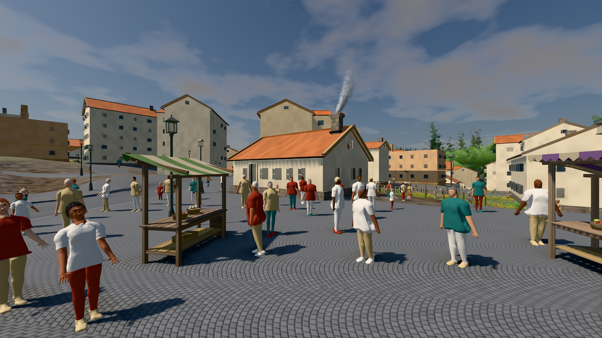
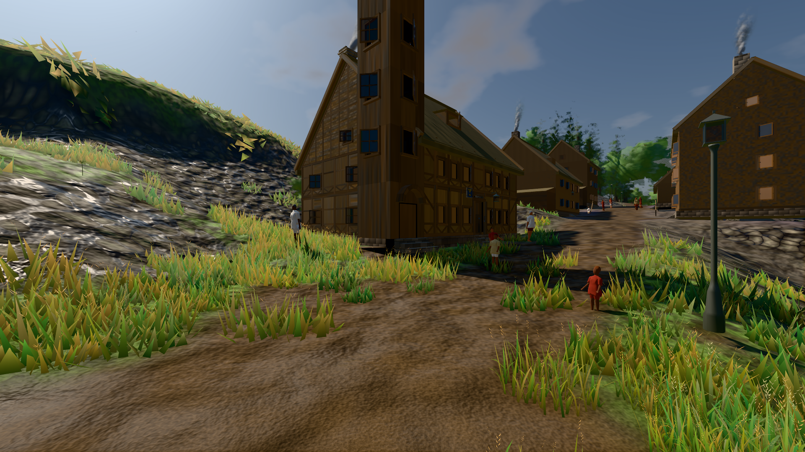

# GPU-PROBE 5f14914a — GRÜN

Zweig `fahrzeug-medium` · Kopf 5f14914aacb6af5fff15b418d506ed70954230da · Läufer omen-gtx1060 · 26.11. 06:07 · Wanduhr ab Push 1491 s · Lauf https://github.com/MiguellD/AnazhRealm/actions/runs/45756943697

Ruf: `gate:vehicle-drive bild:stadt-voll@0.55 bild:dorf@0.42 gate:webgl-probe`

## Läufer omen-gtx1060 — GRÜN

GPU NVIDIA GeForce GTX 1060 · node_modules bleiben (package-lock 370a9b0c)
Schloss /c/Users/micha/AppData/Local/Temp/claude/gpu-schloss hält „ci-runner 45756943697/1 probe“
- Hook 2026-11-26 05:50:52 start ci-runner 45756943697/1 probe: Schloss genommen (refs/heads/fahrzeug-medium 5f14914aacb6af5fff15b418d506ed70954230da ws=C:\actions-runner\_work\AnazhRealm\AnazhRealm)

### gate:vehicle-drive — GRÜN · 114 s · Läufer omen-gtx1060

Adapter: ungenannt (die Probe nannte keinen Browser-Adapter)

```text
  ✅ A8: das Gesetz der Kabine — an jeder Gattung hält jede Ecke des Regler-Paars Gürtel × Dach die Glas-Höhe (≥ 0.1 m) und baut endlich — 64 Ecken an 8 Gattungen · kleinste Glas-Höhe 0.100 m
  ✅ A9: das Boot fällt aus seinem Wasser und seiner Last (Hs 0,1 → 0,5 m: ≥ 1.3× höher, ≥ 3× Ecken; 200 → 400 kg: + 1.2 m) — See 8.23×0.61 m 940 Ecken · offen 6.69×1.11 m 2872 Ecken · schwer 11.07 m
  ✅ A6: die Reibellipse je Achse — im Bogen und in der Kehre ≤ 1.01 μ·g, die Handbremse 0.5–1 μ·g·b/L, geradeaus der Bremsweg ±1 % — gt 1 μ·g Hand 0.76 31.27 m · supersport 1 μ·g Hand 0.757 36.74 m · limousine 1 μ·g Hand 0.751 31.27 m · kompakt_fwd 1 μ·g Hand 0.725 31.27 m · suv 1 μ·g Hand 0.713 31.27 m · transporter 1 μ·g Hand 0.718 31.27 m · boot 0.473 μ·g Hand 0 0 m · karren 0.544 μ·g Hand 0.02 0.15 m
  ✅ B-a/B-b: jedes Fahrzeug-Rezept reiste BIT-EXAKT durch Worker+Ingest (Buch == Node-exportDrive) — gt,supersport,limousine,kompakt_fwd,suv,transporter,boot,karren
  ✅ B-h: die Stadt stadt-voll fährt ≥ 5 Gattungen des Kerns (Wagen ihres Verkehrs und Fahrzeug-Typen der Welt) — 21 von 21 Wagen · {"supersport":1,"kompakt_fwd":7,"limousine":4,"transporter":3,"suv":5,"gt":1} · in der Welt fahrzeug_supersport, fahrzeug_kompakt_fwd, fahrzeug_limousine, fahrzeug_transporter, fahrzeug_suv, fahrzeug_gt
  ✅ B-c: _vehicleProfile(fahrzeug_gt) traegt die LAB-Werte (topSpeedMul/kAcc/kBrake === exportDrive) — kAcc=0.1021105748651266
  ✅ B-d/B2: FAHR-PROBE — nach 120 Fahr-Ticks: Eintrag > 1 m bewegt · Blocker ziehen mit · Snapshot traegt es — kind=instanced dist=14.40m
  ✅ B-f/W5: STAND — ein geparkter GT steht am Hang auf seinen vier Rädern (längs und quer) — größter Rad-Spalt 0.115 m über 6 Hang-Proben (Steigung [0.13,0.13,0.13,0.13,0.13,0.25], je [0.023,0.099,0.115,0.049,0.014,0.007])
  ✅ B-g: FORM — der schwere Stempel fährt den Motor seines Rezepts (Leistung × 1 am Fahr-Satz des Ritts) — Masse × 1.8963, Leistung × 1.000000
✅ GRÜN — DAS LAB-FAHRPROFIL FÜHRT (N6): die Bruecke rechnet exportDrive beim Buch-Bau bit-exakt, _vehicleProfile faehrt die Lab-Werte, der Bewegungs-Loop ist EIN Pfad.
```

### bild:stadt-voll@0.55 — GRÜN · 171 s · Läufer omen-gtx1060

Adapter: [linse-gpu] nvidia/pascal

```text
Kamera des Spiels → Blick (15.0 m): 842.49 57.57 451.79 857.26 57.57 449.21
 "abnahme": "ABNAHME GRÜN · beweis · Sicht 0.0 % · Leib im Vordergrund 4.0 % (Leib bewohner 4.0 %) · Leiber näher als 6 m: 2 von 2 ganz (13 Teile) · Ziel Blickziel im Bild frei 14.99 m · Luma 107.4 σ 36.1 schwarz 0.0 % weiß 0.0 % · Stand 18.546.428 · Bühne summer sunny 0.55 Tiere gehalten · Gerät WebGPU nvidia pascal · Inhalt bauSatz 19.2 % (≥ 2.0 %) Luma 127, bewohner 8.0 % (≥ 1.0 %) Luma 116",
```



### bild:dorf@0.42 — GRÜN · 89 s · Läufer omen-gtx1060

Adapter: [linse-gpu] nvidia/pascal

```text
Kamera des Spiels → Blick (11.3 m): -720.31 44.15 -922.46 -709.17 44.15 -920.56
 "abnahme": "ABNAHME GRÜN · beweis · Sicht 0.0 % · Ziel Blickziel im Bild frei 11.3 m · Luma 83.5 σ 45.8 schwarz 0.3 % weiß 0.0 % · Stand 18.546.428 · Bühne summer sunny 0.42 Tiere gehalten · Gerät WebGPU nvidia pascal · Inhalt bauSatz 17.0 % (≥ 2.0 %) Luma 37",
```



### gate:webgl-probe — GRÜN · 56 s · Läufer omen-gtx1060

Adapter: [linse-gpu] webgl2/NVIDIA GeForce GTX 1060 (0x00001C60) Direct3D11 vs_5_0 ps_5_0

```text
✅ GRÜN — die Kein-WebGPU-Geschichte ist BEWIESEN: der erzwungene WebGL2-Rückfall bootet eine LEBENDE, sichtbare Welt; die WGSL-Konsumenten + Bundles ruhen hinter der EINEN Backend-Wand, der Rückfall ist LAUT benannt, der Fern-Ring trägt auf CPU.
```
