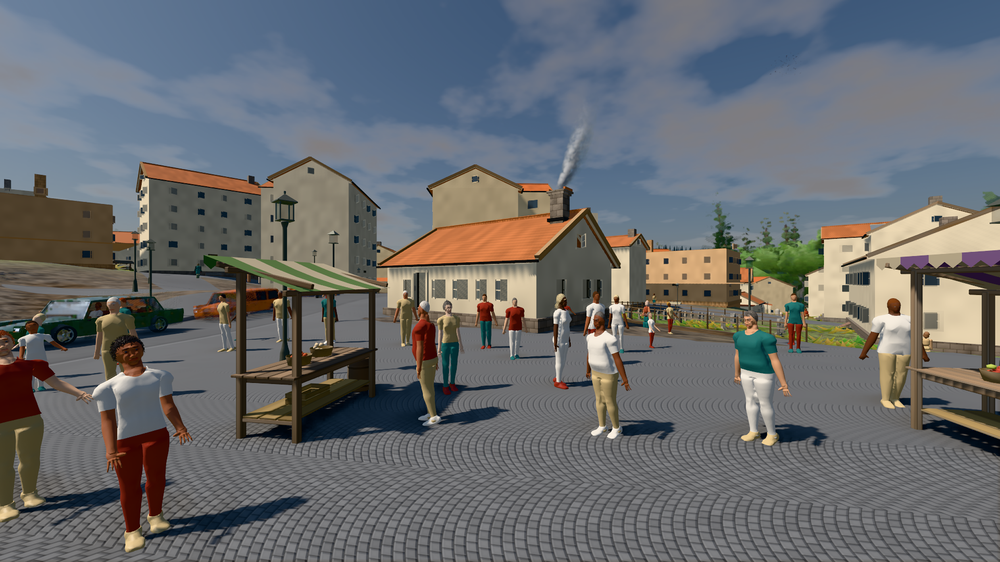

# GPU-PROBE f85ad928 — ROT

Zweig `fahrzeug-medium` · Kopf f85ad92880cb0e03461dd9fc121309a26e033548 · Läufer gtx1050-desktop · 26.11. 11:10 · Wanduhr ab Push 3170 s · Lauf https://github.com/MiguellD/AnazhRealm/actions/runs/45790616358

Ruf: `gate:pruefbuehne-licht gate:weltbild-frost:echt gate:studio-begehen bild:stadt-voll@0.55 gate:webgl-probe`

## Läufer gtx1050-desktop — ROT

GPU NVIDIA GeForce GTX 1050 · npm ci 61 s (package-lock f14185d8)
Schloss /c/Users/User/AppData/Local/Temp/claude/gpu-schloss hält „ci-runner 45790616358/1 probe“
- Hook 2026-11-26 10:34:26 start ci-runner 45790616358/1 probe: Schloss genommen (refs/heads/fahrzeug-medium f85ad92880cb0e03461dd9fc121309a26e033548 ws=C:\actions-runner\_work\AnazhRealm\AnazhRealm)

### gate:pruefbuehne-licht — ROT · 97 s · Läufer gtx1050-desktop

Adapter: [linse-gpu] nvidia/pascal · ⛔ S0 Himmel: nach dem Sprung auf Mitternacht trägt die Umgebung die Bestrahlung 3.289e-8, der Himmel des Orts 2.74e-8 — die Himmels-Umgebung (`_ensureSkyEnvironment`) folgt dem Sprung der Uhr nicht: gemalt vor der Luft-F

```text
  S0 BODEN-PROGRAMM 1/1: 108011 Zeichen WGSL (gebuchter Stand 108011, ±0 — Auskunft, kein Urteil) · Pipeline asynchron → GRÜN · kalt 1959 · 1957 · 1955 · 2151 · 1949 · 1922 · 2010 · 1900 · 1928 ms, Median 1955 ms · ÷ K17 derselben Sitzung 0,76 (Auskunft, kein Zeit-Urteil)
    ⛔ S0 Himmel: nach dem Sprung auf Mitternacht trägt die Umgebung die Bestrahlung 3.289e-8, der Himmel des Orts 2.74e-8 — die Himmels-Umgebung (`_ensureSkyEnvironment`) folgt dem Sprung der Uhr nicht: gemalt vor der Luft-Farbe (`_dayNightApplyLuft`) oder vom Sprung in der Raten-Drossel (SKY_ENV_REGEN_MIN_MS) gehalten
    ⛔ S0 Himmel: der Himmel der Nacht fehlt — um Mitternacht trägt die Umgebung 3.289e-8, der Himmel des Orts 2.74e-8, das Gesetz allein im Sternen-Licht π · nachtHimmel = 3.108e-8 (Sonne -22.08°) — die Tafeln tragen Mond und Sterne nicht (`__weltLicht.tafelLicht` aus `_atmoTakt`: `AnazhRealm.MOONLIGHT`, `_atmoSternenLicht`)
  SELBSTTEST S0 NACHT (die Sicht des Mondes): getroffen — ohne Mond-Sicht „S0 Nacht: das Licht der Nacht trifft keinen Boden 1–3 m (Mond-Sicht 0 an jedem Pixel des Rings, Mond 22.08°)“ · schwarz 8 % im Licht → ROT · schwarz 8 % allein im Schatten grün
⛔ S0 BILD ROT · Nacht {"luma":50.2,"schwarz":0,"gesetz":52.37} (76 s, nvidia/pascal · Holz kienspan)
```

### gate:weltbild-frost:echt — ROT · 424 s · Läufer gtx1050-desktop

Adapter: [linse-gpu] nvidia/pascal · ❌ dritte-person: B das Bild folgt der Kamera — 0.00 % der Blöcke (Soll ≥ 5 %)

```text
  ✅ tab-ich-buehne: W die Wachen des Spiels stehen und schweigen — {"index":null,"gpu":null}
  ❌ hof-buehne: B das Bild folgt der Kamera — 0.00 % der Blöcke (Soll ≥ 5 %)
  ✅ hof-buehne: I jeder Index-Puffer der Welt-GPU trägt das gebundene Format
  ✅ hof-buehne: G kein WebGPU-Validierungsfehler
  ✅ hof-buehne: W die Wachen des Spiels stehen und schweigen — {"index":null,"gpu":null}
[welt-boot] FEHLER pageerror: Error: STOFF: die Ich-Bühne (Bühnen-Render) — Cannot set properties of undefined (setting 'depthClearValue') | at _stoffBruch (stamm/stoff-material.js:3731:19) | at _buehneRender (stamm/werkstatt-vorschau.js:1578:24) | at tick (stamm/werkstatt-hof.js:1419:22)
diag-weltbild-frost.cjs ABSTURZ: Error: DIE WELT HÄNGT: ein Bild der Bühne nach 3601 Takten — offen {"foundry":0,"chunks":0,"wald":0,"karten":14,"spiegel":0,"felder":0,"leiber":0,"dorf":0,"leib":0,"ankunft":0,"stau":0,"horizont":0,"blende":0,"huellen":0,"zeichnung":30,"tore":0,"alter":0,"wesen":0,"bau":0,"leute":0} ohne Bau-Ereignis · Wald: Saat 0 [] · Plan 0 · Pflanz-Warten 0 · Würfe 0 (außer Blick 0) · Nachwuchs 0 · Karten: fimp:birke|3:gnpnull,fimp:fichte|2:gnpnull,fimp:birke|2:gnpnull,fimp:tanne|1:gnpnull,fimp:eiche|3:gnpnull,fimp:totholz|1:gnpnull,fimp:eiche|2:gnpnull,fimp:eic
[welt-boot] ROT — 2 Fehler der Welt:
  ❌ post-kette: [AnazhRealm V18.546.434] [ERROR] STOFF: die Post-Kette (Render-Lauf: TRAA · Bloom · Grading) — der Schirm zeichnet direkt — Cannot read properties of null (reading 'length')
  ❌ pageerror: Error: STOFF: die Ich-Bühne (Bühnen-Render) — Cannot set properties of undefined (setting 'depthClearValue') | at _stoffBruch (stamm/stoff-material.js:3731:19) | at _buehneRender (stamm/werkstatt-vorschau.js:1578:24) | at tick (stamm/werkstatt-hof.js:1419:22)
```

### gate:studio-begehen — GRÜN · 472 s · Läufer gtx1050-desktop

Adapter: [linse-gpu] nvidia/pascal

```text
  ✅ Selbsttest „ruecken" macht B3 Speicher rot — B3 Speicher: 2 Häuser mit Dachraum ohne Speicherlauf, obwohl am First Kopfraum steht (#0 635014 provenzalisch/kirche Speicher zu: First 2.68 m, Stufe 0.2 m, Stehraum 3.21 m · #2 723323 provenzalisch/pfarrhaus Speicher zu: First 2.80 m, Stufe 0.2 m, Stehraum 3.54 m)
[stall-akte] Stderr [17804:12484:1126/104741.376:ERROR:services\on_device_model\public\cpp\service_client.cc:37] Unexpected on_device_model service disconnect; reason: 1, description: Error loading backend.
[stall-akte] Stderr [17804:11572:1126/104913.382:ERROR:google_apis\gcm\engine\mcs_client.cc:702]   Error code: 401  Error message: Authentication Failed: wrong_secret
  ✅ Selbsttest „platte" macht B4 Keller-Decke rot — B4 Keller-Decke = Boden-Platte in 7 von 8
[stall-akte] Stderr [17804:12484:1126/104741.376:ERROR:services\on_device_model\public\cpp\service_client.cc:37] Unexpected on_device_model service disconnect; reason: 1, description: Error loading backend.
[stall-akte] Stderr [17804:11572:1126/104913.382:ERROR:google_apis\gcm\engine\mcs_client.cc:702]   Error code: 401  Error message: Authentication Failed: wrong_secret
  ✅ Selbsttest „flach" macht B5 Weltgrund rot — B5 Weltgrund: die Häuser stehen eben (Spanne 0 m)
[stall-akte] Stderr [17804:12484:1126/104741.376:ERROR:services\on_device_model\public\cpp\service_client.cc:37] Unexpected on_device_model service disconnect; reason: 1, description: Error loading backend.
[stall-akte] Stderr [17804:11572:1126/104913.382:ERROR:google_apis\gcm\engine\mcs_client.cc:702]   Error code: 401  Error message: Authentication Failed: wrong_secret
✅ gate:studio-begehen grün
```

### bild:stadt-voll@0.55 — GRÜN · 371 s · Läufer gtx1050-desktop

Adapter: [linse-gpu] nvidia/pascal

```text
Kamera des Spiels → Blick (15.0 m): 842.49 57.57 451.79 857.26 57.57 449.21
 "abnahme": "ABNAHME GRÜN · beweis · Sicht 0.0 % · Leib im Vordergrund 3.8 % (Leib bewohner 3.8 %) · Leiber näher als 6 m: 4 von 4 ganz (29 Teile) · Ziel Blickziel im Bild frei 14.99 m · Luma 107 σ 36 schwarz 0.0 % weiß 0.0 % · Stand 18.546.434 · Bühne summer sunny 0.55 Tiere gehalten · Gerät WebGPU nvidia pascal · Inhalt bauSatz 19.3 % (≥ 2.0 %) Luma 127, bewohner 7.3 % (≥ 1.0 %) Luma 113",
```



### gate:webgl-probe — GRÜN · 125 s · Läufer gtx1050-desktop

Adapter: [linse-gpu] webgl2/NVIDIA GeForce GTX 1050 (0x00001C81) Direct3D11 vs_5_0 ps_5_0

```text
✅ GRÜN — die Kein-WebGPU-Geschichte ist BEWIESEN: der erzwungene WebGL2-Rückfall bootet eine LEBENDE, sichtbare Welt; die WGSL-Konsumenten + Bundles ruhen hinter der EINEN Backend-Wand, der Rückfall ist LAUT benannt, der Fern-Ring trägt auf CPU.
```
