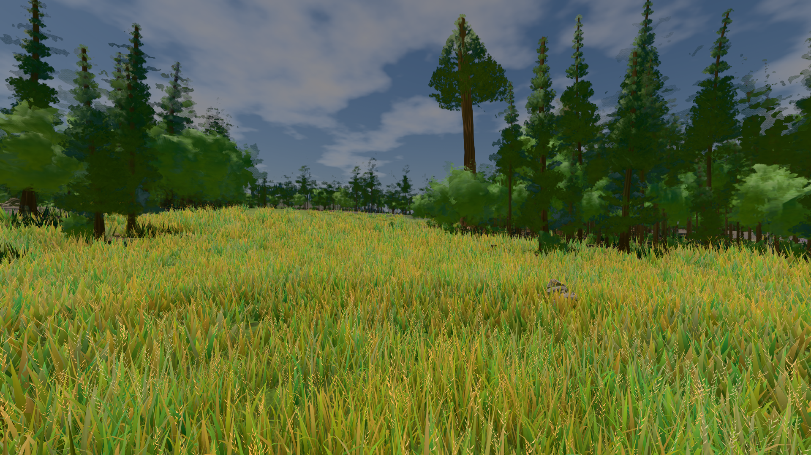

# GPU-PROBE 829d84ac — GRÜN

Zweig `front-planet-leben` · Kopf 829d84acd53f78f42bfe3c81edafb7364b91a89f · Läufer omen-gtx1060 · 22.11. 07:38 · Wanduhr ab Push 947 s · Lauf https://github.com/MiguellD/AnazhRealm/actions/runs/44993457319

Ruf: `bild:wiese@0.5 gate:pflanzen-nah gate:fernwald gate:webgl-probe`

## Läufer omen-gtx1060 — GRÜN

GPU NVIDIA GeForce GTX 1060 · node_modules bleiben (package-lock bf2c0bf2)
Schloss /c/Users/micha/AppData/Local/Temp/claude/gpu-schloss hält „ci-runner 44993457319/1 probe“
- Hook 2026-11-22 07:23:07 start ci-runner 44993457319/1 probe: wartet auf Schloss von 'omen-omen-fahr-leben'
- Hook 2026-11-22 07:29:09 start ci-runner 44993457319/1 probe: Schloss genommen (refs/heads/front-planet-leben 829d84acd53f78f42bfe3c81edafb7364b91a89f ws=C:\actions-runner\_work\AnazhRealm\AnazhRealm)

### bild:wiese@0.5 — GRÜN · 54 s · Läufer omen-gtx1060

Adapter: [linse-gpu] nvidia/pascal

```text
Kamera des Spiels → Blick (10.0 m): -280.40 29.71 -1045.60 -289.61 29.71 -1049.50
 "abnahme": "ABNAHME GRÜN · beweis · Sicht 0.0 % · Ziel Blickziel im Bild frei 10 m · Luma 99.3 σ 35.6 schwarz 0.0 % weiß 0.0 % · Stand 18.546.364 · Bühne summer sunny 0.50 Tiere gehalten · Gerät WebGPU nvidia pascal · Inhalt nahWiese 48.5 % (≥ 15.0 %) h 107° Luma 123",
```



### gate:pflanzen-nah — GRÜN · 53 s · Läufer omen-gtx1060

Adapter: ungenannt (die Probe nannte keinen Browser-Adapter)

```text
Selbsttest: gipsweiße Birke (0,85) ✅ · Ringel-Stamm (jeder 2. Ring ×0,5) ✅ · Klingen-Strauch ✅ · einfarbige Blüte ✅ · Blatt ×3 ✅ · Strauch-Blatt ×½ ✅ · Nadel ×3 ✅ · Klingen-L1 ✅ · Krone nach innen ✅ · Leser kehrt die Krone ✅ · Laubkrone als EINE gelichtet ✅ · Weide in der Großblatt-Zelle ✅ · BC gerade gelesen (ohne ÷ alpha) ✅ · Korn je Texel ✅ · Klecks ohne Lappen ✅ · Höhe gestaucht (Buche × 0,6) ✅ · Stamm × 4 (Buche H/D) ✅ · Krone × 1,4 (Eiche) ✅ · Stamm × ½ (Eiche Krone/BHD) ✅ · Karten-Stufe mit eigenem Stamm (Eiche L1 Ã
✅ GRÜN — 31 Fälle.
```

### gate:fernwald — GRÜN · 132 s · Läufer omen-gtx1060

Adapter: ungenannt (die Probe nannte keinen Browser-Adapter)

```text
  ✅ SELBSTTEST 5 (ein Haus ohne Grundriss macht F rot)
  ✅ H WALDMANTEL (die Krone folgt dem Seitenlicht) — 39 Rand-Bäume (11 am Trauf, mit Nachbarn), 25 im Innern · Kronen-Fuß der Trauf-Gestalt 0.101 H
  ✅ SELBSTTEST 9 (jeder Nachbar macht Bestand — H nennt den Rand-Baum mit kahlem Stamm) — 39 Rand-Bäume (11 am Trauf, mit Nachbarn), 25 im Innern · Täter (11): Rand-Baum mit kahlem Stamm zur offenen Seite: Eiche (-2123, -2153), 1 Nachbarn, Lücke 360°, Gestalt 2 statt 3 | Rand-Baum mit kahlem Stamm zur offenen Seite: Eiche (-2123, -2123), 5 Nachbarn, Lücke 273°, Gestalt 2 statt 3 | Rand-Baum mit kahlem Stamm zur offenen Seite: Eiche (-2123, -2093), 3 Nachbarn, Lücke 303°, Gestalt 2 statt 3
  ✅ SELBSTTEST 4 (ein Gedächtnis mit gekippter Gestalt macht E rot)
  ✅ G GEBURT (die Karte tritt an ihrem Rand ein und blendet in Takten ein) — Laub-Rand 240 m, 40 m Gang: 182 Eintritte im Saum, höchstens 29 je Schritt, Blende 0
  ✅ SELBSTTEST 6 (der Eintritt am Karten-Horizont macht G rot) — Laub-Rand 240 m, 40 m Gang: 428 Eintritte im Saum, höchstens 192 je Schritt · Täter: grown_busch_hazel_v0 253 m, Rand 211, Stempel 2667 | baum_tanne 243 m, Rand 213, Stempel 2673 | baum_eiche 260 m, Rand 219, Stempel 2667 | grown_busch_hazel_v1 267 m, Rand 228, Stempel 2668 | baum_kiefer 269 m, Rand 238, Stempel 2673 | baum_erle 272 m, Rand 230, Stempel 2667
  ✅ SELBSTTEST 7 (eine Karte ohne Blende macht G rot) — grown_busch_hazel_v2 230 m, Rand 231, Stempel 0
  ✅ SELBSTTEST 8 (ein Ding verlässt den Bestand, seine Instanz bleibt — C nennt es „gegangen, aber gezeichnet“) — baum_tanne @ 450 m (Slots 1715/4932 1715/4932): gezeichnet true
  ✅ T keine Ausnahme im Spiel-Takt
✅ GRÜN — der gesetzte Wald ist jenseits der Mesh-Zone seine Karte (1844 Bäume), kein Satz, kein Pop am Radius.
```

### gate:webgl-probe — GRÜN · 101 s · Läufer omen-gtx1060

Adapter: [linse-gpu] webgl2/NVIDIA GeForce GTX 1060 (0x00001C60) Direct3D11 vs_5_0 ps_5_0

```text
✅ GRÜN — die Kein-WebGPU-Geschichte ist BEWIESEN: der erzwungene WebGL2-Rückfall bootet eine LEBENDE, sichtbare Welt; die WGSL-Konsumenten + Bundles ruhen hinter der EINEN Backend-Wand, der Rückfall ist LAUT benannt, der Fern-Ring trägt auf CPU.
```
