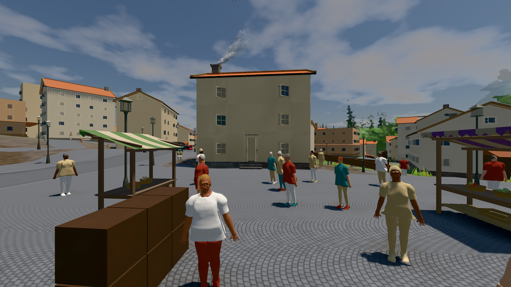

# GPU-PROBE 64837878 — ROT

Zweig `generationen-band` · Kopf 648378780f33ee3e36b7bed69cdd351c4a0b271e · Läufer radeon-890m · 23.11. 01:45 · Wanduhr ab Push 678 s · Lauf https://github.com/MiguellD/AnazhRealm/actions/runs/45089497765

Ruf: `gate:mensch-zuege bild:stadt-voll@0.5 gate:webgl-probe`

## Läufer radeon-890m — ROT

GPU AMD Radeon(TM) 890M Graphics · npm ci 68 s (package-lock bbe4dded)
Schloss /c/Users/micha/AppData/Local/Temp/claude/gpu-schloss hält „ci-runner 45089497765/1 probe“
- Hook 2026-11-23 01:34:29 start ci-runner 45089497765/1 probe: wartet auf Schloss von 'linse-brand-4b-2 2026-11-23T01:31:56+01:00 pid=27808'
- Hook 2026-11-23 01:35:42 start ci-runner 45089497765/1 probe: Schloss genommen (refs/heads/generationen-band 648378780f33ee3e36b7bed69cdd351c4a0b271e ws=C:\actions-runner\_work\AnazhRealm\AnazhRealm)

### gate:mensch-zuege — ROT · 32 s · Läufer radeon-890m

Adapter: ungenannt (die Probe nannte keinen Browser-Adapter) · Täter das Alter 0,05–0,5 wie vorher: ROT — Anteil unter 15 J 0.000 < 0,35 — Täter: stamm/koerper-leib.js _rollHumanoidGenome, das Alter nicht aus koerper epochenAlter (ALTER_GESETZ.pyramide)

```text
  Täter das Alter 0,05–0,5 wie vorher: ROT — Anteil unter 15 J 0.000 < 0,35 — Täter: stamm/koerper-leib.js _rollHumanoidGenome, das Alter nicht aus koerper epochenAlter (ALTER_GESETZ.pyramide)
  Täter die Wahl ohne Lebensphase: ROT — 50 Kinder in der Gestalt eines Erwachsenen — Täter: stamm/siedlung-bewohner.js _bewohnerAbstand ohne koerper alterAbstand (die Lebensphase)
  Täter der Wuchs ohne Höhe: ROT — Wuchs außer Band [{"J":2,"hoehe":1,"soll":0.507,"kopf":1.607,"kopfSoll":0.82},{"J":4,"hoehe":1,"soll":0.593,"kopf":1.433,"kopfSoll":0.86},{"J":6,"hoehe":1,"soll
  Täter das Kind ohne Reife: ROT — Kind-Gestalten unter 10 J mit der Form eines Geschlechts [[3.7,0.229],[7.6,0.927]] (J, sex) — Täter: koerper alterGeschlecht / alterLeib (reife)
✅ Selbsttest: alle 3 Täter des Zugs und die 4 des Alters (Alter wie vorher, Wahl ohne Lebensphase, Wuchs ohne Höhe, Kind ohne Reife) fallen ROT an ihrer Zeile.
✅ DER ZUG ÄNDERT DEN TAG — 0.90 der ersten 20 und 0.85 aller 100 blind ihrem Zug zugeordnet, jeder Zug ≥ 0,6, bit-gleich · DAS ALTER DER EPOCHE — 38.6 % unter 15 J (≥ 35 %), kein Kind in Erwachsenen-Gestalt, der Wuchs im Band
```

### bild:stadt-voll@0.5 — GRÜN · 174 s · Läufer radeon-890m

Adapter: [linse-gpu] amd/rdna-3

```text
Kamera des Spiels → Blick (14.9 m): 842.49 57.57 451.79 857.31 57.57 450.33
 "abnahme": "ABNAHME GRÜN · beweis · Sicht 0.0 % · Leib im Vordergrund 5.4 % (Leib bewohner 5.4 %) · Leiber näher als 6 m: 3 von 3 ganz (21 Teile) · Ziel Blickziel im Bild frei 14.89 m · Luma 100.1 σ 38.3 schwarz 0.1 % weiß 0.0 % · Stand 18.546.373 · Bühne summer sunny 0.50 Tiere gehalten · Gerät WebGPU amd rdna-3 · Inhalt bauSatz 22.6 % (≥ 2.0 %) Luma 96, bewohner 6.2 % (≥ 1.0 %) Luma 100",
```



### gate:webgl-probe — GRÜN · 69 s · Läufer radeon-890m

Adapter: [linse-gpu] webgl2/AMD Radeon(TM) 890M Graphics (0x0000150E) Direct3D11 vs_5_0 ps_5_0

```text
✅ GRÜN — die Kein-WebGPU-Geschichte ist BEWIESEN: der erzwungene WebGL2-Rückfall bootet eine LEBENDE, sichtbare Welt; die WGSL-Konsumenten + Bundles ruhen hinter der EINEN Backend-Wand, der Rückfall ist LAUT benannt, der Fern-Ring trägt auf CPU.
```
