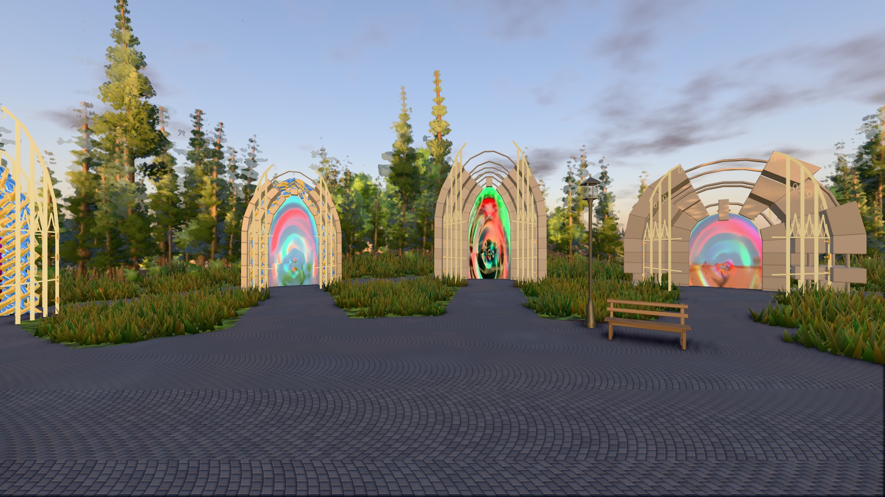
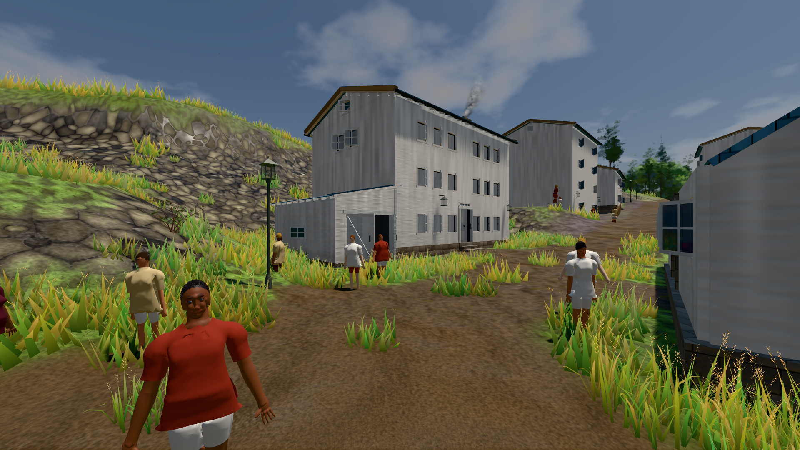

# GPU-PROBE 111af1a6 — GRÜN

Zweig `haus-gefuege` · Kopf 111af1a62607eb2f551ae04809bc492d992cd5d8 · Läufer gtx1050-desktop · 23.11. 06:51 · Wanduhr ab Push 910 s · Lauf https://github.com/MiguellD/AnazhRealm/actions/runs/45118804887

Ruf: `gate:webgl-probe bild:genesis@0.27 bild:dorf@0.5 gate:studio-begehen`

## Läufer gtx1050-desktop — GRÜN

GPU NVIDIA GeForce GTX 1050 · npm ci 37 s (package-lock 711a1ce5)
Schloss /c/Users/User/AppData/Local/Temp/claude/gpu-schloss hält „ci-runner 45118804887/1 probe“
- Hook 2026-11-23 06:36:27 start ci-runner 45118804887/1 probe: Schloss genommen (refs/heads/haus-gefuege 111af1a62607eb2f551ae04809bc492d992cd5d8 ws=C:\actions-runner\_work\AnazhRealm\AnazhRealm)

### gate:webgl-probe — GRÜN · 99 s · Läufer gtx1050-desktop

Adapter: [linse-gpu] webgl2/NVIDIA GeForce GTX 1050 (0x00001C81) Direct3D11 vs_5_0 ps_5_0

```text
✅ GRÜN — die Kein-WebGPU-Geschichte ist BEWIESEN: der erzwungene WebGL2-Rückfall bootet eine LEBENDE, sichtbare Welt; die WGSL-Konsumenten + Bundles ruhen hinter der EINEN Backend-Wand, der Rückfall ist LAUT benannt, der Fern-Ring trägt auf CPU.
```

### bild:genesis@0.27 — GRÜN · 91 s · Läufer gtx1050-desktop

Adapter: [linse-gpu] nvidia/pascal

```text
Kamera des Spiels → Blick (10.0 m): 0.00 92.40 0.00 -10.00 92.40 0.00
 "abnahme": "ABNAHME GRÜN · beweis · Sicht 0.0 % · Ziel Blickziel im Bild frei 10 m · Luma 120.5 σ 59.6 schwarz 0.0 % weiß 0.0 % · Stand 18.546.378 · Bühne summer sunny 0.27 Tiere gehalten · Gerät WebGPU nvidia pascal · Inhalt bodenSatz 36.6 % (≥ 15.0 %) Luma 68, portal-membran 2.7 % (≥ 0.3 %) Luma 163",
```



### bild:dorf@0.5 — GRÜN · 155 s · Läufer gtx1050-desktop

Adapter: [linse-gpu] nvidia/pascal

```text
Kamera des Spiels → Blick (12.9 m): -715.86 49.01 -932.69 -702.99 49.01 -931.86
 "abnahme": "ABNAHME GRÜN · beweis · Sicht 0.0 % · Leib im Vordergrund 4.9 % (Leib bewohner 4.9 %) · Leiber näher als 6 m: 1 von 1 ganz (7 Teile) · Ziel Blickziel im Bild frei 12.9 m · Luma 93.7 σ 31.1 schwarz 0.1 % weiß 0.0 % · Stand 18.546.378 · Bühne summer sunny 0.50 Tiere gehalten · Gerät WebGPU nvidia pascal · Inhalt bauSatz 20.2 % (≥ 2.0 %) Luma 94",
```



### gate:studio-begehen — GRÜN · 477 s · Läufer gtx1050-desktop

Adapter: [linse-gpu] nvidia/pascal

```text
  ✅ Selbsttest „ruecken" macht B3 Speicher rot — B3 Speicher: 2 Häuser mit Dachraum ohne Speicherlauf, obwohl am First Kopfraum steht (#0 635014 provenzalisch/kirche Speicher zu: First 2.68 m, Stufe 0.2 m, Stehraum 3.21 m · #2 723323 provenzalisch/pfarrhaus Speicher zu: First 2.80 m, Stufe 0.2 m, Stehraum 3.54 m)
[stall-akte] Stderr [3336:10960:1123/064613.377:ERROR:services\on_device_model\public\cpp\service_client.cc:37] Unexpected on_device_model service disconnect; reason: 1, description: Error loading backend.
[stall-akte] Stderr [3336:8068:1123/064744.410:ERROR:google_apis\gcm\engine\mcs_client.cc:702]   Error code: 401  Error message: Authentication Failed: wrong_secret
  ✅ Selbsttest „platte" macht B4 Keller-Decke rot — B4 Keller-Decke = Boden-Platte in 7 von 8
[stall-akte] Stderr [3336:10960:1123/064613.377:ERROR:services\on_device_model\public\cpp\service_client.cc:37] Unexpected on_device_model service disconnect; reason: 1, description: Error loading backend.
[stall-akte] Stderr [3336:8068:1123/064744.410:ERROR:google_apis\gcm\engine\mcs_client.cc:702]   Error code: 401  Error message: Authentication Failed: wrong_secret
  ✅ Selbsttest „flach" macht B5 Weltgrund rot — B5 Weltgrund: die Häuser stehen eben (Spanne 0 m)
[stall-akte] Stderr [3336:10960:1123/064613.377:ERROR:services\on_device_model\public\cpp\service_client.cc:37] Unexpected on_device_model service disconnect; reason: 1, description: Error loading backend.
[stall-akte] Stderr [3336:8068:1123/064744.410:ERROR:google_apis\gcm\engine\mcs_client.cc:702]   Error code: 401  Error message: Authentication Failed: wrong_secret
✅ gate:studio-begehen grün
```
