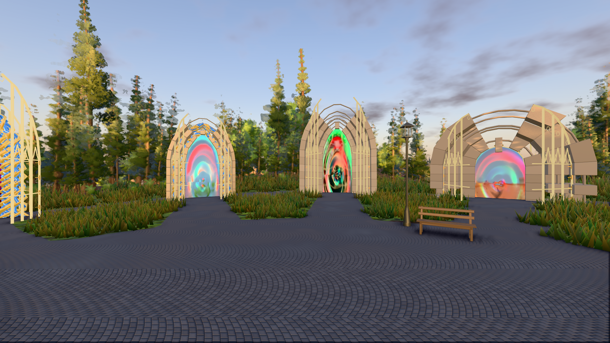
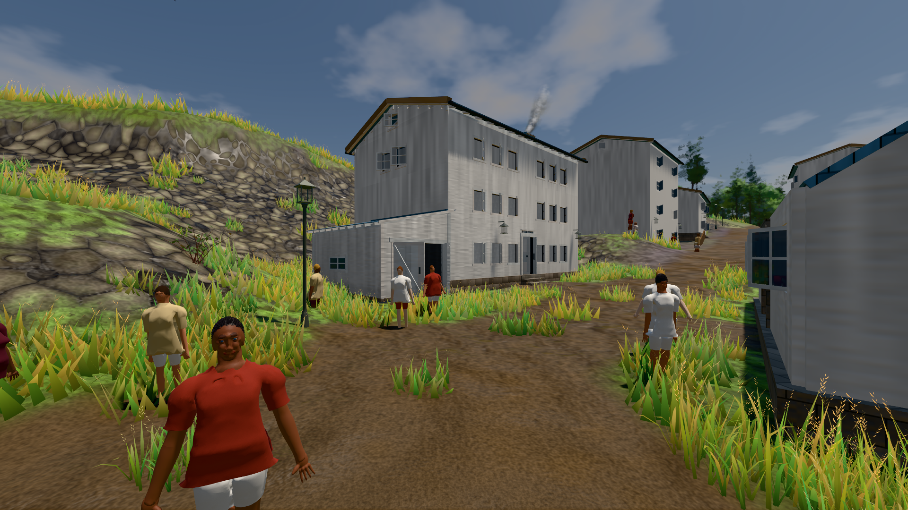

# GPU-PROBE ec33234c — NACHGEGEBEN

Zweig `haus-gefuege` · Kopf ec33234c205d80efdca73cfc69f42e3967795de5 · Läufer gtx1050-desktop · 23.11. 06:05 · Wanduhr ab Push 670 s · Lauf https://github.com/MiguellD/AnazhRealm/actions/runs/45114534610

Ruf: `gate:webgl-probe bild:genesis@0.27 bild:dorf@0.5 gate:studio-begehen`

## Läufer gtx1050-desktop — NACHGEGEBEN

GPU NVIDIA GeForce GTX 1050 · node_modules bleiben (package-lock 46829d76)
Schloss /c/Users/User/AppData/Local/Temp/claude/gpu-schloss hält „ci-runner 45114534610/1 probe“
- Hook 2026-11-23 05:54:25 start ci-runner 45114534610/1 probe: Schloss genommen (refs/heads/haus-gefuege ec33234c205d80efdca73cfc69f42e3967795de5 ws=C:\actions-runner\_work\AnazhRealm\AnazhRealm)

### gate:webgl-probe — GRÜN · 103 s · Läufer gtx1050-desktop

Adapter: [linse-gpu] webgl2/NVIDIA GeForce GTX 1050 (0x00001C81) Direct3D11 vs_5_0 ps_5_0

```text
✅ GRÜN — die Kein-WebGPU-Geschichte ist BEWIESEN: der erzwungene WebGL2-Rückfall bootet eine LEBENDE, sichtbare Welt; die WGSL-Konsumenten + Bundles ruhen hinter der EINEN Backend-Wand, der Rückfall ist LAUT benannt, der Fern-Ring trägt auf CPU.
```

### bild:genesis@0.27 — GRÜN · 82 s · Läufer gtx1050-desktop

Adapter: [linse-gpu] nvidia/pascal

```text
Kamera des Spiels → Blick (10.0 m): 0.00 92.40 0.00 -10.00 92.40 0.00
 "abnahme": "ABNAHME GRÜN · beweis · Sicht 0.0 % · Ziel Blickziel im Bild frei 10 m · Luma 120.5 σ 59.6 schwarz 0.0 % weiß 0.0 % · Stand 18.546.377 · Bühne summer sunny 0.27 Tiere gehalten · Gerät WebGPU nvidia pascal · Inhalt bodenSatz 36.6 % (≥ 15.0 %) Luma 68, portal-membran 2.7 % (≥ 0.3 %) Luma 163",
```



### bild:dorf@0.5 — GRÜN · 162 s · Läufer gtx1050-desktop

Adapter: [linse-gpu] nvidia/pascal

```text
Kamera des Spiels → Blick (12.9 m): -715.86 49.01 -932.69 -702.99 49.01 -931.86
 "abnahme": "ABNAHME GRÜN · beweis · Sicht 0.0 % · Leib im Vordergrund 5.0 % (Leib bewohner 5.0 %) · Leiber näher als 6 m: 1 von 1 ganz (7 Teile) · Ziel Blickziel im Bild frei 12.9 m · Luma 93.7 σ 31.1 schwarz 0.1 % weiß 0.0 % · Stand 18.546.377 · Bühne summer sunny 0.50 Tiere gehalten · Gerät WebGPU nvidia pascal · Inhalt bauSatz 20.2 % (≥ 2.0 %) Luma 94",
```



### gate:studio-begehen — NACHGEGEBEN · 236 s · Läufer gtx1050-desktop

Adapter: [linse-gpu] nvidia/pascal · NACHGEGEBEN: Karten-Job „echt gtx1050 (GPU-Wände auf der Karte)“ (Lauf 45115415286) wartet auf diesen Läufer (gtx1050-gpu)

```text
  ✅ Selbsttest „huelle" macht B1 Hülle nach Promotion + B1 Hülle nach Demotion rot — B1 Hülle nach Promotion: 10 von 10 Häusern zu | B1 Hülle nach Demotion: 0 von 2 Häusern (Geister)
  ✅ Selbsttest „kopf" macht B3 Kopf rot — B3 Kopf: 27 von 120 Treppen-Läufen enden im Solid
  ✅ Selbsttest „kappe" macht B3 Steigen rot — B3 Steigen: 21 von 24 Treppen erreichen ihre Höhe (EG→OG 9/9 · OG→OG 12/12 · Speicher 0/3)
  ✅ Selbsttest „spur" macht B3 Steigen rot — B3 Steigen: 15 von 24 Treppen erreichen ihre Höhe (EG→OG 9/9 · OG→OG 3/12 · Speicher 3/3)
[stall-akte] Stderr [5084:1304:1123/060334.682:ERROR:services\on_device_model\public\cpp\service_client.cc:37] Unexpected on_device_model service disconnect; reason: 1, description: Error loading backend.
  ✅ Selbsttest „austritt" macht B3 Kopfraum rot — B3 Kopfraum: 14 Austritte unter 1.7 m (min 0.99 m — der Kopf steht im Dach: #0 635014 provenzalisch/kirche sattel speicher 1.69 · #0 635014 provenzalisch/kirche sattel speicher 1.68 · #2 723323 provenzalisch/pfarrhaus sattel speicher 1.2 · #2 723323 provenzalisch/pfarrhaus sattel speicher 1.21 · #3 773412 italienisch/wohnhaus sattel speicher 1 · #3 773412 italienisch/wohnhaus sattel speicher 0.99 · #8 351993 provenzalisch/wohnhaus sattel speicher 1.26 · #8 351993 provenzalisch/wohnhaus sattel speicher 1.15 · #8 351993 provenzali
```
