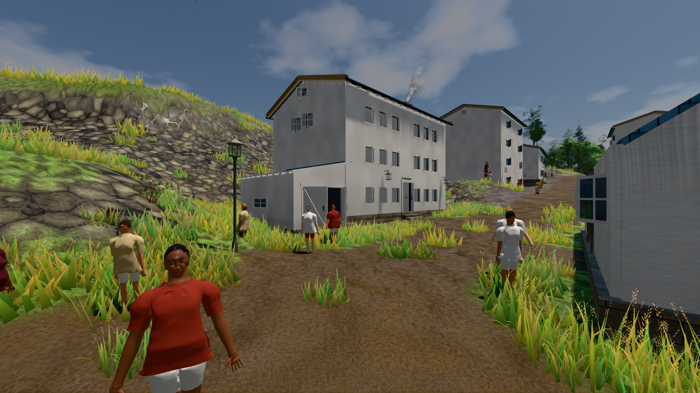

# GPU-PROBE 0a23c12b — GRÜN

Zweig `haus-ziegel-putz` · Kopf 0a23c12b0af31c705f082ed7311277013c632b0d · Läufer gtx1050-desktop · 23.11. 13:13 · Wanduhr ab Push 1203 s · Lauf https://github.com/MiguellD/AnazhRealm/actions/runs/45169261251

Ruf: `bild:dorf@0.5 gate:studio-begehen gate:webgl-probe`

## Läufer gtx1050-desktop — GRÜN

GPU NVIDIA GeForce GTX 1050 · node_modules bleiben (package-lock fe4522c5)
Schloss /c/Users/User/AppData/Local/Temp/claude/gpu-schloss hält „ci-runner 45169261251/1 probe“
- Hook 2026-11-23 12:55:44 start ci-runner 45169261251/1 probe: wartet auf Schloss von 'hand nacht-laterne (Claude)'
- Hook 2026-11-23 13:00:18 start ci-runner 45169261251/1 probe: Schloss genommen (refs/heads/haus-ziegel-putz 0a23c12b0af31c705f082ed7311277013c632b0d ws=C:\actions-runner\_work\AnazhRealm\AnazhRealm)

### bild:dorf@0.5 — GRÜN · 182 s · Läufer gtx1050-desktop

Adapter: [linse-gpu] nvidia/pascal

```text
Kamera des Spiels → Blick (12.9 m): -715.86 49.01 -932.69 -702.99 49.01 -931.86
 "abnahme": "ABNAHME GRÜN · beweis · Sicht 0.0 % · Leib im Vordergrund 5.0 % (Leib bewohner 5.0 %) · Leiber näher als 6 m: 1 von 1 ganz (7 Teile) · Ziel Blickziel im Bild frei 12.9 m · Luma 94 σ 31 schwarz 0.1 % weiß 0.0 % · Stand 18.546.382 · Bühne summer sunny 0.50 Tiere gehalten · Gerät WebGPU nvidia pascal · Inhalt bauSatz 20.2 % (≥ 2.0 %) Luma 96",
```



### gate:studio-begehen — GRÜN · 491 s · Läufer gtx1050-desktop

Adapter: [linse-gpu] nvidia/pascal

```text
[stall-akte] Stderr [9272:5960:1123/130652.342:ERROR:services\on_device_model\public\cpp\service_client.cc:37] Unexpected on_device_model service disconnect; reason: 1, description: Error loading backend.
  ✅ Selbsttest „dachlos" macht B3 Dach rot — B3 Dach: 7 Speicher-Austritte ohne Dach über dem Kopf (der Lauf steigt durch das Dach)
[stall-akte] Stderr [9272:5960:1123/130652.342:ERROR:services\on_device_model\public\cpp\service_client.cc:37] Unexpected on_device_model service disconnect; reason: 1, description: Error loading backend.
  ✅ Selbsttest „ruecken" macht B3 Speicher rot — B3 Speicher: 2 Häuser mit Dachraum ohne Speicherlauf, obwohl am First Kopfraum steht (#0 635014 provenzalisch/kirche Speicher zu: First 2.68 m, Stufe 0.2 m, Stehraum 3.21 m · #2 723323 provenzalisch/pfarrhaus Speicher zu: First 2.80 m, Stufe 0.2 m, Stehraum 3.54 m)
[stall-akte] Stderr [9272:5960:1123/130652.342:ERROR:services\on_device_model\public\cpp\service_client.cc:37] Unexpected on_device_model service disconnect; reason: 1, description: Error loading backend.
  ✅ Selbsttest „platte" macht B4 Keller-Decke rot — B4 Keller-Decke = Boden-Platte in 7 von 8
[stall-akte] Stderr [9272:5960:1123/130652.342:ERROR:services\on_device_model\public\cpp\service_client.cc:37] Unexpected on_device_model service disconnect; reason: 1, description: Error loading backend.
  ✅ Selbsttest „flach" macht B5 Weltgrund rot — B5 Weltgrund: die Häuser stehen eben (Spanne 0 m)
[stall-akte] Stderr [9272:5960:1123/130652.342:ERROR:services\on_device_model\public\cpp\service_client.cc:37] Unexpected on_device_model service disconnect; reason: 1, description: Error loading backend.
✅ gate:studio-begehen grün
```

### gate:webgl-probe — GRÜN · 100 s · Läufer gtx1050-desktop

Adapter: [linse-gpu] webgl2/NVIDIA GeForce GTX 1050 (0x00001C81) Direct3D11 vs_5_0 ps_5_0

```text
✅ GRÜN — die Kein-WebGPU-Geschichte ist BEWIESEN: der erzwungene WebGL2-Rückfall bootet eine LEBENDE, sichtbare Welt; die WGSL-Konsumenten + Bundles ruhen hinter der EINEN Backend-Wand, der Rückfall ist LAUT benannt, der Fern-Ring trägt auf CPU.
```
