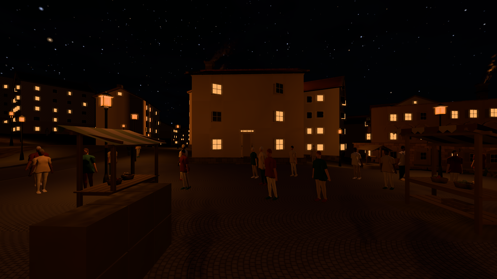

# GPU-PROBE 0a142819 — GRÜN

Zweig `heap-register-2` · Kopf 0a1428194e21866b1bc65d4ecbe0843facd18e1f · Läufer omen-gtx1060 · 22.11. 23:26 · Wanduhr ab Push 3206 s · Lauf https://github.com/MiguellD/AnazhRealm/actions/runs/45072765459

Ruf: `gate:pruefbuehne-licht gate:weltbild-frost:echt gate:studio-begehen bild:stadt-voll@0 gate:webgl-probe`

## Läufer omen-gtx1060 — GRÜN

GPU NVIDIA GeForce GTX 1060 · node_modules bleiben (package-lock 98869e32)
Schloss /c/Users/micha/AppData/Local/Temp/claude/gpu-schloss hält „ci-runner 45072765459/3 probe“
- Hook 2026-11-22 23:13:48 start ci-runner 45072765459/3 probe: wartet auf Schloss von 'omen-punkte-gtx-sitzung'
- Hook 2026-11-22 23:14:19 start ci-runner 45072765459/3 probe: Schloss genommen (refs/heads/heap-register-2 0a1428194e21866b1bc65d4ecbe0843facd18e1f ws=C:\actions-runner\_work\AnazhRealm\AnazhRealm)

### gate:pruefbuehne-licht — GRÜN · 106 s · Läufer omen-gtx1060

Adapter: [linse-gpu] nvidia/pascal

```text
  S0 BODEN-PROGRAMM 1/1: 103347 Zeichen WGSL (Ratsche ≤ 104162) · Pipeline asynchron → GRÜN · kalt 1066 · 1043 · 1056 · 1380 · 1086 · 1017 · 1096 · 1083 · 1050 ms, Median 1066 ms · ÷ K17 derselben Sitzung 0,74 (Auskunft, kein Zeit-Urteil)
✅ S0 BILD GRÜN: die Feuerstelle trägt den Feuerkreis aus 2 m in der Ausgabe · Nacht {"luma":21.8,"schwarz":0,"gesetz":22.75} (72 s, nvidia/pascal · Holz kienspan)
```

### gate:weltbild-frost:echt — GRÜN · 143 s · Läufer omen-gtx1060

Adapter: [linse-gpu] nvidia/pascal

```text
  ✅ S6 der JS-Speicher fällt mit dem Abschied zurück — 256.8 → 260.8 MB nach 10 Erscheinungen und Abschied (Soll ≤ +20 MB)
  ✅ Nachlauf: kein verspätetes Wort einer Validierung
  ✅ P2 kein writeBuffer schief: der Pfad und ein Index ungerader Länge der Ich-Bühne — 400957 writeBuffer, keiner schief
  ✅ T1 die Index-Wache nennt den Index über der Vertex-Zahl beim Namen — Vendor- und Storage-Index — gezeichnet nach 64 Bildern · Scene/frost-taeter-bereich: Index 3 ≥ 3 Vertices im gezeichneten Bereich | Scene/frost-taeter-speicher: Index 3 ≥ 3 Vertices im gezeichneten Bereich
  ✅ T3 die Puffer-Wache nennt den schiefen writeBuffer beim Namen, WebGPU wirft — frost-taeter-puffer · Uint16Array · Versatz 0 · 6 B · q.writeBuffer (stamm/dirigent-ankunft.js:253:36) < pptr:;page.%3Ccomputed%3E%20(C%3A%5Cactions-runner%5C_work%5CAnazhRealm%5Cgpu-probe%5Cscripts%5Clib%5Cwelt-boot.cjs%3A1029%3A22):6:23 · geworfen: Failed to execute 'writeBuffer' on 'GPUQueue': Number of bytes to write must be a multiple of 4
  ✅ T2 die Index-Wache nennt den geweiteten Index beim Pfad — Group/BundleGroup/Group/mensch/torso/head/Mesh: 7962 × Uint32Array = 31848 B gebunden, der Puffer trägt 15924 B
  ✅ T2 die GPU-Wache des Spiels zählt die Validierung — {"n":289}
  ✅ T2 der eigene Hörer hört die Validierung (Device oder r184-Fehler-Bereich) — 578 Meldungen: device 0: Index range (first: 0, count: 7962, format: IndexFormat::Uint32) does not fit in index buffer size (15924). | device 0: [Invalid RenderBundle from RenderBundleEncoder "renderBundleEncoder"] is invalid due to a previous error.
  ✅ T2 die Bild-Probe erkennt das stehende Bild — 0.00 % der Blöcke bewegt
✅ GRÜN — DIE FROST-WAND steht — durch Werkstatt, Ich- und Hof-Bühne trägt jeder Index-Puffer der Welt-GPU sein Format, kein Device meldet, das Bild folgt der Kamera; die Täter (Index über der Vertex-Zahl, ein fremd geweiteter Mensch-Index) nennen die Wachen beim Namen, und das stehende Bild wird erkannt.
```

### gate:studio-begehen — GRÜN · 232 s · Läufer omen-gtx1060

Adapter: [linse-gpu] nvidia/pascal

```text
  ✅ Selbsttest „huelle" macht B1 Hülle nach Promotion + B1 Hülle nach Demotion rot — B1 Hülle nach Promotion: 10 von 10 Häusern zu | B1 Hülle nach Demotion: 0 von 2 Häusern (Geister)
  ✅ Selbsttest „kopf" macht B3 Kopf rot — B3 Kopf: 26 von 120 Treppen-Läufen enden im Solid
  ✅ Selbsttest „kappe" macht B3 Steigen rot — B3 Steigen: 21 von 24 Treppen erreichen ihre Höhe (EG→OG 9/9 · OG→OG 12/12 · Speicher 0/3)
  ✅ Selbsttest „spur" macht B3 Steigen rot — B3 Steigen: 15 von 24 Treppen erreichen ihre Höhe (EG→OG 9/9 · OG→OG 3/12 · Speicher 3/3)
  ✅ Selbsttest „austritt" macht B3 Kopfraum rot — B3 Kopfraum: 11 Austritte unter 1.7 m (min 0.99 m — der Kopf steht im Dach)
  ✅ Selbsttest „dachlos" macht B3 Dach rot — B3 Dach: 4 Speicher-Austritte ohne Dach über dem Kopf (der Lauf steigt durch das Dach)
  ✅ Selbsttest „platte" macht B4 Keller-Decke rot — B4 Keller-Decke = Boden-Platte in 7 von 8
  ✅ Selbsttest „flach" macht B5 Weltgrund rot — B5 Weltgrund: die Häuser stehen eben (Spanne 0 m)
✅ gate:studio-begehen grün
```

### bild:stadt-voll@0 — GRÜN · 164 s · Läufer omen-gtx1060

Adapter: [linse-gpu] nvidia/pascal

```text
Kamera des Spiels → Blick (14.8 m): 842.49 57.57 451.79 857.27 57.57 451.19
 "abnahme": "ABNAHME GRÜN · beweis · Sicht 0.0 % · Leib im Vordergrund 5.6 % (Leib bewohner 5.6 %) · Ziel Blickziel im Bild frei 14.79 m · Luma 11.5 σ 19.5 schwarz 37.0 % weiß 0.0 % · Stand 18.546.368 · Bühne summer sunny 0.00 Tiere gehalten · Gerät WebGPU nvidia pascal · Inhalt bauSatz 26.8 % (≥ 2.0 %), bewohner 3.1 % (≥ 1.0 %) (Nacht: Farbe ungefordert)",
```



### gate:webgl-probe — GRÜN · 58 s · Läufer omen-gtx1060

Adapter: [linse-gpu] webgl2/NVIDIA GeForce GTX 1060 (0x00001C60) Direct3D11 vs_5_0 ps_5_0

```text
✅ GRÜN — die Kein-WebGPU-Geschichte ist BEWIESEN: der erzwungene WebGL2-Rückfall bootet eine LEBENDE, sichtbare Welt; die WGSL-Konsumenten + Bundles ruhen hinter der EINEN Backend-Wand, der Rückfall ist LAUT benannt, der Fern-Ring trägt auf CPU.
```
