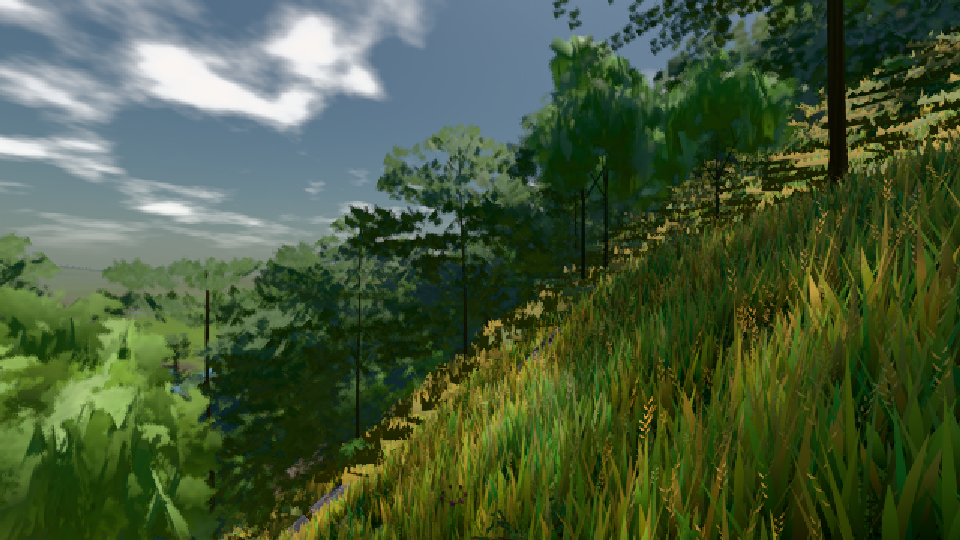

# GPU-PROBE ccd607c0 — GRÜN

Zweig `heim2-w15-lod-umriss` · Kopf ccd607c0428c59c877c15f7de8d69e808643a4ef · Läufer radeon-890m · 08.11. 17:51 · Wanduhr ab Push 1525 s · Lauf https://github.com/MiguellD/AnazhRealm/actions/runs/42499850347

Ruf: `bild:dorf@0.5`

GPU AMD Radeon(TM) 890M Graphics · node_modules bleiben (package-lock 74fc4120)
Schloss /c/Users/micha/AppData/Local/Temp/claude/gpu-schloss hält „ci-runner 42499850347/1 probe“
- Hook 2026-11-08 17:45:10 start ci-runner 42499850347/1 probe: wartet auf Schloss von 'punkte-radeon-sitzungpid=47240'
- Hook 2026-11-08 17:49:37 start ci-runner 42499850347/1 probe: Schloss genommen (refs/heads/heim2-w15-lod-umriss ccd607c0428c59c877c15f7de8d69e808643a4ef ws=C:\actions-runner\_work\AnazhRealm\AnazhRealm)

### bild:dorf@0.5 — GRÜN · 56 s

Adapter: [linse-gpu] amd/rdna-3

```text
Kamera des Spiels → Blick (10.0 m): -841.00 86.89 -861.00 -834.08 86.89 -853.78
 "abnahme": "ABNAHME GRÜN · beweis · Sicht 0.0 % · Ziel Blickziel im Bild frei 10 m · Luma 84.5 σ 48 schwarz 0.0 % weiß 0.0 % · Stand 18.546.224 · Bühne summer sunny 0.50 · Gerät WebGPU amd rdna-3",
```


