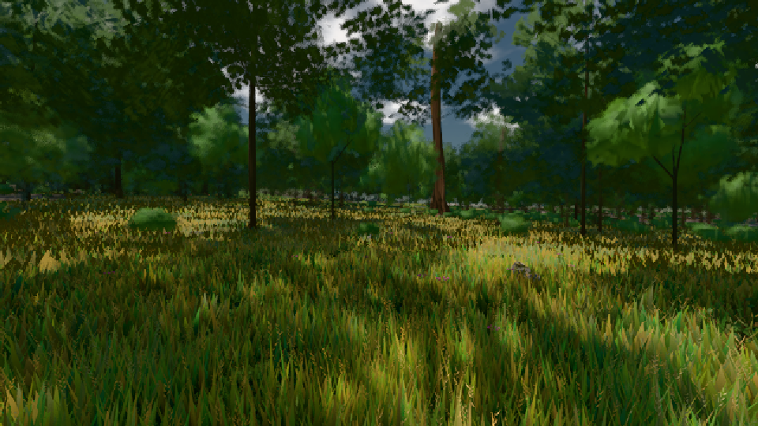

# GPU-PROBE fdfa9795 — GRÜN

Zweig `heim2-w20-haar-arm` · Kopf fdfa9795ef6007e50f2f375f86e9d353be68f917 · Läufer radeon-890m · 08.11. 17:42 · Wanduhr ab Push 436 s · Lauf https://github.com/MiguellD/AnazhRealm/actions/runs/42500683275

Ruf: `bild:wiese@0.5`

GPU AMD Radeon(TM) 890M Graphics · node_modules bleiben (package-lock 74fc4120)
Schloss /c/Users/micha/AppData/Local/Temp/claude/gpu-schloss hält „ci-runner 42500683275/1 probe“
- Hook 2026-11-08 17:40:53 start ci-runner 42500683275/1 probe: Schloss genommen (refs/heads/heim2-w20-haar-arm fdfa9795ef6007e50f2f375f86e9d353be68f917 ws=C:\actions-runner\_work\AnazhRealm\AnazhRealm)

### bild:wiese@0.5 — GRÜN · 51 s

Adapter: [linse-gpu] amd/rdna-3

```text
Kamera des Spiels → Blick (10.0 m): -280.40 29.71 -1045.60 -289.61 29.71 -1049.50
 "abnahme": "ABNAHME GRÜN · beweis · Sicht 0.0 % · Ziel Blickziel im Bild frei 10 m · Luma 55.9 σ 31.1 schwarz 0.0 % weiß 0.0 % · Stand 18.546.224 · Bühne summer sunny 0.50 · Gerät WebGPU amd rdna-3",
```


