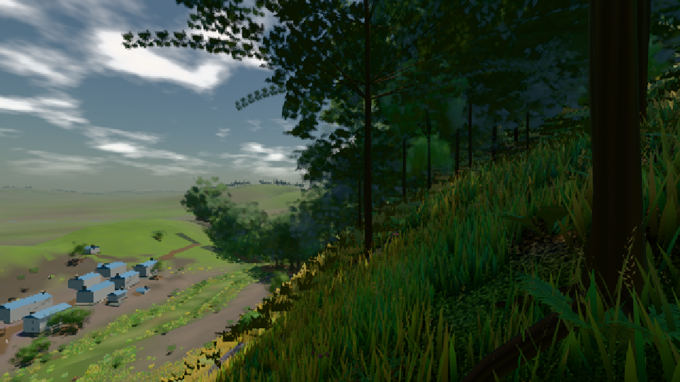
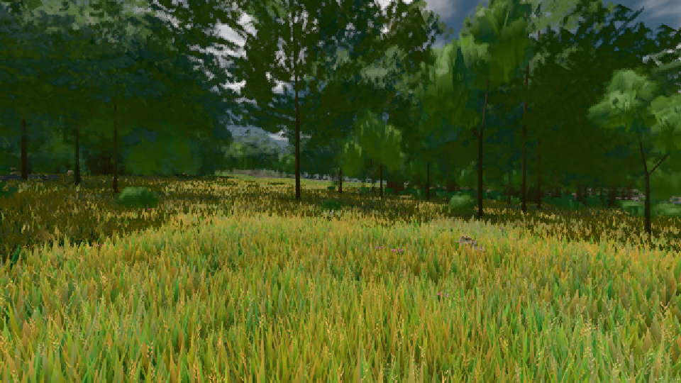

# GPU-PROBE 23687dd3 — GRÜN

Zweig `heim2-w20-wald-kosten` · Kopf 23687dd34f100a4ca73c4f0a12e9b0db0a4c91e9 · Läufer radeon-890m · 08.11. 19:18 · Wanduhr ab Push 1478 s · Lauf https://github.com/MiguellD/AnazhRealm/actions/runs/42507273366

Ruf: `bild:dorf@0.5 bild:wiese@0.5`

GPU AMD Radeon(TM) 890M Graphics · node_modules bleiben (package-lock 74fc4120)
Schloss /c/Users/micha/AppData/Local/Temp/claude/gpu-schloss hält „ci-runner 42507273366/1 probe“
- Hook 2026-11-08 19:04:53 start ci-runner 42507273366/1 probe: wartet auf Schloss von 'blick-w24pid=19504'
- Hook 2026-11-08 19:15:10 start ci-runner 42507273366/1 probe: Schloss genommen (refs/heads/heim2-w20-wald-kosten 23687dd34f100a4ca73c4f0a12e9b0db0a4c91e9 ws=C:\actions-runner\_work\AnazhRealm\AnazhRealm)

### bild:dorf@0.5 — GRÜN · 91 s

Adapter: [linse-gpu] amd/rdna-3

```text
Kamera des Spiels → Blick (10.0 m): -841.00 86.89 -861.00 -834.08 86.89 -853.78
 "abnahme": "ABNAHME GRÜN · beweis · Sicht 0.0 % · Ziel Blickziel im Bild frei 10 m · Luma 67.1 σ 54 schwarz 0.2 % weiß 0.0 % · Stand 18.546.224 · Bühne summer sunny 0.50 · Gerät WebGPU amd rdna-3",
```



### bild:wiese@0.5 — GRÜN · 68 s

Adapter: [linse-gpu] amd/rdna-3

```text
Kamera des Spiels → Blick (10.0 m): -280.40 29.71 -1045.60 -289.61 29.71 -1049.50
 "abnahme": "ABNAHME GRÜN · beweis · Sicht 0.0 % · Ziel Blickziel im Bild frei 10 m · Luma 83.1 σ 39.7 schwarz 0.0 % weiß 0.0 % · Stand 18.546.224 · Bühne summer sunny 0.50 · Gerät WebGPU amd rdna-3",
```


