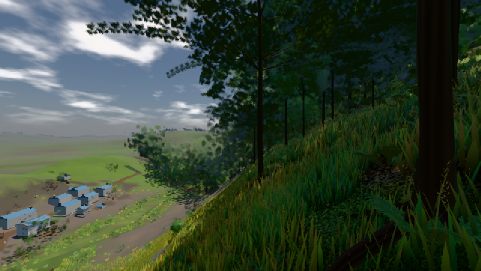

# GPU-PROBE 44e5255e — GRÜN

Zweig `heim2-w20-wald-kosten` · Kopf 44e5255e6c26b4ef8ebf716f98d488cd94add1b4 · Läufer omen-gtx1060 · 09.11. 04:27 · Wanduhr ab Push 773 s · Lauf https://github.com/MiguellD/AnazhRealm/actions/runs/42555338974

Ruf: `bild:dorf@0.5`

GPU NVIDIA GeForce GTX 1060 · node_modules bleiben (package-lock c278d7b5)
Schloss /c/Users/micha/AppData/Local/Temp/claude/gpu-schloss hält „ci-runner 42555338974/1 probe“
- Hook 2026-11-09 04:26:32 start ci-runner 42555338974/1 probe: Schloss genommen (refs/heads/heim2-w20-wald-kosten 44e5255e6c26b4ef8ebf716f98d488cd94add1b4 ws=C:\actions-runner\_work\AnazhRealm\AnazhRealm)

### bild:dorf@0.5 — GRÜN · 60 s

Adapter: [linse-gpu] nvidia/pascal

```text
Kamera des Spiels → Blick (10.0 m): -841.00 86.89 -861.00 -834.08 86.89 -853.78
 "abnahme": "ABNAHME GRÜN · beweis · Sicht 0.0 % · Ziel Blickziel im Bild frei 10 m · Luma 67.1 σ 54.2 schwarz 0.6 % weiß 0.0 % · Stand 18.546.232 · Bühne summer sunny 0.50 · Gerät WebGPU nvidia pascal",
```


