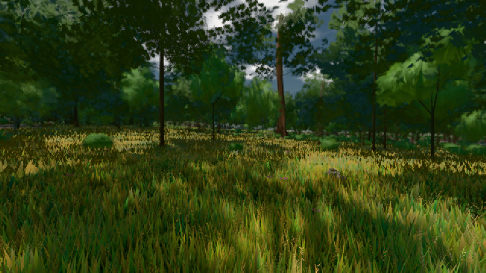

# GPU-PROBE 36cbed36 — ROT

Zweig `heim2-w21-laub-jahr-fern` · Kopf 36cbed36b0509dc12648e6ee2544056e386cb147 · Läufer radeon-890m · 08.11. 19:04 · Wanduhr ab Push 936 s · Lauf https://github.com/MiguellD/AnazhRealm/actions/runs/42506828354

Ruf: `gate:foundry-impostor bild:wiese@0.5 bild:gipfel-blick@0.5`

GPU AMD Radeon(TM) 890M Graphics · node_modules bleiben (package-lock 74fc4120)
Schloss /c/Users/micha/AppData/Local/Temp/claude/gpu-schloss hält „ci-runner 42506828354/1 probe“
- Hook 2026-11-08 18:49:57 start ci-runner 42506828354/1 probe: wartet auf Schloss von 'punkte-radeon-sitzungpid=26076'
- Hook 2026-11-08 18:50:55 start ci-runner 42506828354/1 probe: Schloss genommen (refs/heads/heim2-w21-laub-jahr-fern 36cbed36b0509dc12648e6ee2544056e386cb147 ws=C:\actions-runner\_work\AnazhRealm\AnazhRealm)

### gate:foundry-impostor — GRÜN · 28 s

Adapter: [linse-gpu] webgl2/AMD Radeon(TM) 890M Graphics (0x0000150E) Direct3D11 vs_5_0 ps_5_0

```text
  C5 WACHSEN: GRÜN · Selbsttest: Vorlage karte-albedo:atlas#46,Vorlage karte-normal:atlas#47
  C5 WACHSEN: GRÜN · Selbsttest: nur bc
✅ GRÜN — die Welt-Fernstufe liest die im Welt-Renderer gebackene Karte über EINEN Karten-Atlas (eine Gruppe, ein Material, Schicht + Rahmen je Instanz), die Karte steht richtig herum und in der Tiefe ihrer Gestalt, befreite Slots zeichnen nichts (die Gruppe verdichtet), jede Atlas-Stichprobe trägt die Gradienten der stetigen Koordinate (kein Stamm-Strich).
```

### bild:wiese@0.5 — GRÜN · 66 s

Adapter: [linse-gpu] amd/rdna-3

```text
Kamera des Spiels → Blick (10.0 m): -280.40 29.71 -1045.60 -289.61 29.71 -1049.50
 "abnahme": "ABNAHME GRÜN · beweis · Sicht 0.0 % · Ziel Blickziel im Bild frei 10 m · Luma 55.9 σ 31.1 schwarz 0.0 % weiß 0.0 % · Stand 18.546.224 · Bühne summer sunny 0.50 · Gerät WebGPU amd rdna-3",
```



### bild:gipfel-blick@0.5 — ROT · 658 s

Adapter: [linse-gpu] amd/rdna-3 · DECKEL 480 s

```text
[linse-gpu] amd/rdna-3
```
