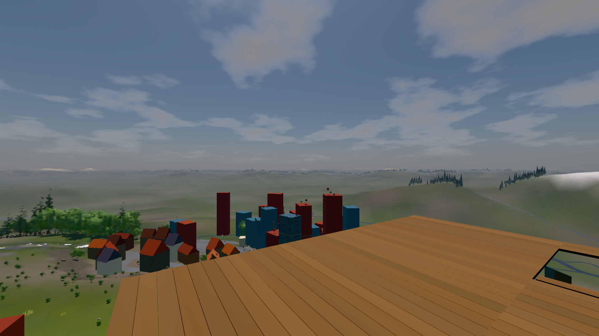

# GPU-PROBE 9b767287 — GRÜN

Zweig `hochhaus-dach-speicher` · Kopf 9b767287b4e3422ceb1a71a6c108ea72976c6306 · Läufer radeon-890m · 21.11. 04:43 · Wanduhr ab Push 733 s · Lauf https://github.com/MiguellD/AnazhRealm/actions/runs/44861572527

Ruf: `gate:profiband gate:studio-begehen bild:hochhaus-dach`

## Läufer radeon-890m — GRÜN

GPU AMD Radeon(TM) 890M Graphics · node_modules bleiben (package-lock 42ac545e)
Schloss /c/Users/micha/AppData/Local/Temp/claude/gpu-schloss hält „ci-runner 44861572527/1 probe“
- Hook 2026-11-21 04:34:34 start ci-runner 44861572527/1 probe: wartet auf Schloss von 'pend-diag3 2026-11-21T04:34:18+01:00 pid=40856'
- Hook 2026-11-21 04:36:13 start ci-runner 44861572527/1 probe: Schloss genommen (refs/heads/hochhaus-dach-speicher 9b767287b4e3422ceb1a71a6c108ea72976c6306 ws=C:\actions-runner\_work\AnazhRealm\AnazhRealm)

### gate:profiband — GRÜN · 42 s · Läufer radeon-890m

Adapter: ungenannt (die Probe nannte keinen Browser-Adapter)

```text
✅ SELBST-TEST: Re-Mint: boden haupt 7 → 10 Befehle (der Nachzug hält 7), 70 000 → 7 000 Dreiecke; 70 000 gegen 7 000 ist weit, die Linse bleibt sauber; ohne Ratsche „ungemessen" beim Datei-Namen; jede Rot-Zeile trägt ihren Schlüssel
✅ SELBST-TEST: Re-Mint: die Gesamt-Zeile vramMB ist höchstens die Summe der Erzeuger (zwei Läufe 6,0 + 4,0 und 5,9 + 4,1 → Erzeuger 5,9 + 4,0, Gesamt 10,0 → 9,9, beim Namen)
✅ SELBST-TEST: Gerät × Sicht: amd rdna-3 → radeon, nvidia pascal → gtx, SwiftShader → keins; first → ego, third → third; geraet (EIN Gerät) und eine Kamera „drohne" brechen den Haushalt
✅ SELBST-TEST: Gang: Heap je Minute und VRAM-Drift urteilen, der Halter steht beim Pfad
✅ SELBST-TEST: Weg: der Speicher folgt dem Blick — N1 · N2 · N3 rot beim Pfad ihres Halters
✅ SELBST-TEST: Runde: Behälter mit Anlage, Geometrie mit Geburts-Stelle, Zell-Gedächtnis außerhalb des Blicks und unangemeldetes rot beim Namen, die geräumte Runde grün
✅ SELBST-TEST: Runde: der JS-Heap-Zuwachs steht beim Besteller (Datei:Zeile) und der Stelle, ein voll gelaufener Cache grün, Splitter benannt
✅ SELBST-TEST: Soll des Turms: die Stufe 0 je Auftrag ist rot bei sollTon, je Bau einmal grün
✅ SELBSTTEST GRÜN — die Band-Wand feuert (46/46)
✅ DIE BAND-WAND steht — H1 Haushalt 208/208 Befehle · 680000/680000 Dreiecke in 14 Klassen (keine Sammelzeile) · H2 Ratsche 14 Klassen × 3 Pässe je Ort × Gerät × Sicht · H2b 12 Ratschen frisch an V18.546.355 · H4 Täter-Klasse des Stamms: 17 Schlüssel-Formen · Messorte wiese × radeon × ego (V18.545.0, gemessen 66 von 84) · wiese × radeon × third (V18.545.0, gemessen 66 von 84) · wiese × gtx × ego (V18.546.55, gemessen 72 von 84) · wiese × gtx × third (V18.546.55, gemessen 72 von 84) · genesis × radeon × ego (V18.545.0, gemessen 66 von 84) · genesis × radeon × th
```

### gate:studio-begehen — GRÜN · 156 s · Läufer radeon-890m

Adapter: [linse-gpu] amd/rdna-3

```text
  ✅ Selbsttest „huelle" macht B1 Hülle nach Promotion + B1 Hülle nach Demotion rot — B1 Hülle nach Promotion: 10 von 10 Häusern zu | B1 Hülle nach Demotion: 0 von 2 Häusern (Geister)
  ✅ Selbsttest „kopf" macht B3 Kopf rot — B3 Kopf: 26 von 120 Treppen-Läufen enden im Solid
  ✅ Selbsttest „kappe" macht B3 Steigen rot — B3 Steigen: 21 von 24 Treppen erreichen ihre Höhe (EG→OG 9/9 · OG→OG 12/12 · Speicher 0/3)
  ✅ Selbsttest „spur" macht B3 Steigen rot — B3 Steigen: 15 von 24 Treppen erreichen ihre Höhe (EG→OG 9/9 · OG→OG 3/12 · Speicher 3/3)
  ✅ Selbsttest „austritt" macht B3 Kopfraum rot — B3 Kopfraum: 11 Austritte unter 1.7 m (min 0.99 m — der Kopf steht im Dach)
  ✅ Selbsttest „dachlos" macht B3 Dach rot — B3 Dach: 4 Speicher-Austritte ohne Dach über dem Kopf (der Lauf steigt durch das Dach)
  ✅ Selbsttest „platte" macht B4 Keller-Decke rot — B4 Keller-Decke = Boden-Platte in 7 von 8
  ✅ Selbsttest „flach" macht B5 Weltgrund rot — B5 Weltgrund: die Häuser stehen eben (Spanne 0 m)
✅ gate:studio-begehen grün
```

### bild:hochhaus-dach — GRÜN · 172 s · Läufer radeon-890m

Adapter: [linse-gpu] amd/rdna-3

```text
Kamera des Spiels → Blick (53.3 m): 696.96 180.10 -3558.85 686.75 180.10 -3506.53
 "abnahme": "ABNAHME GRÜN · beweis · Sicht 0.0 % · Ziel Blickziel im Bild frei 53.31 m · Luma 106.4 σ 25.1 schwarz 0.1 % weiß 0.0 % · Stand 18.546.355 · Bühne summer sunny 0.50 Tiere gehalten · Gerät WebGPU amd rdna-3 · Inhalt bauSatz 23.4 % (≥ 2.0 %) Luma 97",
```


